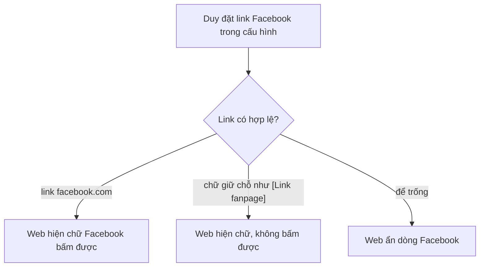

# Shop: thêm link Facebook của shop (luồng NHANH)

Trạng thái: ĐÃ DUYỆT (Duy 15/11: "đại đại đi, kiểu cái link fb là []").

## FB-01 · Hiện Facebook của shop ở chân trang và trang Liên hệ (BE+FE)

- **AC1 (BE):** env `SELLER_FACEBOOK` → `GET /api/public/site-info/` trả `seller.facebook` (chuỗi đã cắt khoảng trắng, rỗng → `null`). Đọc settings mỗi lần gọi như các trường seller khác. Không ảnh hưởng `seller_complete`.
- **AC2 (FE):** `seller.facebook` là link `https://` thuộc `facebook.com`, `www.facebook.com`, `m.facebook.com`, `fb.com` hoặc `fb.me` → chân trang (khối liên hệ, cạnh Zalo/Email) và trang Liên hệ hiện "Facebook" là link mở tab mới (`rel="noopener noreferrer"`), có nhãn cho trình đọc màn hình.
- **AC3 (FE):** giá trị khác rỗng nhưng không phải link hợp lệ (vd `[Link fanpage Facebook]`, `javascript:…`) → hiện **chữ thường** "Facebook: <giá trị>", không tạo thẻ `<a>`.
- **AC4 (FE):** `null`/rỗng → không hiện dòng Facebook.
- **AC5:** 360 px không cuộn ngang, 0 lỗi console; mock FE cập nhật kiểu dữ liệu; test BE + FE cho 3 trường hợp trên.
- **AC6 (FE, Duy báo 15/11 kèm ảnh):** chân trang dòng Zalo hiện cả số, dạng "Zalo: 0373850884" (số lấy từ `seller.zalo`; nếu `seller.zalo` là link `https://zalo.me/<số>` thì hiện phần số). Vẫn là link mở Zalo như cũ. Thứ tự khối liên hệ: Hotline · Zalo · Facebook · Email.
