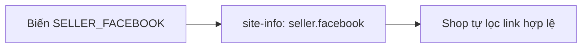

# FB-01 — Ghi chú dev

## BE (AC1)
- `backend/config/settings.py`: thêm `SELLER_FACEBOOK` (env, mặc định rỗng) cạnh `SELLER_ZALO`.
- `backend/apps/content/site/services.py`: `seller.facebook` trong khối `seller.update(...)`; chuỗi đã strip, rỗng hoặc khoảng trắng thì `null`. Trả chuỗi thô, không lọc link (chữ giữ chỗ như `[Link fanpage Facebook]` vẫn hiện, FE tự lọc). `seller_complete` không đổi.
- Test: `test_site_info_shop.py` (lớp `SiteInfoFacebookTests`, tên test `test_fb01_ac1_*`), cập nhật tập khoá `seller` ở `test_site_info.py`. Không có migration.
- Còn nợ: đặt `SELLER_FACEBOOK` trên staging/production khi Lộc đưa link fanpage.

## FE (AC2–AC6)
- `frontend/lib/facebook.ts` (mới): `facebookHrefOf` (chỉ `https://` host facebook.com, www., m., fb.com, fb.me; chặn user@, host giả như `facebook.com.evil.example`) và `facebookPlainTextOf` (chuỗi không hợp lệ thành chữ thường). `lib/phone.ts`: thêm `zaloNumberOf` (số thường hoặc `https://zalo.me/<số>`).
- `ShopFooter.tsx` + `ShopFooter.module.css`: danh sách liên hệ Hotline · Zalo: <số> · Facebook · Email; điện thoại có nút "Nhắn Zalo <số>" và một dòng Facebook riêng (danh sách chỉ hiện từ 768 px). Facebook hợp lệ là link `target=_blank rel="noopener noreferrer"` kèm chữ ẩn "(mở tab mới)"; không hợp lệ là chữ "Facebook: <giá trị>", không có `<a>`; rỗng thì ẩn. `ShopFrame.tsx` truyền `zaloNumber`, `facebook`.
- `ContactView.tsx`: thẻ Facebook (link hoặc chữ thường), thẻ Zalo hiện số (rút từ link nếu cần). `ui/TextLink.tsx`: `external` giờ tôn trọng `rel` do nơi gọi truyền (mặc định vẫn `noopener`).
- Kiểu `seller.facebook?: string | null` ở `features/site/types.ts`; mock có link facebook mẫu.
- Test: `frontend/scripts/test-facebook.mjs` (27 ca, gồm Zalo). Chạy `node scripts/test-facebook.mjs`.
- Playwright trên bản build mock (360 và 1280 px, trang chủ + Liên hệ): scrollWidth = viewport, 0 lỗi console, thấy "Zalo: …" và Facebook. Ảnh chân trang ở `scratchpad/fb-shots/`. Chưa chụp ca chữ giữ chỗ bằng trình duyệt (đã có test hàm thuần).
- Lệch contract: không.
