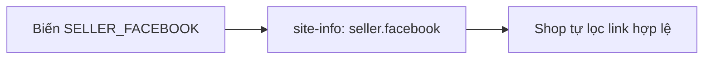

# FB-01 — Ghi chú dev

## BE (AC1)
- `backend/config/settings.py`: thêm `SELLER_FACEBOOK` (env, mặc định rỗng) cạnh `SELLER_ZALO`.
- `backend/apps/content/site/services.py`: `seller.facebook` trong khối `seller.update(...)`; chuỗi đã strip, rỗng hoặc khoảng trắng thì `null`. Trả chuỗi thô, không lọc link (chữ giữ chỗ như `[Link fanpage Facebook]` vẫn hiện, FE tự lọc). `seller_complete` không đổi.
- Test: `test_site_info_shop.py` (lớp `SiteInfoFacebookTests`, tên test `test_fb01_ac1_*`), cập nhật tập khoá `seller` ở `test_site_info.py`. Không có migration.
- Còn nợ: đặt `SELLER_FACEBOOK` trên staging/production khi Lộc đưa link fanpage.
