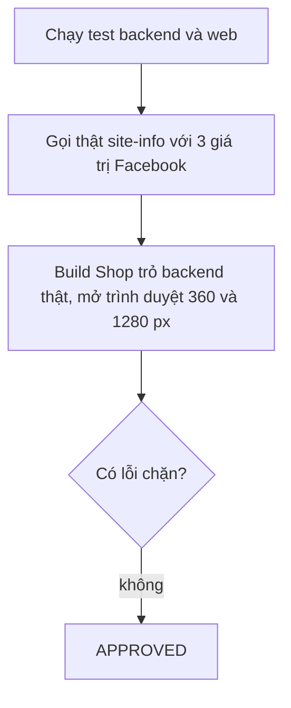

# QA — FB-01 Shop hiện Facebook và số Zalo · lần 1 · 15/11/2026

## Kết luận: APPROVED — AC1–AC6 đều có bằng chứng chạy thật, không lỗi chặn
## Tổng: 16 ca · ✅ 16 · ❌ 0 · ⏸ 0

## Theo AC
| Mã AC | Kết quả | Bằng chứng |
|---|---|---|
| AC1 | ✅ | `manage.py test apps.content --parallel 1`: Ran 219 tests OK. Gọi thật `/api/public/site-info/` (runserver :8765): link hợp lệ trả đúng chuỗi, `[Link fanpage Facebook]` trả chuỗi thô, `javascript:alert(1)` trả chuỗi thô, rỗng trả `null`. `seller` không có khoá lạ |
| AC2 | ✅ | Bản build không mock trỏ :8765, 360 và 1280 px, trang chủ + Liên hệ: `<a href=https://www.facebook.com/...>` có `target=_blank`, `rel="noopener noreferrer"`, kèm chữ ẩn "(mở tab mới)" |
| AC3 | ✅ | `[Link fanpage Facebook]` và `javascript:alert(1)`: footer hiện "Facebook: <giá trị>" bằng chữ, trang Liên hệ hiện thẻ chữ; 0 thẻ `<a>` có href chứa giá trị đó (cả 2 viewport, cả 2 trang) |
| AC4 | ✅ | Rỗng: không có dòng Facebook ở footer lẫn trang Liên hệ |
| AC5 | ✅ | `scrollWidth == clientWidth` ở mọi ca (360/1280). Trang Liên hệ 0 lỗi console. `test-facebook.mjs` 27/27, `tsc --noEmit` exit 0 |
| AC6 | ✅ | `SELLER_ZALO` dạng số và dạng `https://zalo.me/0373850884`: footer "Zalo: 0373850884" vẫn là link `https://zalo.me/0373850884` (`_blank`); điện thoại có nút "Nhắn Zalo 0373850884". Thứ tự desktop: Hotline · Zalo · Facebook · Email (chụp ở `fb-qa/`) |

## Ngoại lệ, biên, hồi quy
- Chuỗi toàn khoảng trắng và host giả (`facebook.com.evil.example`, `user@`): phủ bởi `test-facebook.mjs` (27 ca đạt).
- Hồi quy `TextLink` (sửa 1 dòng `rel`): `test-phone.mjs` 21/21, `test-safe-href.mjs` 40/40. Trên 118 thẻ `target=_blank` thu được ở 24 lượt tải trang, 0 thẻ thiếu `noopener`. Nơi dùng `TextLink external` khác (`ShopFooter` compactLink) không truyền `rel` nên vẫn `noopener`; `Button` không đổi.
- Nút "Nhắn Zalo <số>" ở 360 px không tràn; nhãn xuống 2 dòng trong nút (cùng kiểu nút "Gọi <số>"), chấp nhận được.
- `python3 scripts/check_naming.py`: OK, không vi phạm mới.

## Phân quyền, giá vốn, dữ liệu cá nhân
- `site-info` là API công khai chỉ trả thông tin người bán (SELLER_*), chính sách, giờ; không có giá vốn, không có tên/SĐT/địa chỉ khách. Giá trị Facebook là link fanpage công khai của shop.
- `localStorage` chỉ có `cangcaloc_cart_v1` (giỏ rỗng), `sessionStorage` rỗng, URL không có query dữ liệu cá nhân. Dữ liệu dùng là giả (SĐT 0900000001, shop@example.com).

## Ghi nhận (không chặn)
- Trang chủ báo 3 lỗi console `ERR_CONNECTION_REFUSED` ở mọi ca. Nguyên nhân do môi trường QA: nội dung CMS nạp vào DB tạm tham chiếu ảnh `http://localhost:8000/media/...` (backend không chạy cổng đó). Không liên quan FB-01; trang Liên hệ 0 lỗi.
- Nút nổi Zalo ở góc phải che một đoạn chữ ở ảnh chụp toàn trang 360 px trang Liên hệ: có sẵn từ trước, không thuộc FB-01.

## Lỗi
Không có.

## Lệnh đã chạy
- `manage.py test apps.content --parallel 1` → Ran 219 tests OK
- `npx tsc --noEmit` → exit 0; `node scripts/test-facebook.mjs` (27), `test-phone.mjs` (21/21), `test-safe-href.mjs` (40/40)
- `NEXT_PUBLIC_USE_MOCK=0 NEXT_PUBLIC_API_BASE=http://localhost:8765 npm run build` → thành công
- Playwright: 7 tổ hợp (FB valid/placeholder/js/empty × Zalo số; valid/placeholder/empty × Zalo link) × 2 viewport × 2 trang, ảnh ở `scratchpad/fb-qa/`. Backend dùng DB SQLite tạm, khởi động lại mỗi tổ hợp; đã tắt hết server.
