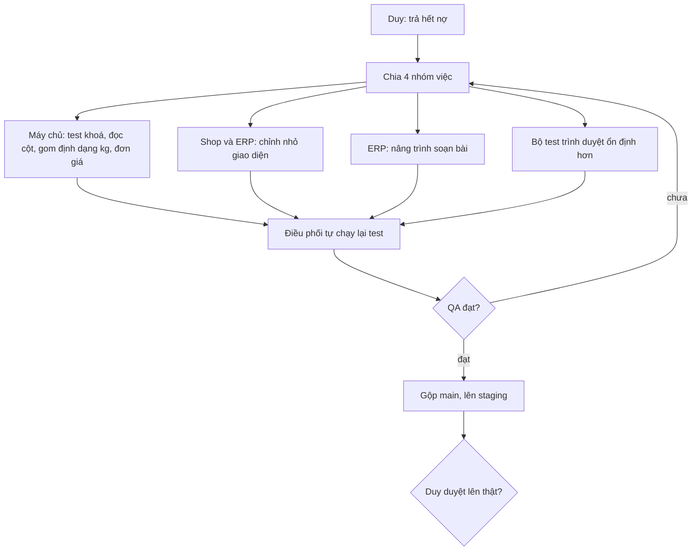

# Trả nợ kỹ thuật sau go-live (FISH-68) — luồng NHANH

Trạng thái: ĐANG LÀM (Duy 15/11: "làm trả hết nợ đi e"). Không đổi quy tắc nghiệp vụ.
Chưa làm trong đợt này: Google Maps (chờ Duy cấp key), câu hỏi gửi Lộc (`doc/ops/hoi-loc.md`).

| Mã | Việc | Ai | Nguồn nợ |
|---|---|---|---|
| TD-01 | Test đua: luồng chính giữ khoá bảng giá rồi mới ghi, luồng phụ phải chờ và nhận 409 | be-dev | 02b Excel §13.3 L3 |
| TD-02 | Đọc dòng tiêu đề file nhập không giới hạn cột, bắt cột lạ nằm xa | be-dev | 02b Excel §13.3 L6 |
| TD-03 | Gom 3 hàm định dạng kg kiểu Việt về một hàm chung | be-dev | 02b Excel §13.2 L1 |
| TD-04 | Test throttle nội dung công khai không phụ thuộc env máy chạy; sửa test voucher ngày cài cứng nếu còn đỏ | be-dev | review Shop lô 7 L6 |
| TD-05 | Trang thanh toán hiện đơn giá niêm yết thật của dòng (không suy từ thành tiền) | be-dev + fe-dev | review Shop lô 7 L2 |
| TD-06 | Shop: ô tìm kiếm 16px tới 1023px, chấm slide không animate `width`, dòng nhắc mã giảm giá không chớp, giỏ có mã món lạ không hiện mã thô | fe-dev | techlead GUI + QA N1 |
| TD-07 | ERP nhập Excel: bỏ code nửa vời ở toast "đã ghi rồi" | fe-dev | 02b Excel §13.3 L5 |
| TD-08 | ERP: nâng Tiptap 2 lên 3, hết 25 cảnh báo moderate | fe-dev | NX-01 |
| TD-09 | Bộ e2e: runner báo lỗi khi cổng đã bị chiếm; máy chủ tĩnh không rớt kết nối | fe-dev | QA GUI + NX-01 |
| TD-10 | Cập nhật spec: BR-BH-22 (0,5 kg), thêm BR-DM-27..33 (file Excel) | điều phối | FISH-66 |

## Tiêu chí

**TD-01**
- Có ca mới trong `test_commit_race.py`: luồng chính `atomic` + `select_for_update` bảng giá mặc định, luồng phụ gọi `commit_import` cùng phiếu, luồng chính ghi `import_items` cùng `import_ref` rồi commit → luồng phụ nhận 409 `IMPORT_ALREADY_APPLIED`, không ghi thêm `ItemPrice`/`AuditLog`.
- Chứng minh luồng phụ thật sự chờ: luồng phụ chưa xong khi luồng chính còn giữ khoá.
- SQLite bỏ qua như ca cũ; CI Postgres (GitHub Actions) chạy và xanh.

**TD-02**
- File có cột lạ ở cột AD (ngoài 25 cột) → 400 `unknown_columns` nêu tên cột.
- Dòng dữ liệu vẫn đọc với `max_col` cũ; ca ô ở `A1048576` vẫn bị chặn dưới 1 giây.

**TD-03**
- Một hàm duy nhất trong `apps/sales/utils.py` (cạnh `kg_str`), ba nơi cũ gọi hàm này.
- Ra dấu phẩy kiểu Việt: 0,5 · 1 · 1,5 · 12,25. Không còn bản ra dấu chấm. Test mọi nơi gọi xanh.

**TD-04**
- Test throttle đặt/ghi đè env trong test (hoặc so với mặc định trong code), đặt `THROTTLE_PUBLIC_CONTENT` bất kỳ trên máy vẫn xanh.
- Cả bộ test backend chạy xanh ở ngày bất kỳ (không ca nào cài cứng ngày đã qua).

**TD-05**
- API tra đơn/thanh toán công khai trả thêm đơn giá bán niêm yết của từng dòng. Không trả giá vốn, giá nhập, mã lô hay dữ liệu cá nhân mới. Test quét khoá giá vốn xanh.
- Trang thanh toán dùng đơn giá đó; dòng có ưu đãi tự động vẫn hiện "kg × đơn giá niêm yết", thành tiền giữ đúng số máy chủ.
- Máy chủ cũ chưa có khoá thì Shop giữ cách cũ (chỉ hiện khi chia đúng đồng).

**TD-06**
- Ô tìm kiếm 16px ở mọi bề rộng dưới 1024px (iPad dọc không tự phóng to).
- Chấm slide trang chủ dùng `transform`, không animate `width`; vẫn tắt khi reduced-motion.
- Dòng "sẽ kiểm khi đặt" chỉ hiện khi không đang kiểm mã; kiểm lại thành công thì xoá lỗi cũ.
- Giỏ có mã món không tồn tại trong danh mục: hiện "Món không còn bán" (không hiện mã thô), vẫn bỏ được khỏi giỏ, chặn đặt như món hết.
- Ảnh 360 + 1280, không cuộn ngang, e2e Shop xanh.

**TD-07**
- `ItemImportScreen` chỉ còn một cách: hoặc bỏ biến số đếm, hoặc toast dùng số đếm. Test đơn vị giữ hành vi 409 `IMPORT_ALREADY_APPLIED` = thành công.

**TD-08**
- `@tiptap/*` lên 3.x; `npm audit` ERP 0 moderate trở lên (hoặc ghi rõ cảnh báo còn lại không sửa được).
- Trình soạn bài CMS vẫn đủ: đậm, nghiêng, tiêu đề, danh sách, liên kết (giữ `rel` an toàn), ảnh, lưu nháp, đăng. Nội dung bài cũ mở ra không mất định dạng.
- `tsc`, `npm test`, build ERP xanh; e2e CMS/ERP xanh.

**TD-09**
- Cổng backend hoặc frontend đã bị chiếm → runner dừng ngay, báo cổng nào, mã thoát khác 0.
- Máy chủ tĩnh không còn lỗi reset kết nối: chạy `erp_flow` và `footer_consent` 3 lần liền đều xanh.

**TD-10**
- `doc/business-process-spec.md`: BR-BH-22 ghi mua từ 0,5 kg, bội 0,5 kg; thêm BR-DM-27..33 theo `2026-11-14-hang-ban-excel-dong-lanh/01-analysis.md`.
