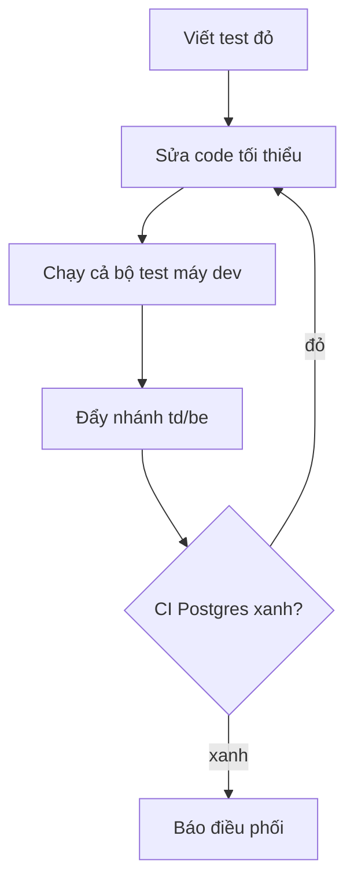

# Dev notes BE — trả nợ kỹ thuật (FISH-68): TD-01..04 và phần BE của TD-05



Nhánh `td/be` (tách từ `7646b6b`). Không migration, không đổi quy tắc nghiệp vụ.

## TD-01 — test đua giữ khoá bảng giá (02b Excel §13.3 L3)
- File: `backend/apps/catalog/item_files/tests/test_commit_race.py`, ca `test_td01_second_commit_waits_for_default_price_list_lock_then_gets_already_applied`.
- Luồng chính `atomic` + `select_for_update` bảng giá mặc định; luồng phụ gọi `commit_import`; poll `pg_stat_activity` cho tới khi có phiên `wait_event_type='Lock'` (chứng minh luồng phụ thật sự chờ), `future.result(timeout=0.5)` phải TimeoutError; luồng chính ghi `import_items` cùng `import_ref` rồi commit; luồng phụ nhận `ConflictError` `IMPORT_ALREADY_APPLIED`; kiểm không có `create_item`, `ItemPrice`, `Item MUC01` mới và chỉ 1 `import_items`.
- Máy dev (SQLite) bỏ qua ca này. Kết quả CI Postgres: xem mục "CI" cuối file.

## TD-02 — đọc tiêu đề không giới hạn cột (L6)
- File: `backend/apps/catalog/item_files/reader.py`: dòng 1 đọc riêng bằng `iter_rows(min_row=1, max_row=1)` không `max_col`; các dòng dữ liệu `iter_rows(min_row=2, max_col=scan_max_col)` như cũ (M1 vẫn chặn `A1048576` < 3 giây).
- Test: `tests/test_reader.py` — `test_td02_unknown_header_far_right_is_reported` (cột lạ ở AD → 400 `unknown_columns`, nêu tên "Gia moi"); ca spy `max_col` sửa lại: 3 lần gọi, đúng 1 lần `max_col=None` (tiêu đề).
- Đỏ trước: ca AD trả 200, ca spy 2 != 3.

## TD-03 — gom hàm định dạng kg kiểu Việt
- Hàm mới `kg_vn_str` ở `backend/apps/sales/utils.py` (0,5 · 1 · 1,5 · 12,25). Test: `backend/apps/sales/tests/test_utils_kg.py`.
- `shop_errors._vn_kg` và `load_shop_content._format_kg` đã xoá, gọi `kg_vn_str`. Chữ hiển thị KHÔNG đổi (hai bản này vốn đã ra dấu phẩy).
- **KHÔNG đổi `_kg_text` ở `apps/content/site/services.py`**: hàm này làm ra `policies.min_qty_kg` và `policies.qty_step_kg` của `/api/.../site-info` mà Shop FE PARSE như số: `CartScreen.tsx:76` `Number(minKg) > 0`, `HomeScreen.tsx:112` / `homeBlocks.ts:146` regex `^\d+(\.\d+)?$` rồi mới tự đổi sang dấu phẩy khi hiển thị. Đổi sang "0,5" sẽ làm `Number()` ra NaN và regex hỏng. Theo yêu cầu giao việc nên dừng ở điểm này và giữ dấu chấm (giá trị máy đọc). Chữ hiển thị đổi từ chấm sang phẩy: không có. Nếu Duy vẫn muốn gom hẳn, cần FE chuẩn hoá trước (đổi `,` thành `.` trước khi parse) rồi mới đổi BE.
- Docstring `kg_vn_str` ghi rõ: chỉ cho câu chữ; JSON máy đọc dùng `kg_str`/`money_str` (dấu chấm).

## TD-04 — test không phụ thuộc env và ngày
- Helper `backend/apps/common/tests/throttle_defaults.py`: nạp `config/settings.py` vào module riêng với mọi `THROTTLE_*` bị gỡ và không đọc `.env`, trả `_DEFAULT_THROTTLE_RATES`.
- Dùng ở 3 test đọc bảng mặc định: `apps/content/public/tests/test_public_api.py` (`test_qa_l12_default_rate_is_600_per_minute`), `apps/catalog/vouchers/tests/test_shop_check.py` (`test_default_rate_is_20_per_minute`), `apps/sales/orders/tests/test_shop_lookup.py` (`test_s3_02_default_rates_are_defined`; cùng lỗi, chỉ chưa bị nêu tên).
- Tái hiện đỏ: `THROTTLE_PUBLIC_CONTENT=5/min` → `5/min != 600/min`. Sau sửa, chạy cả bộ với `THROTTLE_PUBLIC_CONTENT=5/min THROTTLE_SHOP_LOOKUP_IP=1/min THROTTLE_SHOP_VOUCHER_CHECK=2/min` đều xanh.
- Ngày cài cứng: bộ vouchers dùng `timezone.now()` hoặc năm 2099; ca duy nhất cài cứng `2020-01-01` là ca "kết thúc trước bắt đầu" (đúng ở mọi ngày). Cả bộ xanh ngày 15/11/2026, không ca nào đỏ vì ngày. Chưa kiểm được ở ngày giả khác vì repo không có freezegun/faketime (chưa kiểm chứng ngày khác, chỉ rà bằng grep).

## TD-05 (BE) — `rate` trên dòng đơn Shop công khai
- Một chỗ dựng chung: `backend/apps/sales/orders/shop_payload.py::lines_payload`, dùng cho tạo đơn (`create_payload`, cả nhánh gửi lại cùng `client_request_id`) và tra đơn / trang thanh toán (`shop_api` lookup). Không có response công khai nào khác trả mảng dòng.
- Dùng `SalesOrderLine.rate` đã lưu (đóng băng lúc đặt), không tính lại.
- Contract (mỗi phần tử của `lines`):
```json
{"item_code": "TOM-SU-1", "name": "Tôm sú loại 1", "unit": "kg", "qty": "2", "rate": "270000", "amount": "540000"}
```
  `rate` = chuỗi tiền VNĐ nguyên đồng như `amount` (`money_str(money_vnd(...))`), là đơn giá BÁN niêm yết trước ưu đãi; `amount` vẫn là thành tiền gộp (qty × rate, trước giảm). Dòng có ưu đãi tự động: `rate` vẫn là giá niêm yết, giảm nằm ở `discount` cấp đơn. Combo: `rate` là giá combo/1 combo (`unit: "combo"`).
- Test: `test_shop_lookup.py` (`test_td05_lines_carry_list_rate_and_never_cost_keys_or_cost_values`: giá bán đổi sau khi đặt vẫn ra giá đóng băng, không có khoá thuộc `COST_KEYS` trừ `rate`, không chuỗi 180000/purchase_rate/tên/SĐT/địa chỉ; `test_td05_promo_line_keeps_list_rate_while_amount_stays_gross`), `test_shop_order_create.py` (`test_td05_create_response_lines_carry_list_rate`). Sửa 2 test cũ kỳ vọng nguyên dict dòng, và `test_shop_api.test_lookup_does_not_leak_internal_or_cost_fields`: bỏ `rate` khỏi danh sách cấm vì `rate` ở đây là giá bán (COST_KEYS chứa "rate" cho giá nhập của lô/phiếu nhập, nhưng các khoá giá vốn khác vẫn cấm).
- Lưu ý techlead: tên khoá `rate` trùng khoá trong `COST_KEYS`. Test quét giá vốn kiểu `find_keys(... COST_KEYS)` chạy trên response Shop sẽ phải trừ `rate` như các ca credit note đã làm (`- {"rate"}`).

## Lệnh kiểm chứng (máy dev, SQLite)
- `cd backend && DJANGO_SECRET_KEY=test DJANGO_DEBUG=1 THROTTLE_PUBLIC_CONTENT=5/min THROTTLE_SHOP_LOOKUP_IP=1/min THROTTLE_SHOP_VOUCHER_CHECK=2/min python manage.py test --parallel 1` → `Ran 4071 tests in 245.287s` / `OK (skipped=19)`.
- `python3 scripts/check_naming.py` → `OK - 6437 vi phạm cũ trong 173 file, không phát sinh mới.`
- `python manage.py makemigrations --check --dry-run` → `No changes detected`.

## CI Postgres (GitHub Actions `backend-tests`, nhánh `td/be`)
- Lần 1, run 43696372138 (commit `d573c48`): job SQLite xanh; job PostgreSQL ĐỎ đúng 1 ca, chính là ca TD-01 mới: `AssertionError: Luồng phụ không chờ khoá` (`Ran 4071 tests`, `FAILED (failures=1)`). Nguyên nhân: cách phát hiện "có phiên đang chờ khoá" dựa trên `pg_stat_activity.wait_event_type='Lock'` không bắt được. Đã đổi sang `pg_locks WHERE NOT granted` (nguồn trực tiếp của khoá chưa cấp), thêm thông báo lỗi nêu `done`/kết quả luồng phụ. Không sửa code sản phẩm.
- Lần 2, run 43697514793 (commit `11aff72`, https://github.com/DuyduyFedev46/fish/actions/runs/43697514793): cả hai job XANH. Job PostgreSQL 16: `Ran 4071 tests in 727.961s`, `OK` (không có `skipped=`, nên `test_commit_race` chạy thật, gồm ca TD-01). Job SQLite: `Ran 4071 tests`, xanh.
