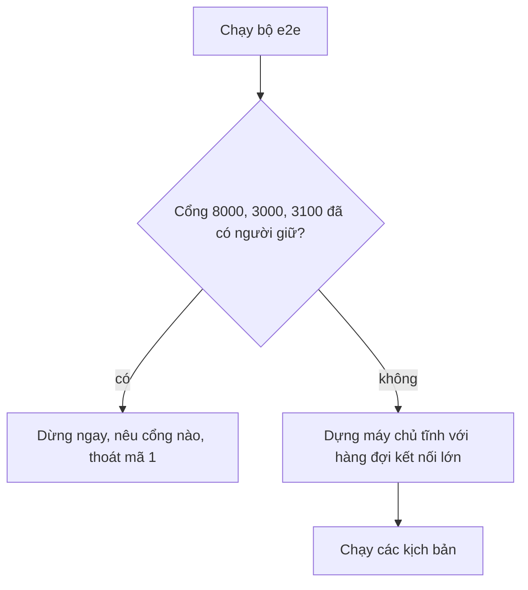

# TD-09 dev notes: bộ e2e (cổng bị chiếm, máy chủ tĩnh reset kết nối)



Chỉ sửa `frontend/e2e/run_shop_e2e.py`. Không sửa code sản phẩm hay nội dung ca kiểm thử.

## Nguyên nhân gốc
`http.server.ThreadingHTTPServer` kế thừa `socketserver.TCPServer.request_queue_size = 5` (tham số `listen(5)`).
Chromium mở cả loạt kết nối song song khi tải các chunk JS của trang ERP/Shop; kết nối vượt hàng đợi 5 bị nhân hệ điều hành
reset (`ERR_CONNECTION_RESET`), chunk không tải nên trang không hydrate (không thấy `#u`, `#f-name`). Handler
đã là HTTP/1.0 đóng sau mỗi yêu cầu và `daemon_threads` đã True nên không phải nguyên nhân.

Tái hiện không cần trình duyệt: 40 đợt x 30 kết nối đồng thời GET `/login/` vào máy chủ tĩnh của runner.
- Trước: `backlog 5` -> `{'ConnectionResetError': 383, 'ok': 814, 'BrokenPipeError': 3}` (32% hỏng)
- Sau (`request_queue_size = 512`): `{'ok': 1200}`

## Thay đổi
- `StaticServer` (`request_queue_size = 512`, `daemon_threads = True`) thay `ThreadingHTTPServer`.
- `port_in_use()` thử kết nối 127.0.0.1 và ::1; `main()` kiểm cả 3 cổng (backend 8000, Shop 3000, ERP 3100) trước khi
  migrate/seed/bật server, in cổng nào bị chiếm và `sys.exit` mã 1.

## Kiểm chứng
Ca cổng bị chiếm (socket tự chiếm 3100, rồi chạy runner):
```
Cổng đã bị chiếm, dừng ngay: ERP 3100. Tắt tiến trình đang giữ cổng rồi chạy lại.
exit=1
```
Trước khi sửa, `erp_flow` + `footer_consent` (`--skip-build`, 5 lần chạy cả hai suite): **10/10 suite đỏ** (không ghi
ca nào; hiện tượng gồm `Page.fill` quá hạn không thấy `#u`, `wait_for_function` đăng nhập quá hạn, và `footer_consent`
mất chân trang). Ghi chú: ở lần dựng này tỉ lệ đỏ cao hơn số 2-3% của QA NX-01 vì máy đang chạy nặng.
Sau khi sửa, mỗi suite 3 lần liền:
```
PASS erp_flow: 41 đạt, 0 lỗi, 0 bỏ qua   (lần 1, 2, 3)
PASS footer_consent: 31 đạt, 0 lỗi, 1 bỏ qua   (lần 1, 2, 3)
```
Toàn bộ suite một lần:
```
PASS payment_choice 77 · full_flow 135 · design_screens 91 (4 bỏ qua) · general_rules 168 (1 bỏ qua)
PASS erp_flow 41 · content_pages 58 · footer_consent 31 (1 bỏ qua) · formats_timezones 73
```

## Nợ / ghi chú
- Khi kịch bản crash trước `finish()`, dòng tổng kết in "0 đạt, 0 lỗi" vì chưa có `result-*.json`; chưa sửa (ngoài phạm vi).
- Worktree dùng symlink `backend/.venv`, `*/node_modules` (không commit).
