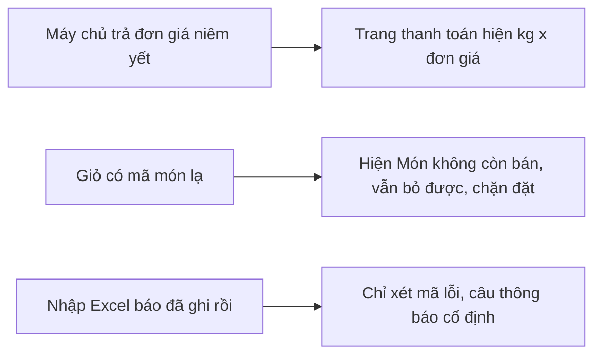

# 03 Dev notes FE Shop + ERP (TD-05 FE, TD-06, TD-07)

Nhánh `td/fe-shop`. Không đụng `erp-console/package*.json`, editor Tiptap, `run_shop_e2e.py`.

## Đã sửa
- **TD-05 FE:** `frontend/lib/types.ts` thêm `OrderLineData.rate?: Money`. `PaymentView.tsx` `unitText` dùng `rate` khi có (hiện "kg × đơn giá niêm yết"); không có thì giữ cách cũ (chia đúng đồng). Mock `frontend/lib/mock.ts` trả `rate`. Chưa có BE nên khoá `rate` là theo thoả thuận trong brief, chưa đối chiếu với serializer thật.
- **TD-06:**
  - `SearchBox.module.css`: HEAD đã đúng (14px chỉ trong khối `min-width: 1024px`, mặc định 16px), điểm review dòng 114 là số cũ. Chỉ thêm chú thích; đo ở 768px ra 16px.
  - `HomeScreen.module.css`: chấm slide dùng `transform: scaleX(2.25)` thay `width` 8 -> 18px; transition đổi sang `transform`; khối `prefers-reduced-motion` vẫn tắt transition. Đầu chấm hơi bầu dục khi kéo giãn, chấp nhận được.
  - `CheckoutScreen.tsx`: nhắc "sẽ kiểm khi đặt" chỉ khi `voucher.error !== null && !voucher.checking`. `useVoucher.ts`: kiểm lại tự động thành công thì `setError(null)`.
  - `features/cart/reconcile.ts`: mã không có trong danh mục (khi đã có catalog) đổi tên thành "Món không còn bán" (hằng `MISSING_ITEM_NAME`), vẫn `status: "out"`, mã giữ để bỏ khỏi giỏ, chặn đặt như món hết. Chưa có catalog (đang tải/lỗi) giữ tên cũ. Thêm 4 ca vào `scripts/test-cart-reconcile.mjs`.
- **TD-07:** `erp-console/features/catalog/itemFilesModel.ts`: bỏ `extractAlreadyAppliedCounts`, thêm `isImportAlreadyApplied(err)` chỉ xét `code`. `ItemImportScreen.tsx` dùng nó; toast vẫn `M.toastAlreadyApplied` (02a §5). `itemFiles.test.ts` giữ ca 409 `IMPORT_ALREADY_APPLIED` = thành công (true), mã khác = false.

## Kiểm chứng (chạy thật)
- frontend: `npm ci` + `npx tsc --noEmit` sạch; mọi `scripts/test-*.mjs` xanh (cart-reconcile 33/33, catalog-view 27/27, format 33/33, home-content 37/37, order-state 81/81, phone 21/21, quantity 65/65, safe-href 40/40, facebook 43/43, voucher 27 ca OK); `NEXT_PUBLIC_USE_MOCK=0 NEXT_PUBLIC_API_BASE=http://localhost:8000 npm run build` sạch; `check-no-mock` XANH.
- erp-console: `tsc --noEmit` sạch; `npm test` 116 file, 1386 test xanh; build xanh (lần đầu "Build failed because of webpack errors" ở bước tải font Google, lần chạy lại xanh, nghi mạng chập chờn).
- `python3 scripts/check_naming.py` đã chạy (không thêm vi phạm).

## Ảnh (thư mục `shots/` bị .gitignore nên ảnh chỉ nằm local, không commit; mock mode, dữ liệu giả, không cuộn ngang ở cả 360 và 1280)
`doc/features/2026-11-15-tra-no-ky-thuat/shots/fe-shop/`: `home-360/1280.png`, `cart-unknown-item-360/1280.png` (giỏ có KHONG-CO), `payment-360/1280.png`, `search-768.png`.

## Còn nợ / không làm được
- **e2e Shop không chạy:** cổng 3000/3100 đang bị tiến trình khác (agent song song) chiếm và worktree không có `backend/.venv`; chạy sẽ đụng nhau. Cần chạy `general_rules`, `full_flow` sau khi hợp nhất.
- TD-05 chưa kiểm với BE thật (khoá `rate`).
