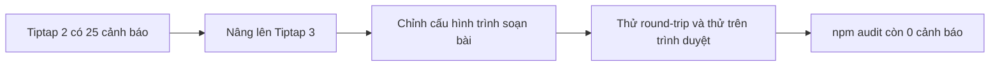

# TD-08 (FE): nâng Tiptap 2.27.3 lên 3.32.2 trong ERP

## Phiên bản
- `@tiptap/core`, `react`, `pm`, `starter-kit`, `extension-link`: 2.27.3 -> **3.32.2** (phát hành 30/10/2026, đủ hơn 2 tuần; 3.32.3 và mới hơn chưa đủ 2 tuần). Lỗ hổng nằm ở `@tiptap/core <= 3.30.3`, bản 3.32.2 đã vá.
- Thêm `@tiptap/core` vào dependencies trực tiếp (hai extension tự viết import từ đó). React 18, Next 15.5 giữ nguyên: Tiptap 3 hỗ trợ React 17/18/19, không chặn.

## npm audit
- Trước: `25 moderate severity vulnerabilities` (gốc `@tiptap/core <=3.30.3`, GHSA-cp6q-959q-f8rh).
- Sau (`npm ci` sạch rồi `npm audit`): `found 0 vulnerabilities`.

## Thay đổi code (chỉ `erp-console/`)
`features/content/editor/TiptapEditor.tsx`:
- `StarterKit.configure`: thêm `link: false`, `underline: false`, `trailingNode: false`. Tiptap 3 gộp sẵn Link và Underline (tránh đăng ký trùng, giữ lược đồ cũ không có gạch chân) và thêm `trailingNode` (tự chèn đoạn rỗng cuối bài, sẽ làm đổi `body.blocks`).
- `immediatelyRender: false` (xuất tĩnh, chỉ dựng ở trình duyệt) và `shouldRerenderOnTransaction: true` (v3 mặc định không render lại, nút Đậm/Nghiêng... sẽ không sáng đúng).
- Mảng extension đưa ra ngoài component (`EDITOR_EXTENSIONS`).
- `setContent(content, { emitUpdate: false })` (v3 đổi chữ ký từ tham số boolean sang object).
- Cấu hình Link giữ nguyên: `protocols` https/http/mailto/tel, `autolink: false`, `openOnClick: false`, `validate: isSafeHref`; `rel="noopener noreferrer nofollow"` và `target="_blank"` vẫn do mặc định của extension, đã xác nhận trong HTML thật.
- Không đổi `convert.ts`, `CaveImageExtension.ts`, `ItemCardExtension.ts`, định dạng `body.blocks`.
- BubbleMenu/FloatingMenu: dự án không dùng, không phải xử lý.

Test mới `features/content/editor/schema.roundtrip.test.ts` (dùng `getSchema` của Tiptap 3 với đúng cấu hình editor, không cần DOM): đủ loại khối (h2, h3, đoạn có đậm/nghiêng/cả hai/link/mailto, trích dẫn, danh sách chấm và số, ảnh, thẻ mặt hàng) đi `bodyToTiptap` -> lược đồ thật -> `tiptapToBody` ra y nguyên; không có mark underline/strike/code; `javascript:` bị loại khi xuất.

## Kiểm chứng (chạy thật)
- `npm ci`: xong, `npm audit` 0 lỗ hổng.
- `npx tsc --noEmit`: sạch.
- `npm test`: `Test Files 117 passed (117)`, `Tests 1389 passed (1389)` (trước đổi: 116 file / 1386 ca).
- `NEXT_PUBLIC_USE_MOCK=0 NEXT_PUBLIC_API_BASE=http://localhost:8000 npm run build`: `Compiled successfully`, toàn bộ trang tĩnh. (Một lần chạy đầu lỗi tải font Google do mạng, chạy lại xanh.)
- `python3 scripts/check_naming.py`: OK, không vi phạm mới.
- Playwright, ERP mock (`loc`/`demo1234`), `/content/edit/?id=1`: mở bài có sẵn giữ nguyên h2 + đoạn; gõ tiêu đề H2, chữ đậm, nghiêng, danh sách chấm, liên kết (HTML ra `<a target="_blank" rel="noopener noreferrer nofollow" href=...>`), hộp liên kết chặn `javascript:` bằng thông báo lỗi, bấm "Lưu nháp" hiện "Đã lưu". Đối chiếu song song với bản main (Tiptap 2) cho cùng kịch bản: HTML giống nhau. 0 lỗi console ở 1280 và 360.
- Ảnh: `doc/features/2026-11-15-tra-no-ky-thuat/shots/tiptap/` (`mo-bai-co-san`, `hop-lien-ket`, `soan-bai`, `luu-nhap`, mỗi loại 1280 và 360).

## Chưa làm / nợ
- Chèn ảnh qua giao diện (tải lên) không thử trên mock; nút chèn ảnh dùng `insertContent` y như cũ và khối ảnh được test round-trip trên lược đồ v3.
- e2e CMS (`erp-console/e2e/ed_batch16_*.py`, `ra_soat_cms*.py`) cần backend thật + dữ liệu seed riêng nên không chạy ở đây; nên để QA/e2e chạy.
- Ghi chú harness (không do nâng cấp): gõ phím quá nhanh ngay sau bấm nút thanh công cụ làm mất ký tự đầu, cả ở bản Tiptap 2.

## Thay đổi hành vi
Không có thay đổi người dùng thấy được. Tiptap 3 có thêm Underline (Ctrl+U), trailing node, listKeymap trong StarterKit: đã tắt Underline và trailingNode để không đổi lược đồ; listKeymap (phím tắt danh sách) để mặc định.
