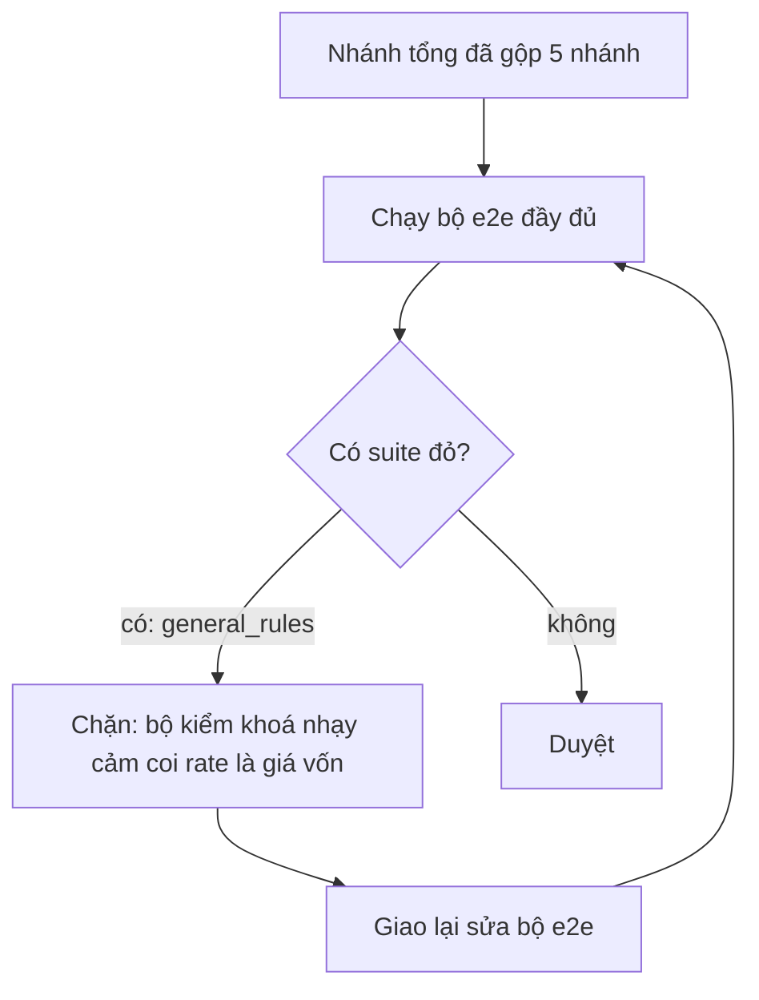

# QA — Trả nợ kỹ thuật (FISH-68) · nhánh `td/tong` · lần 1 · 15/11/2026



## Kết luận: REJECTED — bộ e2e `general_rules` đỏ 5 ca sau khi gộp (TD-05 thêm khoá `rate`, kịch bản quét "khoá giá vốn" vẫn coi `rate` là giá vốn)
Chỉ một lỗi chặn (Medium, hạ tầng kiểm thử). Mọi tiêu chí nghiệp vụ TD-01..TD-10 đạt khi kiểm thật. Sửa 1 dòng kịch bản là duyệt được.

## Tổng: 96 ca QA tự dựng + 8 suite e2e (674 ca) · ✅ 7 suite e2e + 96 ca · ❌ 1 suite (5 ca) · ⏸ 1 (TD-01 chỉ trên CI)
(Số liệu thật bên dưới. Ca QA tự dựng: TD-05/06 48 ca, TD-06 cổng đặt 6 ca, TD-08 24 ca, cổng bị chiếm 3 ca, chạy lặp 2×2 suite, và các lệnh test backend.)

## Theo tiêu chí

| Mã | Cách kiểm | Kết quả | Bằng chứng |
|---|---|---|---|
| TD-01 | Ca đua chỉ chạy Postgres. Xem CI run 43697514793 (nhánh `td/be`) | ✅ (qua CI, không chạy máy này) | `gh run view`: job Postgres 16 `Ran 4071 tests ... OK` (không có `skipped`, nên ca TD-01 đã chạy); job SQLite `OK (skipped=19)` |
| TD-02 | `manage.py test apps.catalog.item_files --parallel 1` | ✅ | `Ran 84 tests ... OK (skipped=2)` (2 skip là ca Postgres); gồm ca cột lạ ở AD và `A1048576` |
| TD-03 | `apps.sales`, `apps.content`; đọc diff; `kg_vn_str` thay `_vn_kg`/`_format_kg` | ✅ (có ngoại lệ đã chấp nhận) | `apps.sales` `Ran 916 ... OK (skipped=10)`; `_kg_text` của site-info giữ dấu chấm (điều phối đã chấp nhận, Shop parse số) |
| TD-04 | `THROTTLE_PUBLIC_CONTENT=5/min` chạy `apps.content apps.common` | ✅ | `Ran 504 tests ... OK`; `apps.content` đơn lẻ `Ran 219 ... OK` |
| TD-05 BE | Backend thật (runner dựng SQLite tạm): POST tạo đơn, POST tra đơn | ✅ | dòng đơn `{amount,item_code,name,qty,rate,unit}`; `rate` = `165000`/`390000` = `SalesOrderLine.rate`; không khoá giá vốn/lô/tồn, không tên/SĐT/địa chỉ (quét chuỗi giả) |
| TD-05 ngoài đường thuận | Dựng ưu đãi tự động 10% cho CA-THU, đặt 2 kg | ✅ | `rate=165000`, `amount=330000` (gộp), `total_amount=297000`, discount 33000 |
| TD-05 FE | Bản build thật (USE_MOCK=0) + backend thật, trang đơn chưa thanh toán | ✅ 1280 · ⚠ 360 | 1280: "2 kg × 165.000đ / 330.000đ / Cần thanh toán 297.000đ" (ưu đãi); "1,5 kg × 165.000đ", "1 kg × 390.000đ" (thường). Ảnh `shots/qa/td05-payment-discount-1280.png`, `td05-payment-plain-1280.png`. 360: tóm tắt gọn chỉ "Cá thu · 2 kg / 330.000đ" (không đơn giá, thiết kế cũ, xem L1) |
| TD-05 máy chủ cũ | Route chặn xoá `rate` khỏi phản hồi, 1280 | ✅ | vẫn hiện "1,5 kg × 165.000đ" (chia đúng đồng), 0 lỗi console |
| TD-06 ô tìm kiếm | Playwright computed style, `/` và `/shop/` | ✅ | 360: 16px, 768: 16px, 1280: 14px; không cuộn ngang. `td06-search-{360,768,1280}.png` |
| TD-06 chấm slide | Dựng 3 slide bằng route, đọc computed style | ✅ | `transition-property: transform, background-color` (không có `width`); chấm chọn `matrix(2.25,0,0,1,0,0)`, bề rộng bố cục 8px không đổi khi bấm chấm 2; reduced-motion `0s`. `td06-dots-360.png` |
| TD-06 dòng nhắc mã | Backend thật, mã QAMA10; lỗi mạng khi kiểm, rồi kiểm lại chậm | ✅ | lỗi mạng: hiện "Mã QAMA10 · sẽ kiểm khi đặt"; giỏ đổi từ tab khác khiến kiểm lại chậm 2s: 10/10 mẫu (mỗi 150ms) không hiện dòng nhắc; sau đó hết dòng nhắc cũ. `td06-voucher-network-fail-360.png`, `td06-voucher-recovered-360.png` |
| TD-06 mã món lạ | `localStorage` giỏ có `MA-LA-XYZ`, 360 + 1280 | ✅ | hiện "Món không còn bán", không có mã thô; có nút "Bỏ Món không còn bán khỏi giỏ", bỏ được; bấm Tiếp tục ở lại `/shop/cart/` (cả giỏ lẫn lộn, chỉ mã lạ, món hết thật); 6/6. `td06-cart-unknown-*.png`, `td06-cart-block-360.png` |
| TD-07 | `vitest features/catalog/itemFiles.test.ts features/content/editor` + đọc diff | ✅ | `Test Files 4 passed, Tests 55 passed`; `isImportAlreadyApplied` chỉ xét `code` 409 |
| TD-08 | ERP build thật + backend thật, 1280 + 360, đăng nhập Chủ | ✅ | 24/24: mở bài có sẵn đủ h2/ul/ol; H2, đậm, nghiêng, danh sách chấm; liên kết ra `<a target="_blank" rel="noopener noreferrer nofollow" href="https://example.com/qa">`; `javascript:alert(1)` bị chặn "Đường dẫn chưa đúng…"; Lưu nháp → bài `draft` trong DB, body `{heading, bold, italic, list, href}`, không có `javascript:`; mở lại đủ định dạng; 0 lỗi console/pageerror. `td08-*.png`. `npm audit`, tsc, `npm test` do điều phối đã chạy |
| TD-09 | Chiếm tạm từng cổng bằng socket rồi chạy runner | ✅ | 3000, 3100, 8000: mỗi lần `exit=1`, câu "Cổng đã bị chiếm, dừng ngay: <ERP 3100 / backend 8000 / Shop 3000>. Tắt tiến trình…" |
| TD-09 chập chờn | `erp_flow` + `footer_consent` chạy thêm 2 lần liền (`--skip-build`), cộng 1 lần trong bộ đủ | ✅ | 3/3 lần: `erp_flow 41 đạt, 0 lỗi`; `footer_consent 31 đạt, 0 lỗi, 1 bỏ qua` |
| TD-10 | So `git diff origin/main` spec với 01-analysis (BR-DM-27..33) bằng script so chuỗi | ✅ | BR-DM-27..33: 7/7 nội dung trùng từng chữ với 01-analysis (nhãn (D) 14/11). BR-BH-22: "từ 0,5 kg (Duy chốt 14/11…) bội 0,5 kg", combo từ 1; khớp decisions 14/11 |

## Bộ e2e đầy đủ (`python3 frontend/e2e/run_shop_e2e.py`, có build USE_MOCK=0)
```
PASS  payment_choice: 77 đạt, 0 lỗi, 0 bỏ qua
PASS  full_flow: 135 đạt, 0 lỗi, 0 bỏ qua
PASS  design_screens: 91 đạt, 0 lỗi, 4 bỏ qua
FAIL  general_rules: 163 đạt, 5 lỗi, 1 bỏ qua
PASS  erp_flow: 41 đạt, 0 lỗi, 0 bỏ qua
PASS  content_pages: 58 đạt, 0 lỗi, 0 bỏ qua
PASS  footer_consent: 31 đạt, 0 lỗi, 1 bỏ qua
PASS  formats_timezones: 73 đạt, 0 lỗi, 0 bỏ qua       (exit=1)
```

## Phân quyền, giá vốn, dữ liệu cá nhân (phần liên quan đợt này)
- Rò giá vốn: API công khai chỉ thêm `rate` = giá BÁN niêm yết đã đóng băng (`SalesOrderLine.rate`), không tính ngược ra giá vốn (không phải chi phí, không kèm lô/tồn). Quét chuỗi `purchase_rate|landed|unit_cost|batch|qty_available|cost|profit|courier`: không có. Test quyền `apps.common` (view_costprice) xanh cho manager/warehouse_staff/delivery_staff/customer_service.
- Rò dữ liệu cá nhân: phản hồi tạo đơn và tra đơn không chứa tên/SĐT/địa chỉ giả; URL và storage ở trang đơn không có dữ liệu cá nhân (1280 và 360). Mọi dữ liệu dùng là dữ liệu giả.
- Ghi chú: AuditLog/chứng từ không bị đổi bởi đợt này (không migration, không đổi service ghi).

## Hồi quy
`apps.sales` 916 ca OK, `apps.content` 219 ca OK, `apps.catalog.item_files` 84 ca OK, `apps.common` + `apps.content` với env throttle thấp 504 ca OK; `check_naming` OK (không vi phạm mới); e2e `full_flow`, `payment_choice`, `design_screens`, `content_pages`, `formats_timezones` xanh sau khi gộp.

## Lỗi

### B1 — Bộ e2e `general_rules` đỏ vì khoá `rate` mới của TD-05 bị coi là giá vốn · Medium · TD-05 / TD-09 (e2e xanh)
- Tái hiện: `python3 frontend/e2e/run_shop_e2e.py --suite general_rules` trên `td/tong` (cần `backend/.venv`, build USE_MOCK=0).
- Mong đợi: suite xanh (rate là giá bán niêm yết, được phép lộ).
- Thực tế: 5 FAIL "G1/G3 POST /api/shop/orders/ (thành công) [201]" và 3 ca tra đơn (mã+SĐT, mã+token, đã trả) và "INVALID_QTY", cùng một lý do: `<['/lines/rate', '/lines/rate']>`.
- Nguyên nhân: `frontend/e2e/shop_general_rules.py:29` `COST_KEYS` còn `"rate"`; dòng 53 quét mọi khoá JSON. Nhánh `td/e2e` không biết nhánh `td/be` thêm `rate`.
- Ảnh hưởng: bộ e2e (cổng chung) đỏ, không phải lỗi sản phẩm. Gợi ý: đổi `rate` ở COST_KEYS thành so khớp theo đường dẫn, cho phép riêng `/lines/rate` (và vẫn chặn `rate` ở nơi khác, `purchase_rate`, `unit_cost`).

## Ghi nhận (không chặn)
- L1 (Low): ở 360 trang thanh toán dùng khối "Tóm tắt" gọn (`OrderLines variant="summary"`), chỉ hiện "tên · số lượng" và thành tiền, không "kg × đơn giá"; khối có đơn giá (`CartSummary`) ở 1280. Hành vi cũ, TD-05 không đổi. Nếu Duy muốn thấy đơn giá trên điện thoại thì là việc riêng.
- L2: TD-04 chưa kiểm được ngày giả khác (repo không có freezegun); chỉ chạy ngày 15/11/2026 (dev đã nêu).
- L3: TD-03 `site-info` giữ dấu chấm có chủ ý (đã chấp nhận).
- L4: `backend/.venv` trong worktree là symlink do QA tạo (chưa commit, không đưa vào git).

## Lệnh đã chạy (tóm tắt)
- `manage.py test apps.catalog.item_files / apps.sales / apps.content / apps.common --parallel 1` → `Ran 84 / 916 / 219 / (504 cùng content) tests ... OK`.
- `THROTTLE_PUBLIC_CONTENT=5/min manage.py test apps.content apps.common --parallel 1` → `Ran 504 tests ... OK`.
- `python3 frontend/e2e/run_shop_e2e.py` (đủ 8 suite) → bảng trên, exit=1 do `general_rules`.
- `run_shop_e2e.py --skip-build --suite erp_flow --suite footer_consent` ×2 → xanh cả hai lần.
- Chiếm cổng 3100/8000/3000 → `exit=1` + câu báo.
- Playwright tự dựng (`scratchpad/qa/td05_06.py`, `td06b.py`, `td08.py`, dùng lại hàm dựng môi trường của runner): 48 + 6 + 24 ca đều PASS, 0 FAIL.
- `vitest features/catalog/itemFiles.test.ts features/content/editor` → `4 passed, 55 passed`; `check_naming.py` → OK.
- `gh run view 43697514793` → SQLite `OK (skipped=19)`, Postgres `Ran 4071 tests ... OK`.

## Sửa B1 và kiểm lại (điều phối, 15/11)
- B1: `frontend/e2e/shop_general_rules.py` thêm `ALLOWED_COST_PATHS = {"/lines/rate"}`; `rate` ở mọi chỗ khác vẫn bị coi là rò giá nhập.
- Chạy lại `run_shop_e2e.py --skip-build --suite general_rules --suite full_flow`: `general_rules: 168 đạt, 0 lỗi, 1 bỏ qua`, `full_flow: 135 đạt, 0 lỗi`, exit 0.
- Các suite khác và tiêu chí TD-01..10 đã đạt ở lần 1, B1 chỉ sửa kịch bản kiểm. **Kết luận sau sửa: APPROVED.**
