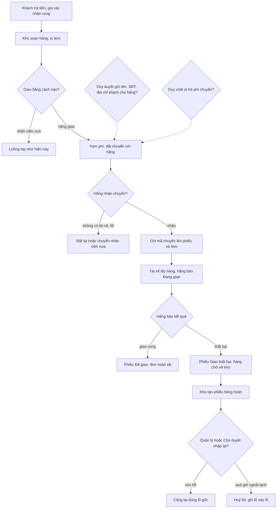

# Liên kết hãng giao hàng (Ahamove, Giao Hàng Tiết Kiệm) — Phân tích nghiệp vụ

> BA · 2026-11-16 · Trạng thái: **CHỜ DUYỆT**
> Nguồn: sheet FIX WEB dòng 10 (Lộc, mức "Lưu Lại (<2 tháng)", ngày 16/11/2026).
> Phụ thuộc: sheet dòng 9, hồ sơ `doc/features/2026-11-16-structured-address/` (đang phân tích song song).

## 1. Yêu cầu gốc

> "Tiến hành tìm cách liên kết với đơn vị giao hàng ahamove, giao hàng tiết kiệm để test tiếp quá trình in tem đến giao hàng thành công"
> — Lộc, sheet FIX WEB dòng 10, 16/11/2026.

## 2. Tóm tắt

**Kho và Quản lý** cần **đặt chuyến giao với một hãng giao ngoài ngay trên phiếu giao, rồi để hãng tự báo Đang giao, Đã giao hoặc Giao thất bại về hệ thống**, để Lộc thử trọn đường đi từ in tem tới giao thành công mà không phải nhờ nhân viên vựa bấm tay từng bước.

Kết luận chính của BA, cần anh đọc trước:

1. **GHTK gần như không dùng được cho hàng của Cá Về.** Hàng trên web là hải sản cấp đông (decisions 14/11). GHTK ghi rõ không nhận hàng tươi sống và đông lạnh (khảo sát mục 3.2, tin cậy Cao [K1]). GHN cũng vậy [H1]. Thêm nữa khu vực giao chỉ là Phan Thiết (decisions 11/10, S-08) và giỏ hàng đã hứa "giao trong 2 giờ dưới 15 km, 4 giờ từ 15 km" (decisions 14/11), là điều hãng chuyển phát theo bưu cục không đáp ứng.
2. **Ahamove hợp nhất để làm hãng đầu tiên**: có mặt ở Phan Thiết, có API tạo đơn, ước phí, webhook và môi trường thử (khảo sát mục 5b). Việc Ahamove ở Phan Thiết có nhận thùng xốp đá hay không thì **chưa xác minh**. Lộc phải hỏi.
3. Đề xuất làm **một lớp "hãng giao" chung**: nhân viên vựa là một cách giao, mỗi hãng là một cách giao khác, có **hãng giả lập** cho staging. Như vậy IT làm được ngay mà không cần khoá thật, và Lộc vẫn "test tiếp" được trên staging.
4. Việc này **lật một phần** quyết định 09/09 "100% nhân viên nội bộ giao" (BR-GH-01), **đụng** BR-BH-10 (không có phí giao trên đơn) và **gửi dữ liệu cá nhân cho bên thứ ba** (bất biến 9). Cả ba cần Duy quyết.

## 3. Bối cảnh trong hệ thống

### 3.1 Tài liệu và quyết định ràng buộc

| Nguồn | Nội dung liên quan |
|---|---|
| decisions 2026-09-09 | Người giao là nhân viên nội bộ, không thuê ngoài (Grab/Ahamove). Phí giao ngoài phạm vi hệ thống, không có field phí ship. |
| decisions 2026-10-10 (tối) | Khách trả **một lần** qua QR, không thu khi nhận. Chưa có phí ship. Câu "Đã gồm giao hàng…". Khi có phí ship thì cộng vào tổng QR và ghi quyết định riêng. Không lưu toạ độ. Tem ERP chỉ hiện 4 số cuối SĐT. |
| decisions 2026-10-11, S-08 | Khu vực giao: **Phan Thiết**. Hãng **Ahamove hoặc GHN, chưa chốt**. Khi chốt hãng ngoài phải ghi quyết định riêng và cập nhật chính sách quyền riêng tư. |
| decisions 2026-11-14 | Hàng trên web là hải sản cấp đông. Giỏ hàng hiện "Giao trong 2 giờ… dưới 15 km · Từ 15 km trở lên: trong 4 giờ". |
| URD §3, §5, §6.4, mục ngoài phạm vi | 100% giao tận nhà bằng nhân viên nội bộ. "Giao hàng qua đối tác thứ 3 (Grab/Ahamove)" đang nằm ngoài phạm vi, có ghi chú 11/10. Không định tuyến, không theo dõi chi phí vận chuyển. |
| Spec P-06 | BR-GH-01 (nhân viên nội bộ, có ghi chú 11/10 sẽ sửa khi chốt hãng), BR-GH-02, BR-GH-04 (thất bại là trạng thái tạm, nhắc sau 2 lần), BR-GH-05 (Đã giao không quay lui), BR-GH-06, BR-GH-24 (một phiếu một kết cục, không ghi đè). |
| Spec P-08 | BR-HV-01…04. BR-HV-03 ngưỡng giờ ngoài chuỗi lạnh vẫn là **câu hỏi mở #3**, chờ Lộc cho số. |
| Spec P-05, P-10 | BR-BH-10 (không có trường phí giao), BR-BH-18 (giao xong phiếu cuối thì đơn hoàn tất), BR-BC-01…04 (lãi lỗ lô, lãi lỗ kỳ). |
| `doc/ops/hoi-loc.md` | L1 ranh giới khu vực, L2 địa chỉ ngoài khu vực, **L3 Ahamove hay GHN, ai đặt chuyến, ai trả cước**, **L4 Lộc có đồng ý gửi dữ liệu khách cho hãng**, L5 thời gian giao. Cả năm câu **chưa có trả lời**. |
| `doc/ops/khao-sat-ben-van-chuyen.md` | Khảo sát 28/09. Ahamove hạng 1 cho nội thành Phan Thiết. GHN, GHTK bị loại vì cấm hàng đông lạnh. Chưa bên nào công bố mẫu thoả thuận xử lý dữ liệu (DPA). |
| `doc/ops/go-live-phap-ly.md` mục 6, 6b | Chính sách quyền riêng tư phải nêu bên nhận dữ liệu. Dữ liệu ra máy chủ nước ngoài phải vào hồ sơ đánh giá tác động chuyển dữ liệu ra nước ngoài. |
| Hồ sơ `2026-10-01-huy-don-dang-giao` (chưa thuộc spec) | Huỷ đơn khi phiếu đang giao, có lý do dự kiến "Bên giao huỷ chuyến" (`CARRIER_CANCELLED`) chỉ khi mở hãng ngoài. |

### 3.2 Hệ thống đang làm gì (đọc code)

Luồng hiện tại là **luồng tay**, mọi bước do người bấm trên ERP:

| Bước | Ai bấm | Code hiện có |
|---|---|---|
| 1. Thanh toán xong → có hoá đơn → tạo phiếu giao ở **Chờ gọi xác nhận** | Hệ thống | `delivery/services.py` `create_delivery_note`, mã phiếu `GH-<mã hoá đơn>-xxxxx` |
| 2. Gọi xác nhận khách, có thể đổi tên/SĐT người nhận | `customer_service` | `delivery/confirmation/`, `DeliveryNote.recipient_name/recipient_phone` |
| 3. **Đang soạn hàng → Chờ lấy hàng** | NV kho (`pack_deliverynote`) | `advance_status` |
| 4. **In tem** 100×150 mm: mã phiếu, mã đơn, tên người nhận, **SĐT che còn 4 số cuối**, địa chỉ, tổng kg, hạn dùng sớm nhất, "ĐÃ THANH TOÁN – không thu thêm". Mã vạch = `<mã phiếu>.<lần in>`. In lại thì tem cũ mất hiệu lực, huỷ tem có ghi nhận | NV kho (`print_label`) | `delivery/labels/services.py`, model `LabelPrint`; ERP `app/print/label/page.tsx`, tra mã tem `deliveries/lookup` |
| 5. **Chọn người giao**: chỉ chọn được User đang làm thuộc nhóm `delivery_staff`, chỉ khi phiếu chưa lên xe | Quản lý (`assign_deliverynote`) | `assign_deliverer`, `DeliveryNote.assigned_to` (FK User) |
| 6. "Đã lấy hàng, bắt đầu giao" → **Đang giao**, ghi giờ bắt đầu giao | NV giao | `advance_status`, `delivery_started_at` |
| 7a. "Đã giao xong" → **Đã giao**, phiếu cuối giao xong thì đơn hoàn tất | NV giao | `advance_status` + `completion.complete_order_if_delivered` (BR-BH-18) |
| 7b. "Báo giao thất bại" → **Giao thất bại**, bắt buộc lý do (Không gặp khách / Từ chối / Sai địa chỉ / Hàng hư / Khác có ghi chú), đếm số lần, từ lần 2 nhắc Quản lý/Chủ | NV giao | `mark_failed`, `failure_reason`, `failed_attempts`, `DELIVERY_MAX_FAILED_ATTEMPTS` |
| 8. "Giao lại" → Đang giao lần nữa | NV giao | `advance_status` FAILED → DELIVERING |
| 9. Hàng mang về → **phiếu hàng hoàn Chờ duyệt** theo từng lô gốc, giờ rời kho lấy từ lần chuyển Đang giao gần nhất | NV giao / NV kho | `inventory/returns/creation.py` `create_return` |
| 10. Duyệt **Tái nhập** (cộng đúng lô gốc) hoặc **Huỷ bỏ** (ghi lỗ) | Quản lý/Chủ (`approve_returntostock`) | `inventory/returns/services.apply_return` |

Ghi nhận thêm:
- **Không có** khái niệm hãng giao, mã vận đơn, phí chuyến, hay nguồn cập nhật "do hãng báo". Mọi chuyển trạng thái ghi `AuditLog` `delivery_advance_status` / `delivery_mark_failed` với người bấm.
- `adapter/` hiện **chỉ** nhận webhook và IPN của SePay rồi chuyển vào Django kèm token nội bộ. Chưa có cổng nào cho hãng giao. Mẫu xử lý lỗi (4xx dữ liệu trả nguyên, 5xx để bên gửi thử lại) dùng lại được về mặt nghiệp vụ.
- Địa chỉ giao là **một ô chữ** `SalesOrder.delivery_address`. Không có tỉnh, phường, toạ độ (decisions 10/10).
- Phạm vi xem dữ liệu khách của NV giao (`delivery/pii_scope.py`) dựa trên `assigned_to`. Phiếu do hãng giao sẽ không có User nào được gán.
- Màn phiếu giao ERP (`erp-console/features/deliveries/components/DeliveryDetailScreen.tsx`) có các nút: Giao cho người giao, In tem / In lại tem, Đã lấy hàng bắt đầu giao, Báo giao thất bại, Đã giao xong, Giao lại.

### 3.3 Liên kết hãng thay đổi bước nào

| Bước hiện tại | Khi giao bằng hãng | Mức thay đổi |
|---|---|---|
| 5. Chọn người giao | Chọn **cách giao**: nhân viên vựa (như cũ) hoặc hãng. Chọn hãng thì **xem phí ước tính** rồi **đặt chuyến**. Hãng trả **mã chuyến (mã vận đơn)**, lưu trên phiếu | Mới |
| 4. In tem | Giữ tem của mình, **thêm mã chuyến** của hãng. Ahamove giao nội thành theo xe máy thường không cần tem riêng của hãng (PA, chưa xác minh). Hãng chuyển phát kiểu GHTK bắt dán **tem của hãng**, tem đó thường in đủ thông tin người nhận (chưa xác minh), đụng quyết định "tem chỉ 4 số cuối" | Sửa |
| 6. Bắt đầu giao | Hãng báo "tài xế đã lấy hàng" → phiếu tự sang **Đang giao**, giờ rời kho = giờ hãng báo lấy hàng | Thay bấm tay bằng tin báo của hãng |
| 7a. Đã giao xong | Hãng báo giao thành công → **Đã giao**, đơn tự hoàn tất (BR-BH-18), người làm ghi là "Hệ thống (theo hãng)" | Thay bấm tay |
| 7b. Giao thất bại | Hãng báo thất bại hoặc hoàn hàng → **Giao thất bại**, lý do của hãng đổi sang lý do của mình | Thay bấm tay |
| 8. Giao lại | Giao lại = **đặt chuyến mới** (phí mới). Chuyến cũ đóng lại, vẫn giữ lịch sử | Mới |
| 9–10. Hàng về kho | Không đổi: kho nhận hàng hãng chở về rồi tạo phiếu hàng hoàn, Quản lý/Chủ duyệt (BR-HV-02). Giờ ngoài chuỗi lạnh tính từ lúc tài xế lấy hàng | Giữ luật, đổi nguồn giờ |
| Huỷ đơn | Đơn huỷ khi chuyến đã đặt mà tài xế chưa lấy → **huỷ chuyến với hãng**. Đã lấy hàng → theo hồ sơ huỷ đơn đang giao | Mới |
| Sự cố của hãng | Không tìm được tài xế, tài xế huỷ, hãng lỗi → phiếu về **Chờ lấy hàng**, đặt lại hoặc chuyển nhân viên vựa | Mới |

## 4. Tác nhân & quyền

| Tác nhân | Group | Làm được gì | Quyền Tầng 2 cần |
|---|---|---|---|
| Chủ | `owner` | Mọi việc. Xem phí từng chuyến và tổng phí theo kỳ để đối soát với hãng. Bật/tắt hãng | Quyền đặt chuyến (đề xuất mới), quyền xem phí chuyến (đề xuất) |
| Quản lý | `manager` | Chọn cách giao, đặt chuyến, huỷ chuyến, chuyển sang nhân viên vựa khi hãng lỗi, **ghi tay kết quả** khi hãng không báo | Quyền đặt chuyến; `assign_deliverynote` (có sẵn) |
| NV kho | `warehouse_staff` | Soạn hàng, in tem (có mã chuyến), bàn giao hàng cho tài xế, nhận hàng hãng chở về, tạo phiếu hàng hoàn | `pack_deliverynote`, `print_label` (có sẵn); đặt chuyến nếu Duy uỷ (Q7) |
| NV giao nội bộ | `delivery_staff` | Như cũ với phiếu giao bằng nhân viên vựa. Không thấy phiếu do hãng giao | Không đổi |
| Nhân viên gọi xác nhận | `customer_service` | Như cũ. Gọi khách khi hãng báo thất bại (sai địa chỉ, không nghe máy) | Không đổi |
| Hãng giao | (bên ngoài) | Báo trạng thái chuyến qua webhook. Không có tài khoản ERP | Không có. Xác thực bằng khoá bí mật của hãng |
| Hệ thống | `actor=None` | Đổi trạng thái phiếu theo tin báo của hãng, chống trùng, ghi AuditLog | — |

Ranh giới quyền (BR-PQ): đặt chuyến làm **tiền rời túi** (phí chuyến) nhưng là **việc khách đang chờ**. Đề xuất cho Quản lý làm, có trần phí mỗi chuyến (tham số). Vượt trần phải Chủ (Q7).

## 5. Use case

### UC-1 Đặt chuyến với hãng cho phiếu đã soạn xong
- **Tiền điều kiện**: phiếu ở **Chờ lấy hàng** (đã gọi xác nhận, đã soạn). Đơn chưa huỷ. Hãng đang bật. Người bấm có quyền đặt chuyến. Địa chỉ đủ thông tin hãng cần (phụ thuộc dòng 9).
- **Luồng chính**
  1. Quản lý mở phiếu, chọn cách giao "Hãng giao" và chọn hãng.
  2. Hệ thống hỏi hãng **phí ước tính** và thời gian dự kiến, hiện cho người bấm. Phí chỉ hiện cho người có quyền xem phí.
  3. Người bấm xác nhận đặt chuyến.
  4. Hệ thống gửi cho hãng **đúng các trường tối thiểu** (mục 7.3), số tiền thu hộ = 0.
  5. Hãng nhận chuyến, trả mã chuyến. Hệ thống lưu mã chuyến, hãng, phí báo giá, giờ đặt lên phiếu và ghi AuditLog (không chép địa chỉ, SĐT).
  6. Tem in sau đó (hoặc in lại) có thêm mã chuyến.
- **Luồng thay thế**
  - A1. Phí ước tính vượt trần → chỉ Chủ đặt được, hoặc chuyển nhân viên vựa.
  - A2. Người bấm chọn "Nhân viên vựa" → luồng tay như hiện nay (bước 5–8 mục 3.2).
- **Ngoại lệ**
  - E1. Hãng từ chối (ngoài vùng phục vụ, địa chỉ không đọc được, hàng cấm) → không lưu chuyến, báo lý do bằng tiếng Việt, phiếu giữ **Chờ lấy hàng**.
  - E2. Mạng rớt hoặc hãng không trả lời → không biết chuyến đã được tạo hay chưa. Lần bấm lại **không được tạo chuyến thứ hai** (chống trùng theo phiếu). Hệ thống phải tra lại được với hãng.
  - E3. Bấm đặt hai lần cùng lúc (hai người) → chỉ một chuyến, người sau thấy "Phiếu vừa được đặt chuyến, tải lại".
  - E4. Đơn bị huỷ trong lúc đang đặt → chặn đặt (BR-GH-24), nếu hãng đã nhận thì huỷ chuyến ngay.
  - E5. Hãng đang tắt hoặc chưa cấu hình khoá → nút đặt chuyến ẩn, chỉ còn nhân viên vựa.
- **Hậu điều kiện**: phiếu vẫn **Chờ lấy hàng**, có một chuyến đang hiệu lực. Tồn kho không đổi (đã trừ lúc xuất hoá đơn).

### UC-2 Hãng báo trạng thái chuyến (webhook)
- **Tiền điều kiện**: phiếu có chuyến đang hiệu lực. Tin báo đến qua cổng của hãng, xác thực được là của hãng.
- **Luồng chính**
  1. Hãng báo **tài xế đã nhận chuyến** → chỉ ghi lên chuyến (tên hiển thị tài xế nếu Duy cho lưu, Q-12), phiếu chưa đổi.
  2. Hãng báo **đã lấy hàng** → phiếu sang **Đang giao**, giờ bắt đầu giao = giờ hãng báo. AuditLog ghi người làm là Hệ thống, nguồn là hãng.
  3. Hãng báo **giao thành công** → phiếu **Đã giao**, ghi giờ hoàn tất. Phiếu cuối của đơn thì đơn hoàn tất (BR-BH-18). Ghi phí thực tế nếu hãng gửi kèm.
- **Luồng thay thế**
  - A1. Hãng báo **giao thất bại** → phiếu **Giao thất bại**, tăng số lần, lý do đổi theo bảng map (BR-GH-33). Từ lần 2 nhắc Quản lý/Chủ (BR-GH-04).
  - A2. Hãng báo **không tìm được tài xế / tài xế huỷ / hãng huỷ** trước khi lấy hàng → chuyến đóng, phiếu giữ **Chờ lấy hàng**, nhắc Quản lý đặt lại hoặc chuyển nhân viên vựa.
- **Ngoại lệ**
  - E1. Tin báo **trùng** (hãng gửi lại) → không đổi gì lần hai, trả "đã nhận" cho hãng.
  - E2. Tin báo **đến sai thứ tự** (ví dụ "giao thành công" đến trước "đã lấy hàng") → đi thẳng tới kết cục, không lùi trạng thái.
  - E3. Tin báo **trái với kết cục đã có** (phiếu đã Đã giao mà hãng báo hoàn hàng; hoặc phiếu đã bị người bấm tay thành thất bại) → **không ghi đè** (BR-GH-05, BR-GH-24). Đưa vào danh sách "cần Quản lý xem".
  - E4. Tin báo cho **đơn đã huỷ** → không đổi phiếu, đưa vào "cần Quản lý xem" (hàng có thể đang ở tài xế).
  - E5. Tin báo **không xác thực được** hoặc mã chuyến lạ → từ chối, chỉ ghi log mã chuyến và lý do, **không ghi nội dung tin**.
  - E6. Django tạm lỗi → không trả "thành công" cho hãng để hãng gửi lại (như mẫu SePay hiện có).
- **Hậu điều kiện**: trạng thái phiếu khớp kết cục hãng báo, mỗi lần đổi có AuditLog, không có dữ liệu cá nhân trong log.

### UC-3 Giao thất bại qua hãng, hàng về kho
- **Tiền điều kiện**: phiếu **Giao thất bại** do hãng báo. Tài xế đang giữ hàng.
- **Luồng chính**
  1. Hệ thống hiện phiếu trong "Cần xử lý" kèm lý do của hãng và giờ hàng đã ở ngoài kho.
  2. Nhân viên gọi xác nhận gọi khách (sai địa chỉ, không nghe máy).
  3. Quản lý chọn: **giao lại** (UC-4) hoặc **cho hàng về kho**.
  4. Hàng về kho theo dịch vụ hoàn hàng của hãng (phí hoàn, Q-3). NV kho nhận hàng, tạo **phiếu hàng hoàn** theo từng lô gốc (BR-HV-01) như hiện nay.
  5. Quản lý/Chủ duyệt Tái nhập hoặc Huỷ bỏ (BR-HV-02). Quá ngưỡng giờ ngoài lạnh thì mặc định đề xuất Huỷ bỏ (BR-HV-03).
- **Luồng thay thế**: A1. Tài xế không chở về được (mất, hỏng) → ghi "mất, hỏng không thu hồi" theo hồ sơ huỷ đơn đang giao, việc đòi hãng bồi thường làm ngoài hệ thống (Lộc).
- **Ngoại lệ**: E1. Lô gốc đã chốt → không nhận hàng hoàn (BR-HV-04), ghi lỗ. E2. Hàng về sau nhiều giờ → luôn đề xuất Huỷ bỏ.
- **Hậu điều kiện**: tồn và lãi lỗ lô theo P-08, không đổi luật cũ.

### UC-4 Giao lại sau thất bại
- **Tiền điều kiện**: phiếu **Giao thất bại**, đơn chưa huỷ, hàng còn ở tài xế hoặc đã về kho mà chưa duyệt Huỷ bỏ.
- **Luồng chính**: Quản lý chọn giao lại → đặt **chuyến mới** (UC-1 từ bước 2), chuyến cũ đóng lại có giữ lịch sử, hoặc chuyển nhân viên vựa.
- **Ngoại lệ**: E1. Đã đủ số lần thất bại → bắt buộc Quản lý/Chủ quyết (BR-GH-04). E2. Hàng đã quá ngưỡng giờ ngoài lạnh → cảnh báo trước khi cho giao lại.
- **Hậu điều kiện**: phiếu có nhiều chuyến, chỉ một chuyến hiệu lực.

### UC-5 Huỷ chuyến
- **Tiền điều kiện**: chuyến đang hiệu lực, tài xế **chưa lấy hàng**.
- **Luồng chính**: Quản lý bấm huỷ chuyến (hoặc Hệ thống huỷ khi đơn bị huỷ) → hệ thống báo hãng huỷ → chuyến đóng, phiếu về **Chờ lấy hàng** (hoặc theo đơn đã huỷ). Ghi phí huỷ nếu hãng tính.
- **Ngoại lệ**: E1. Hãng từ chối huỷ vì tài xế đã lấy hàng → coi như Đang giao, xử lý theo hồ sơ huỷ đơn đang giao. E2. Hãng không trả lời → chuyến ở "chưa rõ", nhắc Quản lý gọi hãng.

### UC-6 Ghi tay khi hãng không báo
- **Tiền điều kiện**: chuyến đã quá thời gian dự kiến mà không có tin báo, hoặc hãng lỗi.
- **Luồng chính**: Quản lý/Chủ ghi tay kết quả (Đã giao / Giao thất bại) **kèm lý do bắt buộc**, AuditLog ghi rõ "ghi tay thay hãng".
- **Ngoại lệ**: E1. Tin báo của hãng đến sau với kết cục khác → không ghi đè, đưa vào "cần Quản lý xem" (UC-2 E3).

### UC-7 Lộc thử trên staging bằng hãng giả lập
- **Tiền điều kiện**: staging, dữ liệu giả, hãng giả lập bật (production luôn tắt).
- **Luồng chính**: Lộc đặt đơn thử → gọi xác nhận → soạn, in tem → đặt chuyến với "Hãng giả lập" → bấm giả lập từng tin báo của hãng (đã lấy hàng, giao thành công, thất bại, không có tài xế) → xem phiếu, đơn, hàng hoàn đổi đúng.
- **Luồng thay thế**: khi Lộc có khoá thử của Ahamove thì đặt chuyến với môi trường thử thật của Ahamove.
- **Ngoại lệ**: E1. Khoá thử sai hoặc hết hạn → báo "Hãng chưa cấu hình", không ảnh hưởng luồng tay.

## 6. Business rule

Mã mới đặt từ **BR-GH-30** để tránh trùng: spec đang tới BR-GH-24, code đã dùng BR-GH-22/23 với nghĩa khác hồ sơ huỷ đơn đang giao (BR-GH-22/23/25 ở đó). Techlead/PO dọn số khi ghi vào spec.

| Mã | Nội dung | Nhãn | Mới / Sửa / Giữ |
|---|---|---|---|
| BR-GH-01 | Người giao là nhân viên nội bộ **hoặc một hãng giao đã được Duy chốt**. Mỗi phiếu tại một thời điểm có đúng một cách giao. Nhân viên vựa luôn là cách dự phòng | L (yêu cầu dòng 10) + D cần chốt (Q-1) | **Sửa** |
| BR-GH-02 | Không định tuyến, không tối ưu lộ trình. Không tự chọn hãng rẻ nhất | L | Giữ |
| BR-GH-04 | Thất bại do hãng báo cũng đếm vào số lần thất bại, cùng ngưỡng nhắc | PA | Giữ, mở rộng |
| BR-GH-05 | Đã giao không quay lui, kể cả khi hãng báo khác về sau | D | Giữ |
| BR-GH-24 | Một phiếu một kết cục. Tin báo của hãng và thao tác tay đến sau đều không ghi đè | PA | Giữ, áp cho tin báo |
| BR-GH-30 | Chỉ đặt chuyến khi phiếu **Chờ lấy hàng**, đơn chưa huỷ. Một phiếu chỉ có **một chuyến hiệu lực**. Đặt lại sau thất bại hoặc sau khi hãng huỷ tạo chuyến mới, chuyến cũ giữ lịch sử (không xoá) | PA | Mới |
| BR-GH-31 | Đặt chuyến **chống trùng**: bấm lại, mạng rớt, hai người bấm cùng lúc không tạo hai chuyến với hãng | PA | Mới |
| BR-GH-32 | Tin báo của hãng là **nguồn chính** của trạng thái phiếu giao bằng hãng. Xác thực được mới nhận. Trùng thì bỏ qua. Sai thứ tự thì không lùi trạng thái. Trái kết cục đã có thì không ghi đè, đưa Quản lý xem | PA | Mới |
| BR-GH-33 | Trạng thái của hãng đổi về trạng thái của mình theo bảng cố định: nhận chuyến → (không đổi); đã lấy hàng → Đang giao; giao thành công → Đã giao; thất bại / hoàn hàng → Giao thất bại kèm lý do đã map (không map được → "Khác", ghi chú là mã lý do của hãng, không chép chữ tự do); không có tài xế / hãng huỷ trước lấy hàng → về Chờ lấy hàng | PA | Mới |
| BR-GH-34 | Gửi cho hãng **chỉ** tên người nhận, SĐT người nhận, địa chỉ giao, ghi chú giao hàng (đã lọc dãy số dài như BR-GH-19), số kiện, khối lượng, loại hàng chung ("Hải sản đông lạnh"), tiền thu hộ = 0. **Không** gửi giá vốn, danh sách món kèm giá, lịch sử mua, mã khách. Giá trị khai báo hàng (nếu hãng bắt) lấy theo tổng tiền đơn, chỉ khi Duy cho (Q-11) | D cần chốt (Q-4) + PA | Mới |
| BR-GH-35 | **Chưa gửi dữ liệu khách thật cho hãng nào** khi chưa có đủ: Duy duyệt, chính sách quyền riêng tư nêu tên hãng, legal-vn soát. Staging chỉ dùng dữ liệu giả, với hãng giả lập hoặc môi trường thử của hãng | D (bất biến 9, S-08) | Mới |
| BR-GH-36 | Không ghi nội dung tin báo của hãng, nội dung yêu cầu gửi hãng hay câu trả lời của hãng vào log. Log chỉ có mã phiếu, mã chuyến, trạng thái, mã lỗi | D (bất biến 9) | Mới |
| BR-GH-37 | Phí chuyến (ước tính lúc đặt, thực tế khi hãng báo, phí huỷ, phí hoàn hàng) được ghi trên chuyến để đối soát. **Không** cộng vào tiền khách trả, không đổi BR-BH-10. Ai thấy phí và phí có vào lãi lỗ hay không: chờ Q-3 | PA, chờ D | Mới |
| BR-GH-38 | Đặt chuyến có **trần phí mỗi chuyến** (tham số). Vượt trần chỉ Chủ đặt | PA (Q-7) | Mới |
| BR-GH-39 | Đơn bị huỷ khi chuyến còn hiệu lực mà tài xế chưa lấy hàng → Hệ thống huỷ chuyến với hãng trong cùng thao tác huỷ. Hãng không huỷ được → nhắc Quản lý | PA | Mới |
| BR-HV-03 | Giờ ngoài chuỗi lạnh của phiếu giao bằng hãng tính từ **giờ hãng báo đã lấy hàng** tới giờ kho nhận hàng về. Ngưỡng vẫn chờ Lộc (câu hỏi mở #3) | PA | Sửa (nguồn giờ) |
| BR-HV-01, 02, 04 | Hàng về đúng lô gốc, phải duyệt, lô đã chốt không nhận | D | Giữ |
| BR-BH-10 | Không có trường phí giao trên đơn | L | Giữ (Q-3 có thể đụng) |
| BR-BH-18 | Phiếu cuối Đã giao thì đơn hoàn tất, kể cả khi do hãng báo | D | Giữ |

## 7. Tác động dữ liệu & tích hợp

### 7.1 Dữ liệu (không thiết kế chi tiết, việc của Tech Lead)
- **Phiếu giao** (`DeliveryNote`): cần biết cách giao (nhân viên vựa / hãng nào). `assigned_to` hiện bắt buộc là User `delivery_staff` khi gán, phiếu giao bằng hãng sẽ để trống.
- **Chuyến với hãng** (khái niệm mới, một phiếu nhiều chuyến): hãng, mã chuyến, trạng thái chuyến, giờ đặt, giờ lấy hàng, giờ kết thúc, phí ước tính, phí thực tế, phí huỷ/hoàn, người đặt. Không lưu bản sao địa chỉ hay SĐT đã gửi (lấy lại từ đơn/phiếu khi cần). Không xoá, chỉ đóng bằng trạng thái (bất biến 3).
- **Nhật ký tin báo của hãng**: cần một dấu vết để chống trùng và để Quản lý xem "tin trái kết cục", nhưng **không lưu nguyên nội dung** tin (có tên, SĐT, địa chỉ). Chỉ mã chuyến, mã sự kiện, trạng thái, thời điểm.
- **Tem** (`labels`): thêm mã chuyến và tên hãng. Giữ SĐT che 4 số cuối.
- **Hàng hoàn** (`ReturnToStock`): giờ rời kho lấy theo giờ hãng lấy hàng thay cho lần bấm Đang giao.
- Mọi field mới cần migration chỉ thêm, có lý do ở hồ sơ này (bất biến 8). **Không có field dữ liệu cá nhân mới** nếu Q-12 chọn không lưu tài xế.

### 7.2 Màn hình, API
- ERP màn phiếu giao: chọn cách giao, xem phí, đặt chuyến, huỷ chuyến, mã chuyến, trạng thái chuyến, lịch sử chuyến, ghi tay thay hãng, danh sách "cần xem" (tin trái kết cục, chuyến quá giờ).
- ERP danh sách phiếu: lọc theo cách giao/hãng. Danh sách "Việc giao của tôi" của NV giao không có phiếu hãng.
- `adapter/`: thêm cổng nhận tin báo của từng hãng, theo đúng vai "adapter mỏng, không đụng DB" (decisions 09/09). Hãng nào cũng đi qua cùng một hợp đồng nội bộ với Django.
- Shop: trang đơn hàng công khai hiện trạng thái như hiện nay. **Không** đưa link theo dõi của hãng ra Shop V1 (trang theo dõi của hãng có thể hiện tên, địa chỉ người nhận, chưa xác minh) — 🟡 Q-10.
- Staging: hãng giả lập có nút bắn tin báo để Lộc thử (UC-7). Production không có.

### 7.3 Bên thứ ba
| Hãng | Nhận gì từ Cá Về | Trả gì về | Ghi chú |
|---|---|---|---|
| Ahamove (đề xuất đầu tiên) | Địa chỉ lấy hàng (kho), tên/SĐT/địa chỉ người nhận, ghi chú, khối lượng, loại hàng, thu hộ 0 | Phí ước tính, mã chuyến, trạng thái, có thể có tên/SĐT/biển số tài xế | API có tạo đơn, ước phí, webhook, môi trường thử (khảo sát [A8]). Hàng đông lạnh ở PT chưa xác minh. Toạ độ: API có thể cần kinh độ, vĩ độ (chưa xác minh) → đụng "không lưu toạ độ" (Q-13). Nơi đặt máy chủ: chưa xác minh (mục 6b) |
| GHTK | Như trên, thêm tỉnh/phường theo bộ mã của hãng | Mã vận đơn, tem của hãng, trạng thái | Cấm hàng đông lạnh [K1]. Hợp giao tỉnh, mất ngày. Bộ mã địa chỉ có thể chưa theo 34 tỉnh mới (khảo sát §1) |
| Hãng giả lập (staging) | Dữ liệu giả | Tin báo do người thử bấm | Không ra ngoài |

### 7.4 So sánh Ahamove và GHTK cho hàng Cá Về

| Tiêu chí | Ahamove | GHTK |
|---|---|---|
| Kiểu giao | Xe máy nội thành theo giờ (Siêu tốc ~≤2 giờ, 2H, 4H) [A2][A3] | Bưu cục, lấy hàng rồi phát qua kho, giao tỉnh. Hoả tốc 3 giờ chỉ HN, HCM [K2] |
| Có ở Phan Thiết | Có từ 03/2023 [A1] | Có, toàn quốc |
| Hải sản cấp đông | Mâu thuẫn: có gói thực phẩm tươi sống nhưng nguồn chỉ nhắc HN, HCM; chính sách liên tỉnh loại đông lạnh [A5][A6]. **Phải hỏi** | **Không nhận** hàng tươi sống, đông lạnh; hàng điều kiện đặc biệt phải báo trước để hãng xét [K1] |
| Khớp lời hứa 2 giờ / 4 giờ ở giỏ | Khớp nếu có tài xế | Không khớp |
| Khớp khu vực Phan Thiết (S-08) | Khớp | Thừa (giao tỉnh), hiện ngoài phạm vi |
| Hàng thất bại | Tài xế chở về trong ngày (dịch vụ hoàn, phí, chưa xác minh) | Thử giao nhiều lần rồi hoàn về người gửi, mất ngày → hàng gần như chắc phải huỷ (BR-HV-03) |
| Tem | Thường không cần tem hãng (PA) | Bắt dán tem hãng |
| Phí tham khảo | Siêu tốc ~15.709 đ / 2 km đầu, giờ 15h30–20h có thể ×1,5 (giá chung) [A7] | Không tra (đã loại do hàng cấm) |

**Khuyên**: làm lớp "hãng giao" chung, hãng đầu tiên là **Ahamove**, hãng giả lập cho staging. **GHTK để sau**, chỉ làm khi (a) Lộc có xác nhận bằng văn bản GHTK nhận hải sản cấp đông đóng thùng xốp, và (b) Duy mở khu vực giao ngoài Phan Thiết. Nếu cần giao tỉnh, khảo sát cho thấy Viettel Post (nhận đông lạnh có điều kiện) hoặc Lalamove (xe van) đáng xét hơn GHTK.

## 8. Rủi ro Cá Về

| Loại | Rủi ro | Mức | Cách chặn (cái gì, không phải làm thế nào) |
|---|---|---|---|
| **Dữ liệu cá nhân** (bất biến 9) | Gửi tên/SĐT/địa chỉ cho hãng khi chưa duyệt, chưa có chính sách | **Critical** | BR-GH-35: production chỉ bật hãng khi Duy duyệt + chính sách nêu tên hãng + legal-vn soát. Staging dữ liệu giả |
| Dữ liệu cá nhân | Log tin báo hoặc câu trả lời của hãng có địa chỉ, SĐT. Adapter hiện ghi nguyên chữ phản hồi lỗi của Django vào log (`adapter/app/main.py` khi Django trả lỗi) — với hãng giao, phản hồi đó có thể chứa dữ liệu khách | Cao | BR-GH-36. Tech Lead xem lại cách log lỗi khi thêm cổng hãng giao |
| Dữ liệu cá nhân | Máy chủ của hãng ở nước ngoài → thêm vào hồ sơ chuyển dữ liệu ra nước ngoài (go-live 6b) | Cao | Lộc hỏi hãng nơi lưu dữ liệu; legal-vn bổ sung hồ sơ |
| Dữ liệu cá nhân | Tem hãng (GHTK) in đủ SĐT, lệch decisions 10/10 "tem chỉ 4 số cuối" | TB | Ahamove dùng tem mình. GHTK quyết khi làm |
| Dữ liệu cá nhân | Lưu tên, SĐT, biển số tài xế = dữ liệu cá nhân mới của bên thứ ba | TB | Q-12, mặc định không lưu |
| **Hàng, chuỗi lạnh** | Hãng không nhận đông lạnh, hoặc giữ hàng lâu khi thất bại → bán hàng hỏng nếu tái nhập | Cao | Chọn Ahamove, BR-HV-03 tính từ giờ lấy hàng, ngưỡng chờ Lộc |
| Tồn kho | Cộng kho hai lần khi hàng hãng chở về và đơn bị huỷ | TB | Giữ BR-HV-02 và luật hồ sơ huỷ đơn đang giao, không tự nhập kho theo tin báo |
| **Trạng thái** | Tin báo trùng, sai thứ tự, trái kết cục ghi đè Đã giao | Cao | BR-GH-05, 24, 32 |
| Trạng thái | Đặt hai chuyến cho một phiếu → trả hai lần phí, hai tài xế đến | Cao | BR-GH-30, 31 |
| **Tiền** | Phí chuyến thật mà hệ thống không thấy → lãi lỗ báo cao hơn thực tế; phí tăng giờ cao điểm, Tết ×2,2 | TB | Q-3, BR-GH-37, 38 |
| Tiền | Nhầm bật thu hộ (COD) trong khi khách đã trả QR → khách bị thu hai lần | Cao | Thu hộ luôn = 0 (BR-GH-34); tem giữ "ĐÃ THANH TOÁN – không thu thêm" |
| Giá vốn (bất biến 1) | Gửi giá trị hàng theo giá vốn cho hãng, hoặc lộ phí/giá trị cho NV kho | Thấp | Không gửi giá vốn; phí chuyến tách theo quyền |
| Phân quyền | NV giao mất phạm vi khi phiếu không gán ai; phiếu hãng lọt vào "Việc giao của tôi" | Thấp | Phạm vi Tầng 3 giữ theo `assigned_to`; phiếu hãng không có người giao nội bộ |
| AuditLog | Thay đổi do hãng không biết ai làm | TB | Ghi Hệ thống + nguồn hãng + mã chuyến, không chép địa chỉ |
| Vận hành | Hãng sập, hết tài xế ở PT tối muộn | TB | Nhân viên vựa luôn là dự phòng (BR-GH-01 sửa) |
| Phụ thuộc | Địa chỉ một ô không đủ để hãng định vị → hãng từ chối hoặc giao sai | TB | Dòng 9 (địa chỉ có cấu trúc). Mock và Ahamove thử không bị chặn; production chờ dòng 9 |

## 9. Ngoài phạm vi
- Thu phí ship của khách, dòng phí trên đơn hay trên QR (BR-BH-10 giữ; muốn đổi thì quyết định riêng).
- Thu hộ (COD). Khách luôn trả trước.
- Giao ngoài Phan Thiết, giao liên tỉnh, GHTK (trừ khi Duy đổi ở Q-2).
- Tự so giá nhiều hãng và tự chọn hãng, định tuyến, ghép đơn (BR-GH-02).
- Bản đồ theo dõi tài xế, link theo dõi của hãng trên Shop, SMS/Zalo báo khách.
- Đối soát công nợ tự động với hãng, xuất hoá đơn phí vận chuyển. Hệ thống chỉ cho số để Lộc đối chiếu.
- Đòi bồi thường hàng hỏng, mất với hãng (Lộc làm ngoài hệ thống).
- Tem của GHTK.

## 10. Câu hỏi mở

| # | Mức | Câu hỏi | Mặc định PA / em khuyên |
|---|---|---|---|
| Q-1 | 🔴 | Lộc muốn giao bằng hãng ngoài, khác quyết định 09/09 "100% nhân viên nội bộ giao" (BR-GH-01, URD §3). Anh có chốt **đổi sang cho phép hãng ngoài** không, và có giữ nhân viên vựa làm cách dự phòng không? | Khuyên: **cho phép cả hai**, mỗi phiếu chọn một cách giao, nhân viên vựa là dự phòng khi hãng lỗi hoặc hết tài xế. Ghi thành quyết định riêng như S-08 yêu cầu, sửa BR-GH-01 và URD |
| Q-2 | 🔴 | Hàng là hải sản cấp đông mà GHTK (và GHN) không nhận đông lạnh; khu vực chỉ Phan Thiết; giỏ hứa 2 giờ / 4 giờ. Anh chốt **hãng đầu tiên là Ahamove**, GHTK để sau? (Lưu ý decisions 11/10 ghi "Ahamove hoặc GHN", sheet ghi GHTK) | Khuyên: **Ahamove trước**, kèm hãng giả lập cho staging. GHTK chỉ làm khi Lộc có văn bản GHTK nhận hàng đông lạnh **và** anh mở giao ngoài Phan Thiết. Bỏ GHN khỏi danh sách vì cùng lý do |
| Q-3 | 🔴 | Hãng tính phí theo chuyến (cả phí giao lại, phí huỷ, phí hoàn hàng, giờ cao điểm). Khách đã trả "đã gồm giao hàng" nên **Cá Về chịu phí**? Hệ thống có ghi phí không, và có trừ vào lãi lỗ không? (decisions 09/09 để phí giao ngoài hệ thống) | Khuyên: **Cá Về chịu toàn bộ**, không thu thêm khách (BR-BH-10 giữ). Hệ thống **ghi phí từng chuyến và tổng theo kỳ** để Lộc đối soát, chỉ Chủ và Quản lý xem. **Chưa trừ vào lãi lỗ** lô hay kỳ ở bản đầu (BR-BC không đổi); sau một tháng có số thật thì anh quyết đưa vào lãi lỗ kỳ như một dòng chi phí riêng |
| Q-4 | 🔴 | Anh có duyệt **gửi tên, SĐT, địa chỉ, ghi chú giao hàng của khách cho Ahamove** không (bất biến 9, hoi-loc L4)? | Khuyên: duyệt **ngay cho staging** với dữ liệu giả (hãng giả lập, môi trường thử Ahamove). **Production chỉ bật** khi đủ: chính sách quyền riêng tư nêu tên hãng, legal-vn soát (gồm mục 6b nếu máy chủ hãng ở nước ngoài), Lộc có điều khoản bảo vệ dữ liệu với hãng. Chỉ gửi trường tối thiểu BR-GH-34 |
| Q-5 | 🟡 | Tem: dùng tem của mình hay tem của hãng? | Mặc định: **tem của mình**, thêm tên hãng và mã chuyến, SĐT vẫn che 4 số cuối (decisions 10/10). Tem hãng chỉ xét khi làm hãng bắt dán tem |
| Q-6 | 🟡 | Giao thất bại qua hãng thì hàng về kho thế nào? | Mặc định: đặt chuyến **có hoàn hàng về kho** khi hãng có dịch vụ đó; kho nhận rồi tạo phiếu hàng hoàn như cũ; giờ ngoài lạnh tính từ giờ hãng lấy hàng. Ngưỡng BR-HV-03 vẫn cần Lộc cho số (câu hỏi mở #3) |
| Q-7 | 🟡 | Ai được đặt chuyến (tiền rời túi)? | Mặc định: quyền riêng "đặt chuyến giao" cho **Chủ và Quản lý**, Chủ uỷ được cho NV kho. Trần phí mỗi chuyến là tham số; vượt trần chỉ Chủ |
| Q-8 | 🟡 | Tin báo của hãng và thao tác tay lệch nhau thì tin ai? | Mặc định: **tin hãng là nguồn chính**; ghi tay chỉ Quản lý/Chủ khi hãng không báo, bắt buộc lý do; kết cục đã có thì không bên nào ghi đè, lệch thì đưa Quản lý xem |
| Q-9 | 🟡 | Làm ngay hay chờ Lộc có tài khoản? (sheet ghi "Lưu Lại (<2 tháng)") | Mặc định: làm ngay **lớp hãng chung + hãng giả lập + luồng staging** (không cần khoá). Nối Ahamove thử khi Lộc gửi khoá thử. Production khi Q-4 đủ điều kiện và dòng 9 xong |
| Q-10 | 🟡 | Có đưa link theo dõi chuyến của hãng ra trang đơn Shop không? | Mặc định: **không** ở bản đầu (trang của hãng có thể hiện người nhận, decisions 10/10 trang đơn không hiện người nhận). Shop chỉ hiện trạng thái như hiện nay |
| Q-11 | 🟡 | Hãng bắt khai giá trị hàng (để bảo hiểm) thì khai gì? | Mặc định: khai **tổng tiền khách trả** của đơn (không phải giá vốn); nếu hãng không bắt thì không khai |
| Q-12 | 🟡 | Có lưu tên, SĐT, biển số tài xế hãng gửi về không? | Mặc định: **không lưu**, chỉ hiện tạm trên màn phiếu cho Quản lý/NV kho khi bàn giao nếu cần. Lưu thì phải ghi lý do và Duy duyệt (thu tối thiểu) |
| Q-13 | 🟡 | Nếu Ahamove cần kinh độ, vĩ độ người nhận mà decisions 10/10 "không lưu toạ độ"? | Mặc định: gửi địa chỉ chữ (có phường theo dòng 9), **không lưu toạ độ**. Nếu Ahamove bắt toạ độ thì hỏi lại anh khi có tài liệu thật |
| Q-14 | 🟡 | Phụ thuộc dòng 9 (địa chỉ có cấu trúc) | Mặc định: hãng giả lập và Ahamove thử chạy với địa chỉ hiện có; **production chờ dòng 9** xong để hãng định vị đúng phường mới (34 tỉnh) |
| Q-15 | 🟢 | Giờ hoạt động của hãng ở PT (tối muộn, sáng sớm, Tết) có cần chặn đặt chuyến theo giờ không? | Để sau khi có số thật từ Lộc |
| Q-16 | 🟢 | Báo cáo phí giao theo kỳ, theo hãng, so với doanh thu | Để sau Q-3 |

### Việc Lộc cần chuẩn bị (pháp lý, tài khoản là việc của Lộc; IT soạn khung và nhắc)

1. **Gọi Ahamove xác nhận** (danh sách câu hỏi khảo sát §5d): ở phường Phan Thiết (tỉnh Lâm Đồng mới) có dịch vụ nào; **có nhận hải sản cấp đông đóng thùng xốp đá 1–10 kg không**, đá chảy nước ai chịu; giá thật đơn 5 kg đi 5 km; phụ phí giờ cao điểm; có dịch vụ **chở hàng về lại kho** khi giao thất bại không, phí bao nhiêu; giờ hoạt động, lịch Tết.
2. **Mở tài khoản doanh nghiệp Ahamove** đứng tên chủ thể pháp lý (decisions 11/10: doanh nghiệp), địa chỉ lấy hàng là kho, ghi đúng tên phường mới.
3. **Hợp đồng / điều khoản dịch vụ**: bảng giá, cách trả cước (nạp trước vào ví hay trả sau theo kỳ), hoá đơn VAT cước vận chuyển, mức bồi thường hàng mất/hỏng, thời hạn khiếu nại.
4. **Điều khoản bảo vệ dữ liệu cá nhân** với hãng (khảo sát §4: chưa hãng nào công bố mẫu). Hỏi hãng **lưu dữ liệu ở máy chủ trong nước hay nước ngoài**.
5. **Khoá API môi trường thử (sandbox/staging)** để IT nối thử, rồi **khoá thật (production)** khi go-live. Gửi khoá cho IT qua kênh an toàn để đưa vào Secret Manager, **không gửi qua tin nhắn, sheet hay email thường**.
6. **Đăng ký địa chỉ nhận tin báo (webhook)** trên cổng đối tác của hãng theo địa chỉ IT đưa (staging trước, production sau).
7. **Đối soát**: không dùng thu hộ (COD = 0, khách đã trả QR). Hằng tháng đối chiếu tổng cước hãng tính với số chuyến hệ thống ghi; chuyến lệch thì hỏi hãng.
8. **Quy cách đóng gói** gửi hãng (thùng xốp, đá, khối lượng tối đa) và hướng dẫn nhân viên bàn giao cho tài xế.
9. **Trả lời hoi-loc L1–L5** (ranh giới Phan Thiết, ai đặt chuyến, ai trả cước, đồng ý gửi dữ liệu khách) và **câu hỏi mở #3** (bao nhiêu giờ ngoài lạnh thì phải bỏ hàng).
10. Nếu vẫn muốn GHTK: xin **văn bản GHTK chấp nhận** hàng hải sản cấp đông, tuyến và thời gian giao.

IT làm được ngay **không cần khoá thật**: lớp hãng chung, hãng giả lập và màn thử trên staging, mã chuyến trên phiếu và tem, xử lý tin báo (trùng, sai thứ tự, trái kết cục), hàng về kho theo giờ lấy hàng. Nối Ahamove thử khi Lộc có khoá thử.

### Bước sau
- Duy trả lời Q-1…Q-4 (🔴) và xem các mặc định 🟡.
- Gọi **legal-vn** soát phần gửi dữ liệu cho hãng, chính sách quyền riêng tư, mục 6b, trước khi bật production.
- Đề xuất cập nhật `doc/business-process-spec.md` (P-06 BR-GH-01, BR-GH-30…39; P-08 BR-HV-03) và `doc/URD.md` (mục ngoài phạm vi) **sau khi** Duy chốt, không sửa trước.
