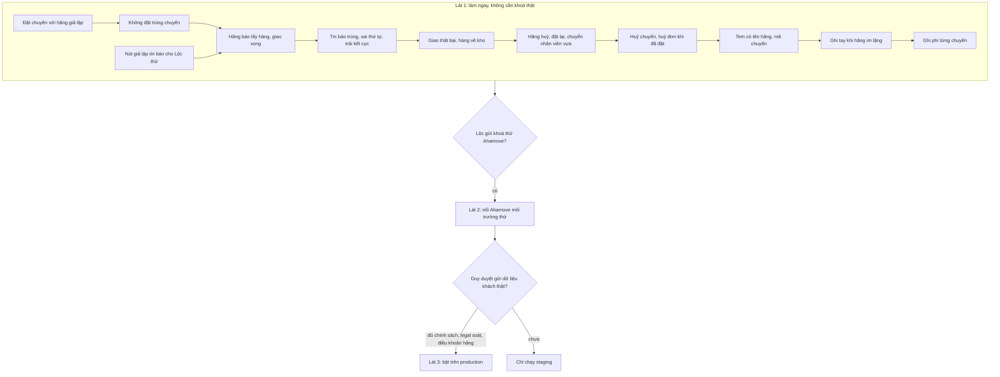

# Liên kết hãng giao hàng — User stories



> PO · 2026-11-16 · Nguồn: `01-analysis.md` (BA, **CHỜ DUYỆT**) · sheet FIX WEB dòng 10 (Lộc, "Lưu lại <2 tháng")
> Trạng thái: **NHÁP — CHỜ DUYỆT**. Viết trước khi Duy trả lời Q-1..Q-4, giả định theo phương án BA khuyên (mục 0).
> Duy duyệt `01-analysis.md` và mục 0 xong thì PO sửa lại story bị ảnh hưởng rồi mới chuyển "CHỜ DUYỆT".

## 0. Giả định đang dùng (chờ Duy chốt)

| Câu | Giả định trong bản nháp | Nếu Duy chọn khác thì story nào đổi |
|---|---|---|
| Q-1 | **Cho phép hãng ngoài**, mỗi phiếu một cách giao, **nhân viên vựa luôn là dự phòng**. Sửa BR-GH-01, ghi quyết định riêng | *Không cho hãng ngoài*: bỏ toàn bộ SHP-01..14, đóng hồ sơ. *Chỉ hãng, bỏ nhân viên vựa*: bỏ AC "chuyển nhân viên vựa" ở SHP-06, SHP-01-AC5; SHP-12 thành Won't |
| Q-2 | **Ahamove trước**, kèm **hãng giả lập** trên staging. GHTK, GHN để sau | *GHTK trước*: SHP-13 đổi sang GHTK, thêm story tem của hãng (đụng decisions 10/10 tem chỉ 4 số cuối) và story mã tỉnh/phường (phụ thuộc dòng 9 cứng hơn). Lát 1 không đổi vì lớp hãng là chung |
| Q-3 | **Cá Về chịu phí**, không thu khách (BR-BH-10 giữ). **Ghi phí từng chuyến**, Chủ + Quản lý xem. **Chưa trừ vào lãi lỗ** | *Thu phí ship của khách*: thêm story Shop + QR (ngoài hồ sơ này, cần quyết định riêng). *Trừ vào lãi lỗ*: thêm story BR-BC mới, SHP-11-AC4 đổi. *Không ghi phí*: SHP-11 thành Won't, bỏ trần phí SHP-12 |
| Q-4 | **Staging dữ liệu giả** ngay. **Production chờ** legal-vn soát + chính sách quyền riêng tư nêu tên hãng + điều khoản dữ liệu với hãng | *Duyệt production ngay*: SHP-14 vẫn giữ cờ bật nhưng bỏ điều kiện chờ legal (PO không khuyên). *Không duyệt gửi dữ liệu*: lát 2 chỉ dùng dữ liệu giả, lát 3 thành Won't |

Mặc định 🟡 khác đang theo BA: Q-5 tem của mình · Q-6 hoàn hàng về kho, phiếu hàng hoàn như cũ · Q-7 quyền đặt chuyến cho Chủ + Quản lý, trần phí là tham số · Q-8 tin hãng là nguồn chính · Q-10 không đưa link theo dõi ra Shop · Q-11 khai giá trị = tổng tiền đơn nếu hãng bắt · Q-12 **không lưu** tên, SĐT, biển số tài xế · Q-13 không lưu toạ độ · Q-14 production chờ dòng 9.

## 1. Mục tiêu & thước đo

Lộc thử trọn đường **in tem → đặt chuyến → hãng báo → giao xong (hoặc thất bại → hàng về kho)** mà không ai phải bấm tay từng bước giao.

Đo bằng:
- Trên staging, một đơn giả chạy hết luồng "giao xong" chỉ bằng thao tác của Quản lý (đặt chuyến) và tin báo của hãng; **0 bước** bấm tay của NV giao.
- 100% ca ngoài đường thuận trong bảng AC (trùng, sai thứ tự, trái kết cục, đặt hai lần, huỷ đơn, thất bại) có test tự động xanh.
- 0 dòng log, AuditLog hay bản ghi tin báo chứa tên, SĐT, địa chỉ người nhận (kiểm bằng test dò chuỗi dữ liệu giả).

## 2. Phạm vi

**Trong:** lớp "hãng giao" chung; hãng giả lập (chỉ staging, dev, test); đặt chuyến, chống trùng, huỷ chuyến; nhận tin báo qua `adapter/`; đổi trạng thái phiếu theo tin báo; giao thất bại → hàng về kho theo P-08; tem có mã chuyến; ghi tay thay hãng; ghi phí chuyến; nối Ahamove môi trường thử; cờ bật hãng trên production.

**Ngoài (theo 01-analysis §9):** phí ship trên đơn hay QR; thu hộ (COD); giao ngoài Phan Thiết; GHTK, GHN; tự chọn hãng rẻ nhất, định tuyến, ghép đơn; bản đồ tài xế; link theo dõi trên Shop; SMS/Zalo báo khách; đối soát công nợ tự động; đòi bồi thường; tem của hãng.

## 3. Bảng story

| Mã | Tiêu đề | MoSCoW | Làm | Lát | BR chính |
|---|---|---|---|---|---|
| SHP-01 | Quản lý đặt chuyến với hãng giả lập trên phiếu Chờ lấy hàng | Must | BE+FE | 1 | BR-GH-01, 30, 34, 35 |
| SHP-02 | Đặt chuyến không bao giờ tạo hai chuyến | Must | BE+FE | 1 | BR-GH-31 |
| SHP-03 | Hãng báo "đã lấy hàng", "giao thành công" → phiếu, đơn tự đổi | Must | BE | 1 | BR-GH-32, 33, 36, BR-BH-18 |
| SHP-04 | Tin báo trùng, sai thứ tự, trái kết cục không làm hỏng phiếu | Must | BE+FE | 1 | BR-GH-05, 24, 32 |
| SHP-05 | Hãng báo giao thất bại → Giao thất bại, hàng về kho | Must | BE+FE | 1 | BR-GH-04, 33, BR-HV-01..04 |
| SHP-06 | Hãng huỷ / không có tài xế / giao lại → đặt chuyến mới hoặc chuyển nhân viên vựa | Must | BE+FE | 1 | BR-GH-01, 30, 33 |
| SHP-07 | Huỷ chuyến, và huỷ đơn khi chuyến đã đặt | Must | BE+FE | 1 | BR-GH-39, 24 |
| SHP-08 | Tem in thêm tên hãng và mã chuyến | Should | BE+FE | 1 | BR-GH-34, decisions 10/10 |
| SHP-09 | Quản lý ghi tay kết quả khi hãng không báo | Should | BE+FE | 1 | BR-GH-24, 32 |
| SHP-10 | Nút giả lập tin báo của hãng trên staging để Lộc thử | Must | BE+FE | 1 | BR-GH-35 |
| SHP-11 | Ghi phí từng chuyến, chỉ Chủ và Quản lý xem | Should | BE+FE | 1 | BR-GH-37, BR-BH-10 |
| SHP-12 | Trần phí mỗi chuyến, vượt trần chỉ Chủ đặt | Could | BE+FE | 1 | BR-GH-38 |
| SHP-13 | Nối Ahamove môi trường thử | Must (khi có khoá) | BE | 2 | BR-GH-33, 34, 36 |
| SHP-14 | Bật hãng trên production chỉ khi đủ điều kiện | Must (lát 3) | BE+FE | 3 | BR-GH-35 |

Won't (bản này): GHTK, GHN · thu hộ · phí ship cho khách · link theo dõi trên Shop · lưu thông tin tài xế · báo cáo phí theo kỳ so doanh thu (Q-16) · chặn đặt theo giờ hoạt động hãng (Q-15).

## 4. Contract API dự kiến (để BE ∥ FE, Tech Lead chốt ở `02b-tech-design.md`)

Tiền tố `/api/` như router hiện có (`delivery/notes`). Khoá JSON tiếng Anh. Tiền là chuỗi Decimal VND. Giờ ISO 8601 UTC, FE hiện giờ Việt Nam.

**Mã cách giao** `delivery_method`: `staff` (nhân viên vựa) · `carrier` (hãng).
**Mã hãng** `carrier`: `mock` (hãng giả lập), `ahamove`.
**Trạng thái chuyến** `trip.status`: `REQUESTING` (đã gửi, chưa có trả lời) · `UNKNOWN` (mạng rớt, chưa rõ) · `ACCEPTED` (hãng nhận, chưa lấy hàng) · `PICKED_UP` · `DELIVERED` · `FAILED` · `CANCELLED`.
**Sự kiện hãng** `event`: `DRIVER_ASSIGNED` · `PICKED_UP` · `DELIVERED` · `FAILED` · `RETURNED` · `NO_DRIVER` · `CARRIER_CANCELLED`.
**Quyền mới (Tầng 2)**: `book_carrier_trip` (Chủ, Quản lý) · `view_carrier_fee` (Chủ, Quản lý).

### 4.1 Danh sách hãng đang bật
`GET /api/delivery/carriers/` — người có `view_deliverynote`.
```json
[{"code": "mock", "name": "Hãng giả lập", "enabled": true, "configured": true}]
```
Production khi cờ tắt: `[]`.

### 4.2 Xem phí ước tính
`POST /api/delivery/notes/{id}/carrier-quote/` — cần `book_carrier_trip`.
```json
// request
{"carrier": "mock"}
// 200
{"carrier": "mock", "estimated_fee": "25000", "eta_minutes": 45, "quote_token": "q_8f2c", "expires_at": "2026-11-20T03:15:00Z", "over_fee_cap": false}
```
Lỗi: `400 {"code":"BR-GH-30","detail":"Chỉ đặt chuyến khi phiếu ở Chờ lấy hàng."}` · `400 {"code":"CARRIER_NOT_CONFIGURED","detail":"Hãng chưa cấu hình."}` · `422 {"code":"CARRIER_REJECTED","detail":"Hãng không nhận: ngoài vùng phục vụ."}` · `503 {"code":"CARRIER_UNAVAILABLE","detail":"Không liên lạc được hãng, thử lại sau."}` · `403`.

### 4.3 Đặt chuyến
`POST /api/delivery/notes/{id}/carrier-trips/` — cần `book_carrier_trip`. Header `Idempotency-Key: <uuid do FE sinh mỗi lần mở hộp xác nhận>`.
```json
// request
{"carrier": "mock", "quote_token": "q_8f2c"}
// 201
{"id": 31, "carrier": "mock", "carrier_name": "Hãng giả lập", "trip_code": "MOCK-000031", "status": "ACCEPTED",
 "booked_at": "2026-11-20T03:05:00Z", "picked_up_at": null, "finished_at": null,
 "estimated_fee": "25000", "actual_fee": null, "extra_fee": null, "booked_by": "Quản lý A"}
```
`estimated_fee`, `actual_fee`, `extra_fee` **không có trong JSON** khi người xem thiếu `view_carrier_fee`.
Cùng `Idempotency-Key` gửi lại → `200` trả đúng chuyến cũ. Lỗi: `400 BR-GH-30` · `409 {"code":"BR-GH-31","detail":"Phiếu vừa được đặt chuyến, tải lại."}` · `422 CARRIER_REJECTED` · `202 {"status":"UNKNOWN", ...}` khi hãng không trả lời (chuyến ở "chưa rõ", hệ thống tự tra lại) · `403`.

### 4.4 Chi tiết phiếu (bổ sung field vào serializer hiện có)
```json
{"id": 12, "code": "GH-HD0001-00001", "status": "READY", "delivery_method": "carrier",
 "active_trip": { "...như 4.3..." }, "trips": [ { "...chuyến cũ, mới nhất trước..." } ],
 "needs_review": false}
```

### 4.5 Huỷ chuyến
`POST /api/delivery/notes/{id}/carrier-trips/{trip_id}/cancel/` — `book_carrier_trip`. Body `{"reason": "Khách đổi giờ"}` (≤200 ký tự, không vào AuditLog).
`200` chuyến `CANCELLED`, phiếu `READY` · `409 {"code":"TRIP_ALREADY_PICKED_UP","detail":"Tài xế đã lấy hàng, không huỷ chuyến được."}`.

### 4.6 Ghi tay thay hãng
`POST /api/delivery/notes/{id}/carrier-trips/{trip_id}/manual-result/` — `book_carrier_trip`.
```json
{"outcome": "DELIVERED" | "FAILED", "failure_reason": "NOT_MET", "note": "Hãng không báo, đã gọi tài xế xác nhận"}
```
`note` bắt buộc. `409 BR-GH-24` khi phiếu đã có kết cục.

### 4.7 Chuyển sang nhân viên vựa
Dùng lại `assign` hiện có (`assign_deliverynote`). Thêm lỗi `409 {"code":"BR-GH-01","detail":"Phiếu đang có chuyến với hãng, huỷ chuyến trước."}` khi còn chuyến `REQUESTING/UNKNOWN/ACCEPTED`.

### 4.8 Tin báo của hãng (nội bộ, adapter → Django)
Bên ngoài: hãng gọi `POST {adapter}/webhooks/carriers/{carrier}/` (xác thực theo cách của hãng). Adapter **không đụng DB**, đổi tin về dạng chung rồi gọi:
`POST /api/internal/delivery/carrier-events/` — token nội bộ như SePay.
```json
{"carrier": "mock", "trip_code": "MOCK-000031", "event_id": "evt_0007", "event": "PICKED_UP",
 "occurred_at": "2026-11-20T03:20:00Z", "carrier_reason_code": null, "actual_fee": null}
```
`200 {"result": "applied" | "duplicate" | "ignored_stale" | "needs_review"}` · `404 {"code":"UNKNOWN_TRIP"}` (adapter trả 4xx cho hãng, không thử lại) · `401` token sai · `5xx` → adapter trả 5xx để hãng gửi lại.
Tin không chứa và Django không nhận tên, SĐT, địa chỉ. Adapter bỏ các field đó trước khi chuyển.

### 4.9 Giả lập tin báo (chỉ staging/dev)
`POST /api/delivery/mock-carrier/trips/{trip_id}/events/` — `book_carrier_trip`, chỉ khi `CARRIER_MOCK_ENABLED=1`; tắt thì `404`.
```json
{"event": "DELIVERED", "carrier_reason_code": null, "actual_fee": "27000"}
```
Đi qua **cùng hàm xử lý** với 4.8 (không có đường tắt). `200` như 4.8.

### 4.10 Danh sách cần Quản lý xem
`GET /api/delivery/carrier-reviews/?resolved=false` — Chủ, Quản lý.
```json
[{"id": 5, "note_code": "GH-HD0001-00001", "trip_code": "MOCK-000031", "event": "RETURNED", "kind": "CONFLICT_WITH_OUTCOME", "received_at": "2026-11-20T04:00:00Z"}]
```
`kind`: `CONFLICT_WITH_OUTCOME` · `ORDER_CANCELLED` · `CANCEL_FAILED` · `TRIP_OVERDUE` · `UNKNOWN_BOOKING`.
`POST /api/delivery/carrier-reviews/{id}/resolve/` body `{"note": "..."}`.

---

## SHP-01 — Quản lý đặt chuyến với hãng giả lập trên phiếu Chờ lấy hàng · Must · BE+FE · Lát 1

**Là** Quản lý, **tôi muốn** chọn "Hãng giao", xem phí ước tính rồi đặt chuyến ngay trên phiếu giao, **để** không phải gọi điện đặt xe và gán tay.
Bối cảnh: UC-1 luồng chính, A2, E1, E5. Dựng **lớp hãng chung** (giao diện hãng: ước phí, đặt, huỷ, tra lại) + **hãng giả lập** trả mã chuyến `MOCK-xxxxxx` ngay. Phiếu giữ Chờ lấy hàng sau khi đặt. Lý do Must: không có thì không có luồng nào chạy.

| Mã | Given | When | Then | BR |
|---|---|---|---|---|
| SHP-01-AC1 | Phiếu ở Chờ lấy hàng, đơn đã thanh toán, hãng giả lập bật, Quản lý đăng nhập | Quản lý chọn "Hãng giao → Hãng giả lập", xem phí, bấm "Đặt chuyến" | Phiếu có `delivery_method=carrier`, một chuyến `ACCEPTED` có `trip_code`, trạng thái phiếu vẫn `READY`, `assigned_to` trống, tồn kho không đổi; AuditLog `delivery_book_carrier_trip` ghi người bấm, mã phiếu, mã chuyến, **không** có địa chỉ/SĐT | BR-GH-01, BR-GH-30, BR-PQ-04 |
| SHP-01-AC2 | Như AC1 | Hãng giả lập nhận yêu cầu đặt | Dữ liệu gửi cho hãng **chỉ** gồm: tên, SĐT, địa chỉ người nhận, ghi chú đã lọc dãy số dài, số kiện, khối lượng, loại hàng "Hải sản đông lạnh", thu hộ = 0; **không** có giá vốn, danh sách món kèm giá, mã khách (test so khoá của payload với danh sách cho phép) | BR-GH-34, bất biến 1, 9 |
| SHP-01-AC3 (lỗi) | Phiếu ở Đang soạn hàng, Đang giao, Đã giao hoặc Đã huỷ | Gọi đặt chuyến | `400 BR-GH-30`, không tạo chuyến, không gọi hãng | BR-GH-30 |
| SHP-01-AC4 (lỗi) | Hãng giả lập đặt chế độ "từ chối: ngoài vùng" | Quản lý đặt chuyến | `422 CARRIER_REJECTED` thông điệp tiếng Việt, không lưu chuyến, phiếu giữ Chờ lấy hàng, nút "Giao cho nhân viên vựa" vẫn dùng được | UC-1 E1 |
| SHP-01-AC5 (lỗi) | Hãng tắt hoặc chưa cấu hình khoá | Quản lý mở phiếu Chờ lấy hàng | Không có lựa chọn "Hãng giao", chỉ còn "Nhân viên vựa"; gọi thẳng API → `400 CARRIER_NOT_CONFIGURED` | UC-1 E5, BR-GH-01 |
| SHP-01-AC6 (quyền) | NV kho, NV giao, Nhân viên gọi xác nhận đăng nhập (không có `book_carrier_trip`) | Gọi `carrier-quote` hoặc `carrier-trips` | `403`, không tạo chuyến; ERP không hiện nút "Đặt chuyến" | BR-PQ, Q-7 |
| SHP-01-AC7 (dữ liệu cá nhân) | Phiếu giao bằng hãng, NV giao nội bộ đăng nhập | Mở "Việc giao của tôi" và gọi chi tiết phiếu đó | Phiếu không có trong danh sách; chi tiết trả `404`; không thấy tên, SĐT, địa chỉ | BR-GH-18, bất biến 9 |
| SHP-01-AC8 (dữ liệu cá nhân) | Đặt chuyến chạy xong (thành công và thất bại) | Dò log ứng dụng trong test | Không có chuỗi tên, SĐT, địa chỉ giả của đơn; chỉ có mã phiếu, mã chuyến, mã lỗi | BR-GH-36 |

Ghi chú dev: hãng giả lập có chế độ trả lời cấu hình được trong test (nhận, từ chối, không trả lời) để phục vụ SHP-01-AC4 và SHP-02. Model chuyến mới: chỉ thêm, không xoá, đóng bằng trạng thái (bất biến 3, 8).

## SHP-02 — Đặt chuyến không bao giờ tạo hai chuyến · Must · BE+FE · Lát 1

**Là** Chủ vựa, **tôi muốn** mỗi phiếu chỉ có một chuyến đang hiệu lực dù bấm lại hay mạng rớt, **để** không trả hai lần cước và không có hai tài xế tới kho.
Bối cảnh: UC-1 E2, E3. Lý do Must: rủi ro tiền "Cao" ở 01 §8.

| Mã | Given | When | Then | BR |
|---|---|---|---|---|
| SHP-02-AC1 | Phiếu Chờ lấy hàng | Gửi hai lần đặt chuyến với **cùng** `Idempotency-Key` | Lần 2 trả `200` đúng chuyến lần 1; hãng giả lập chỉ nhận **1** yêu cầu đặt | BR-GH-31 |
| SHP-02-AC2 (đặt hai lần) | Hai Quản lý cùng mở phiếu | Gửi đồng thời hai yêu cầu đặt với hai `Idempotency-Key` khác nhau | Đúng 1 chuyến được tạo; yêu cầu còn lại `409 BR-GH-31` "Phiếu vừa được đặt chuyến, tải lại."; hãng nhận 1 yêu cầu (test đua chạy trên Postgres ở CI) | BR-GH-31, BR-GH-30 |
| SHP-02-AC3 (mạng rớt) | Hãng giả lập đặt chế độ "nhận nhưng không trả lời" | Quản lý đặt chuyến | Trả `202`, chuyến `UNKNOWN`, phiếu không cho đặt chuyến mới (`409`); hệ thống tra lại hãng theo mã tham chiếu của phiếu: hãng có chuyến → `ACCEPTED`, không có → `CANCELLED` và cho đặt lại | BR-GH-31, UC-1 E2 |
| SHP-02-AC4 (lỗi) | Chuyến `UNKNOWN` quá thời gian tra lại (tham số) | Job tra lại chạy | Đưa vào danh sách cần xem `UNKNOWN_BOOKING`; không tự đặt chuyến mới | BR-GH-31 |
| SHP-02-AC5 (FE) | Quản lý bấm "Đặt chuyến" | Bấm thêm 2 lần liên tiếp trong lúc chờ | Nút khoá ngay lần đầu, chỉ 1 request rời trình duyệt (Playwright đếm request) | BR-GH-31 |
| SHP-02-AC6 (quyền) | NV kho | Gửi lại request đặt với `Idempotency-Key` của Quản lý | `403`, không trả thông tin chuyến | BR-PQ |

## SHP-03 — Hãng báo "đã lấy hàng", "giao thành công" → phiếu, đơn tự đổi · Must · BE · Lát 1

**Là** Quản lý, **tôi muốn** phiếu tự sang Đang giao rồi Đã giao theo tin báo của hãng, **để** không ai phải bấm tay và đơn tự hoàn tất.
Bối cảnh: UC-2 luồng chính, E5, E6. Cổng mới ở `adapter/` (mỏng, không đụng DB), contract 4.8. Lát 1 chỉ có cổng cho hãng giả lập; SHP-10 bắn tin qua cùng hàm xử lý.

| Mã | Given | When | Then | BR |
|---|---|---|---|---|
| SHP-03-AC1 | Phiếu `READY`, chuyến `ACCEPTED` | Nhận sự kiện `DRIVER_ASSIGNED` | Chuyến ghi nhận, phiếu vẫn `READY`; **không lưu** tên, SĐT, biển số tài xế | BR-GH-33, Q-12 |
| SHP-03-AC2 | Như trên | Nhận `PICKED_UP` lúc T | Phiếu `DELIVERING`, `delivery_started_at = T` (giờ hãng báo, không phải giờ nhận tin); chuyến `PICKED_UP`; AuditLog `delivery_advance_status` người làm = Hệ thống, nguồn = hãng, mã chuyến | BR-GH-32, 33, BR-PQ-05 |
| SHP-03-AC3 | Phiếu `DELIVERING`, là phiếu cuối của đơn | Nhận `DELIVERED` | Phiếu `COMPLETED`, `completed_at` = giờ hãng báo; đơn hoàn tất; `actual_fee` lưu nếu tin có | BR-BH-18, BR-GH-33 |
| SHP-03-AC4 (lỗi) | Đơn có 2 phiếu, phiếu kia chưa giao | Nhận `DELIVERED` cho phiếu này | Phiếu `COMPLETED`, đơn **chưa** hoàn tất | BR-BH-18 |
| SHP-03-AC5 (xác thực) | Tin đến adapter sai chữ ký/khoá của hãng | Adapter nhận | Trả 401 cho hãng, không gọi Django; log chỉ ghi tên hãng + "sai chữ ký", **không** ghi nội dung tin | BR-GH-32, 36 |
| SHP-03-AC6 (lỗi) | Mã chuyến lạ | Django nhận tin | `404 UNKNOWN_TRIP`, không đổi dữ liệu; adapter trả 4xx cho hãng | UC-2 E5 |
| SHP-03-AC7 (lỗi) | Django tạm lỗi (5xx/timeout) | Adapter chuyển tin | Adapter trả 5xx cho hãng để hãng gửi lại; log adapter **không** chép thân phản hồi của Django | UC-2 E6, BR-GH-36 |
| SHP-03-AC8 (quyền) | Gọi `/api/internal/delivery/carrier-events/` bằng token JWT của Chủ hoặc không token | Gửi tin hợp lệ | `401/403`, chỉ token nội bộ của adapter được nhận | BR-PQ |
| SHP-03-AC9 (dữ liệu cá nhân) | Tin của hãng kèm tên, SĐT, địa chỉ người nhận (payload giả) | Adapter chuyển, Django lưu dấu vết tin | Body gửi Django và bản ghi tin chỉ có mã chuyến, mã sự kiện, trạng thái, thời điểm, mã lý do, phí; dò log không thấy chuỗi dữ liệu giả | BR-GH-36, bất biến 9 |

## SHP-04 — Tin báo trùng, sai thứ tự, trái kết cục không làm hỏng phiếu · Must · BE+FE · Lát 1

**Là** Quản lý, **tôi muốn** hệ thống bỏ qua tin trùng, không lùi trạng thái và không ghi đè kết cục đã có, **để** phiếu Đã giao không tự quay lại và tôi thấy ngay ca lạ cần xử lý.
Bối cảnh: UC-2 E1–E4, contract 4.10. FE: thẻ "Cần xem (hãng giao)" trên màn phiếu và danh sách, nút "Đã xử lý".

| Mã | Given | When | Then | BR |
|---|---|---|---|---|
| SHP-04-AC1 (trùng) | Đã xử lý `PICKED_UP` với `event_id=evt_7` | Nhận lại `evt_7` (gửi lại 3 lần) | Trả `duplicate`, phiếu, `delivery_started_at`, AuditLog không đổi (vẫn 1 dòng) | BR-GH-32 |
| SHP-04-AC2 (trùng nội dung, khác id) | Phiếu đã `DELIVERING` | Nhận `PICKED_UP` mới với `event_id` khác | Trả `ignored_stale`, `delivery_started_at` không đổi | BR-GH-32 |
| SHP-04-AC3 (sai thứ tự) | Phiếu `READY`, chưa nhận `PICKED_UP` | Nhận `DELIVERED` trước, sau đó `PICKED_UP` | Sau tin 1: phiếu `COMPLETED`, `delivery_started_at` = giờ `DELIVERED` nếu trống; tin 2 `ignored_stale`, phiếu vẫn `COMPLETED` | BR-GH-05, 32 |
| SHP-04-AC4 (trái kết cục) | Phiếu `COMPLETED` | Nhận `RETURNED` hoặc `FAILED` | Phiếu giữ `COMPLETED`, đơn giữ hoàn tất; tạo mục cần xem `CONFLICT_WITH_OUTCOME`; trả `needs_review` | BR-GH-05, 24 |
| SHP-04-AC5 (trái thao tác tay) | Quản lý đã ghi tay `FAILED` (SHP-09) | Hãng báo `DELIVERED` sau | Phiếu giữ `FAILED`, mục cần xem `CONFLICT_WITH_OUTCOME` | BR-GH-24 |
| SHP-04-AC6 (đơn đã huỷ) | Đơn đã huỷ, phiếu `CANCELLED` | Nhận `PICKED_UP` | Phiếu không đổi, mục cần xem `ORDER_CANCELLED` | BR-GH-24, UC-2 E4 |
| SHP-04-AC7 (FE) | Có 1 mục cần xem chưa xử lý | Quản lý mở danh sách phiếu ở 360 px và 1280 px | Thấy thẻ "Cần xem (hãng giao)" có mã phiếu, mã chuyến, loại; bấm "Đã xử lý" + ghi chú → mục biến mất | |
| SHP-04-AC8 (quyền) | NV kho, NV giao, Nhân viên gọi xác nhận | Gọi `carrier-reviews` hoặc `resolve` | `403` | BR-PQ |

## SHP-05 — Hãng báo giao thất bại → Giao thất bại, hàng về kho · Must · BE+FE · Lát 1

**Là** Quản lý, **tôi muốn** phiếu tự sang Giao thất bại với lý do đã đổi về lý do của vựa, rồi kho nhận hàng về theo lô gốc, **để** xử lý hàng hoàn như hiện nay mà giờ ngoài lạnh tính đúng.
Bối cảnh: UC-3, UC-2 A1. Không tự nhập kho theo tin báo; kho vẫn tạo phiếu hàng hoàn, Quản lý/Chủ duyệt.

| Mã | Given | When | Then | BR |
|---|---|---|---|---|
| SHP-05-AC1 | Phiếu `DELIVERING`, `failed_attempts=0` | Nhận `FAILED` mã lý do hãng "không liên lạc được người nhận" | Phiếu `FAILED`, `failed_attempts=1`, `failure_reason=NOT_MET` theo bảng map; chuyến `FAILED` | BR-GH-33, BR-GH-04 |
| SHP-05-AC2 (map không được) | Như trên | Nhận `FAILED` mã lý do lạ `X99` | `failure_reason=OTHER`, `failure_note` = "Mã hãng: X99" (chỉ mã, không chép chữ tự do của hãng) | BR-GH-33, 36 |
| SHP-05-AC3 (lần 2) | Phiếu đã thất bại 1 lần, giao lại bằng chuyến mới | Nhận `FAILED` lần nữa | `failed_attempts=2`, nhắc Quản lý/Chủ như luồng tay hiện có | BR-GH-04 |
| SHP-05-AC4 (hàng về kho) | Phiếu `FAILED` do hãng, `PICKED_UP` lúc T1 | NV kho nhận hàng về, tạo phiếu hàng hoàn lúc T2 | Phiếu hàng hoàn `Chờ duyệt` theo từng lô gốc; giờ ngoài lạnh = T2 − T1 (giờ hãng báo lấy hàng) | BR-HV-01, BR-HV-03 (sửa nguồn giờ) |
| SHP-05-AC5 | Phiếu hàng hoàn của SHP-05-AC4 | Quản lý duyệt Tái nhập / Huỷ bỏ | Như luồng hiện tại: Tái nhập cộng đúng lô gốc; Huỷ bỏ ghi lỗ; tồn chỉ đổi **một lần** | BR-HV-02 |
| SHP-05-AC6 (lỗi) | Lô gốc đã chốt | Tạo phiếu hàng hoàn | Bị chặn như hiện nay, thông điệp BR-HV-04 | BR-HV-04 |
| SHP-05-AC7 (không cộng kho hai lần) | Phiếu `FAILED` do hãng | Nhận thêm `RETURNED` | Không tạo phiếu hàng hoàn tự động, không đổi tồn; chuyến ghi "đang hoàn về" | BR-HV-02 |
| SHP-05-AC8 (quyền) | NV giao nội bộ | Tạo phiếu hàng hoàn cho phiếu giao bằng hãng | `403`/`404` (không thuộc phạm vi của mình); NV kho làm được | BR-PQ, BR-GH-18 |

## SHP-06 — Hãng huỷ / không có tài xế / giao lại → đặt chuyến mới hoặc chuyển nhân viên vựa · Must · BE+FE · Lát 1

**Là** Quản lý, **tôi muốn** khi hãng không tìm được tài xế hoặc giao thất bại thì đặt chuyến mới hoặc chuyển cho nhân viên vựa, **để** khách vẫn nhận hàng trong giờ đã hứa.
Bối cảnh: UC-2 A2, UC-4. Phụ thuộc Q-1 (nhân viên vựa là dự phòng).

| Mã | Given | When | Then | BR |
|---|---|---|---|---|
| SHP-06-AC1 | Chuyến `ACCEPTED`, chưa lấy hàng | Nhận `NO_DRIVER` hoặc `CARRIER_CANCELLED` | Chuyến `CANCELLED`, phiếu giữ `READY`, `active_trip` = null; Quản lý thấy nhắc "Hãng huỷ chuyến, đặt lại hoặc giao nhân viên vựa" | BR-GH-33 |
| SHP-06-AC2 | Phiếu như AC1 | Quản lý đặt chuyến mới | Chuyến mới `ACCEPTED`; chuyến cũ vẫn trong `trips` (không xoá) | BR-GH-30, bất biến 3 |
| SHP-06-AC3 | Phiếu như AC1 | Quản lý "Giao cho nhân viên vựa" chọn NV giao | `delivery_method=staff`, `assigned_to` = NV đó; NV đó thấy phiếu trong "Việc giao của tôi"; luồng tay chạy như cũ | BR-GH-01 |
| SHP-06-AC4 (giao lại) | Phiếu `FAILED` do hãng, đơn chưa huỷ | Quản lý chọn "Giao lại bằng hãng" | Chuyến cũ giữ `FAILED`, chuyến mới tạo; phiếu `READY` chờ tài xế lấy (hoặc theo 02b); chỉ 1 chuyến hiệu lực | BR-GH-30, UC-4 |
| SHP-06-AC5 (lỗi) | Phiếu còn chuyến `ACCEPTED` | Quản lý gán nhân viên vựa | `409 BR-GH-01` "Phiếu đang có chuyến với hãng, huỷ chuyến trước." | BR-GH-01 |
| SHP-06-AC6 (lỗi) | Phiếu `FAILED`, `failed_attempts` ≥ `DELIVERY_MAX_FAILED_ATTEMPTS` | Quản lý giao lại | Hiện cảnh báo "Đã thất bại N lần", phải xác nhận lần nữa; Quản lý hoặc Chủ mới bấm được | BR-GH-04, UC-4 E1 |
| SHP-06-AC7 (quyền) | NV kho, NV giao | Gọi đặt chuyến mới cho phiếu `FAILED` | `403` | Q-7 |

## SHP-07 — Huỷ chuyến, và huỷ đơn khi chuyến đã đặt · Must · BE+FE · Lát 1

**Là** Quản lý, **tôi muốn** huỷ chuyến với hãng khi chưa lấy hàng, và khi đơn bị huỷ thì hệ thống tự huỷ chuyến, **để** không trả cước cho chuyến không cần và tài xế không tới lấy hàng của đơn đã huỷ.
Bối cảnh: UC-5, BR-GH-39, UC-1 E4. Đã lấy hàng thì theo hồ sơ `2026-10-01-huy-don-dang-giao`.

| Mã | Given | When | Then | BR |
|---|---|---|---|---|
| SHP-07-AC1 | Chuyến `ACCEPTED` | Quản lý bấm "Huỷ chuyến", nhập lý do | Hãng giả lập nhận lệnh huỷ; chuyến `CANCELLED`, phiếu `READY`; AuditLog `delivery_cancel_carrier_trip` không chép lý do tự do | BR-GH-30 |
| SHP-07-AC2 (huỷ đơn khi đã đặt) | Đơn chưa giao, phiếu `READY`, chuyến `ACCEPTED` | Huỷ đơn theo luồng huỷ hiện có | Cùng thao tác: chuyến được huỷ với hãng, `CANCELLED`; phiếu `CANCELLED` theo đơn | BR-GH-39, BR-GH-07 |
| SHP-07-AC3 (hãng không huỷ được) | Như AC2, hãng giả lập trả lỗi khi huỷ | Huỷ đơn | Đơn vẫn huỷ thành công; chuyến giữ trạng thái cũ; mục cần xem `CANCEL_FAILED` để Quản lý gọi hãng | BR-GH-39, UC-5 E2 |
| SHP-07-AC4 (đã lấy hàng) | Chuyến `PICKED_UP` | Quản lý bấm huỷ chuyến | `409 TRIP_ALREADY_PICKED_UP`; huỷ đơn đi theo luồng huỷ đơn đang giao | UC-5 E1 |
| SHP-07-AC5 (đơn huỷ giữa chừng) | Đơn bị huỷ ngay trước khi lệnh đặt chuyến tới | Đặt chuyến | `400 BR-GH-24`/`BR-GH-30`, không gọi hãng; nếu hãng đã nhận trong lúc đua thì hệ thống huỷ chuyến ngay | BR-GH-24, UC-1 E4 |
| SHP-07-AC6 (phí huỷ) | Hãng tính phí huỷ | Huỷ chuyến | `extra_fee` lưu trên chuyến, chỉ người có `view_carrier_fee` thấy | BR-GH-37 |
| SHP-07-AC7 (quyền) | NV kho, NV giao, Nhân viên gọi xác nhận | Gọi `cancel` | `403`, chuyến không đổi | BR-PQ |

## SHP-08 — Tem in thêm tên hãng và mã chuyến · Should · BE+FE · Lát 1

**Là** NV kho, **tôi muốn** tem có tên hãng và mã chuyến, **để** bàn giao đúng thùng cho đúng tài xế.
Bối cảnh: bước 4 mục 3.3, Q-5 (tem của mình). Should: luồng chạy được mà không có, nhưng Lộc yêu cầu thử "in tem" nên làm trong lát 1.

| Mã | Given | When | Then | BR |
|---|---|---|---|---|
| SHP-08-AC1 | Phiếu có chuyến `ACCEPTED` | NV kho in tem | Tem có "Hãng giả lập" + `MOCK-000031`; vẫn có mã phiếu, mã đơn, SĐT **chỉ 4 số cuối**, "ĐÃ THANH TOÁN – không thu thêm" (ảnh 100×150 mm) | decisions 10/10, BR-GH-34 |
| SHP-08-AC2 | In tem trước khi đặt chuyến, sau đó đặt chuyến | Mở lại tem | Màn phiếu nhắc "Tem chưa có mã chuyến, in lại"; in lại thì tem cũ mất hiệu lực như luật hiện có | |
| SHP-08-AC3 (lỗi) | Phiếu giao bằng nhân viên vựa | In tem | Tem như hiện nay, không có dòng hãng | |
| SHP-08-AC4 (quyền) | NV giao nội bộ | Gọi in tem phiếu giao bằng hãng | `403`/`404` | BR-GH-18 |

## SHP-09 — Quản lý ghi tay kết quả khi hãng không báo · Should · BE+FE · Lát 1

**Là** Quản lý, **tôi muốn** ghi tay Đã giao hoặc Giao thất bại kèm lý do khi hãng im lặng, **để** đơn không treo mãi.
Bối cảnh: UC-6, Q-8. Should: có SHP-10 thì staging vẫn thử được; cần cho production.

| Mã | Given | When | Then | BR |
|---|---|---|---|---|
| SHP-09-AC1 | Chuyến `PICKED_UP` quá `eta_minutes` + ngưỡng (tham số) không có tin | Job kiểm chạy | Mục cần xem `TRIP_OVERDUE` | UC-6 |
| SHP-09-AC2 | Như AC1 | Quản lý ghi tay `DELIVERED` + ghi chú | Phiếu `COMPLETED`, đơn hoàn tất nếu phiếu cuối; AuditLog ghi "ghi tay thay hãng", người bấm | BR-GH-32, BR-BH-18 |
| SHP-09-AC3 (lỗi) | Như AC1 | Ghi tay không có ghi chú | `400`, không đổi | UC-6 |
| SHP-09-AC4 (lỗi) | Phiếu đã `COMPLETED` | Ghi tay `FAILED` | `409 BR-GH-24` | BR-GH-05, 24 |
| SHP-09-AC5 (quyền) | NV kho, NV giao | Gọi `manual-result` | `403` | BR-PQ |

## SHP-10 — Nút giả lập tin báo của hãng trên staging để Lộc thử · Must · BE+FE · Lát 1

**Là** Lộc (Chủ) trên staging, **tôi muốn** bấm giả lập từng tin của hãng (đã lấy hàng, giao xong, thất bại, không có tài xế), **để** thử trọn luồng in tem → giao xong khi chưa có khoá Ahamove.
Bối cảnh: UC-7. Must: đây chính là yêu cầu "test tiếp" của dòng 10.

| Mã | Given | When | Then | BR |
|---|---|---|---|---|
| SHP-10-AC1 | Staging, `CARRIER_MOCK_ENABLED=1`, phiếu có chuyến giả lập | Chủ bấm lần lượt "Tài xế đã lấy hàng" → "Giao thành công" | Phiếu `DELIVERING` → `COMPLETED`, đơn hoàn tất; kết quả giống hệt khi tin đi qua adapter (cùng hàm, test so AuditLog) | BR-GH-32, UC-7 |
| SHP-10-AC2 | Như trên | Bấm "Giao thất bại" chọn mã lý do, rồi "Không có tài xế" ở chuyến mới | Kết quả như SHP-05-AC1 và SHP-06-AC1 | BR-GH-33 |
| SHP-10-AC3 (lỗi) | Build/cấu hình production (`CARRIER_MOCK_ENABLED` không đặt) | Mở phiếu và gọi API 4.9 | Không có khối nút giả lập; API `404`; `GET /carriers/` không có `mock` | BR-GH-35 |
| SHP-10-AC4 (quyền) | NV kho trên staging | Gọi API 4.9 | `403` | BR-PQ |
| SHP-10-AC5 (dữ liệu giả) | Seed staging cho thử | Tạo đơn thử | Tên, SĐT, địa chỉ là dữ liệu giả (SĐT dạng `09000000xx`), không lấy từ production | BR-GH-35, bất biến 9 |
| SHP-10-AC6 (e2e) | Staging-like local | Chạy e2e "đặt đơn → gọi xác nhận → soạn → in tem → đặt chuyến giả lập → giả lập lấy hàng → giao xong" | Xanh trong `run_shop_e2e.py`, có ảnh 360 + 1280 màn phiếu | UC-7 |

## SHP-11 — Ghi phí từng chuyến, chỉ Chủ và Quản lý xem · Should · BE+FE · Lát 1

**Là** Chủ vựa, **tôi muốn** thấy phí ước tính, phí thực tế, phí huỷ/hoàn của từng chuyến và tổng theo kỳ, **để** đối soát với hãng hằng tháng.
Bối cảnh: Q-3 (Cá Về chịu, chưa vào lãi lỗ), BR-GH-37. Should: không chặn luồng giao.

| Mã | Given | When | Then | BR |
|---|---|---|---|---|
| SHP-11-AC1 | Chuyến có `estimated_fee=25000`, tin `DELIVERED` kèm `actual_fee=27000` | Chủ mở phiếu | Thấy cả hai số, định dạng "25.000 đ" | BR-GH-37 |
| SHP-11-AC2 | Có 3 chuyến trong tháng 11 (1 giao xong, 1 huỷ có phí, 1 thất bại) | Chủ mở "Phí giao theo kỳ" chọn tháng 11 | Tổng = tổng `actual_fee` (hoặc `estimated_fee` khi chưa có thực tế, có ghi chú) + `extra_fee`; số chuyến 3 | BR-GH-37 |
| SHP-11-AC3 (khách không bị thu) | Đơn giao bằng hãng | Xem tổng tiền đơn, QR, trang đơn Shop | Không có dòng phí giao; tổng không đổi | BR-BH-10 |
| SHP-11-AC4 (lãi lỗ không đổi) | Có chuyến với phí | Chạy báo cáo lãi lỗ lô và lãi lỗ kỳ | Số không đổi so với trước khi có chuyến | BR-BC-01..04, Q-3 |
| SHP-11-AC5 (quyền) | NV kho, NV giao, Nhân viên gọi xác nhận | Gọi chi tiết phiếu và chuyến | JSON **không có** khoá `estimated_fee`, `actual_fee`, `extra_fee`; màn không hiện phí | BR-PQ, Q-7 |
| SHP-11-AC6 (công khai) | Khách chưa đăng nhập | Tra đơn trên Shop | Không có phí chuyến, mã chuyến, tên hãng | bất biến 9, Q-10 |

## SHP-12 — Trần phí mỗi chuyến, vượt trần chỉ Chủ đặt · Could · BE+FE · Lát 1

**Là** Chủ vựa, **tôi muốn** đặt trần phí mỗi chuyến, **để** Quản lý không đặt chuyến quá đắt giờ cao điểm mà tôi không biết.
Bối cảnh: BR-GH-38, Q-7. Could: lát đầu khối lượng nhỏ, Lộc tự theo dõi được qua SHP-11.

| Mã | Given | When | Then | BR |
|---|---|---|---|---|
| SHP-12-AC1 | Trần `CARRIER_FEE_CAP_VND=50000`, phí ước tính 60.000 | Quản lý xem phí | `over_fee_cap=true`, nút đặt khoá, chữ "Vượt trần 50.000 đ, cần Chủ đặt hoặc giao nhân viên vựa" | BR-GH-38 |
| SHP-12-AC2 (quyền) | Như AC1 | Quản lý gọi thẳng API đặt | `403 BR-GH-38` | BR-GH-38 |
| SHP-12-AC3 | Như AC1 | Chủ đặt | Thành công | BR-GH-38 |
| SHP-12-AC4 (lỗi) | Phí đúng bằng 50.000 | Quản lý đặt | Thành công (trần tính "lớn hơn") | BR-GH-38 |

## SHP-13 — Nối Ahamove môi trường thử · Must (khi Lộc có khoá) · BE · Lát 2

**Là** Lộc, **tôi muốn** đặt chuyến thật với môi trường thử của Ahamove, **để** biết luồng chạy với hãng thật trước khi mở bán.
Bối cảnh: UC-7 luồng thay thế, Q-2, Q-13. Viết thêm một "hãng" vào lớp chung (ước phí, đặt, huỷ, tra lại) + cổng webhook Ahamove ở adapter, đổi tin về contract 4.8. FE không đổi (danh sách hãng tự có "Ahamove"). **Bị chặn** đến khi Lộc gửi khoá thử; không đổi được nếu tài liệu Ahamove bắt toạ độ (Q-13 → hỏi lại Duy).

| Mã | Given | When | Then | BR |
|---|---|---|---|---|
| SHP-13-AC1 | Staging có khoá thử Ahamove trong Secret Manager | Quản lý đặt chuyến "Ahamove" với đơn giả | Nhận mã chuyến của Ahamove, phí ước tính; thu hộ gửi = 0 | BR-GH-34 |
| SHP-13-AC2 | Ahamove thử bắn webhook các trạng thái | Adapter nhận | Mỗi trạng thái Ahamove đổi đúng theo bảng map BR-GH-33 (bảng map đặt trong 02b, test từng dòng) | BR-GH-33 |
| SHP-13-AC3 (lỗi) | Khoá thử sai/hết hạn | Mở phiếu | "Ahamove" ẩn hoặc báo "Hãng chưa cấu hình"; hãng giả lập và nhân viên vựa vẫn dùng được | UC-7 E1 |
| SHP-13-AC4 (xác thực) | Webhook giả mạo (sai chữ ký Ahamove) | Adapter nhận | 401, không gọi Django, log không có nội dung tin | BR-GH-32, 36 |
| SHP-13-AC5 (dữ liệu cá nhân) | Webhook Ahamove kèm tên, SĐT tài xế, người nhận | Adapter chuyển | Django không nhận các field đó; không lưu thông tin tài xế | BR-GH-36, Q-12 |
| SHP-13-AC6 (chống trùng với hãng) | Mạng rớt khi đặt Ahamove | Tra lại | Dùng mã tham chiếu của phiếu gửi kèm lúc đặt để tra; không tạo chuyến thứ hai | BR-GH-31 |
| SHP-13-AC7 (khoá) | Khoá thử | Kiểm repo, log, `doc/` | Không có khoá trong code, `.env` commit hay log | luật repo |

## SHP-14 — Bật hãng trên production chỉ khi đủ điều kiện · Must (lát 3) · BE+FE · Lát 3

**Là** Duy, **tôi muốn** hãng ngoài trên production chỉ bật bằng một cờ cấu hình mà tôi duyệt, **để** không gửi dữ liệu khách thật cho hãng khi chưa đủ pháp lý.
Bối cảnh: BR-GH-35, Q-4, Q-14. Điều kiện bật (không phải việc code): Duy duyệt; chính sách quyền riêng tư (CMS) nêu tên Ahamove; legal-vn soát (gồm mục 6b nếu máy chủ hãng ở nước ngoài); Lộc có điều khoản dữ liệu với hãng; dòng 9 (địa chỉ có cấu trúc) xong.

| Mã | Given | When | Then | BR |
|---|---|---|---|---|
| SHP-14-AC1 | Production, cờ `CARRIER_AHAMOVE_ENABLED` chưa đặt | Quản lý mở phiếu, gọi `carriers` và đặt chuyến | Không có hãng; API đặt `400 CARRIER_NOT_CONFIGURED`; không có request ra Ahamove | BR-GH-35 |
| SHP-14-AC2 | Production, cờ bật, khoá thật | Đặt chuyến | Chạy như SHP-13 | BR-GH-01 |
| SHP-14-AC3 (lỗi) | Production | Đặt `CARRIER_MOCK_ENABLED=1` | Ứng dụng không khởi động hoặc bỏ qua cờ và ghi cảnh báo (Tech Lead chọn) — hãng giả lập không bao giờ chạy trên production | BR-GH-35 |
| SHP-14-AC4 (công khai) | Production | Khách tra đơn | Không có link theo dõi hãng, tên hãng, mã chuyến | Q-10, bất biến 9 |
| SHP-14-AC5 (doc) | Trước khi bật | Kiểm hồ sơ | Có quyết định mới trong `doc/decisions.md` (Q-1..Q-4), spec P-06/P-08 và URD đã sửa, `0X-phap-ly.md` APPROVED | |

---

## 5. Thứ tự làm đề xuất

**Lát 1 (làm ngay, không cần khoá):**
1. **SHP-01** — dựng lớp hãng chung + hãng giả lập + model chuyến; mọi story sau dựa vào đây.
2. **SHP-02** — chống trùng phải có ngay từ đầu, sửa sau tốn hơn.
3. **SHP-03 ∥ SHP-10** — BE làm xử lý tin + adapter; FE làm khối nút giả lập theo contract 4.9 (mock).
4. **SHP-04** — siết xử lý tin trước khi thêm nhánh thất bại.
5. **SHP-05 → SHP-06 → SHP-07** — nhánh thất bại, đặt lại, huỷ.
6. **SHP-08**, **SHP-09**, **SHP-11** (song song được, ít đụng nhau), **SHP-12** nếu còn thời gian.
→ Mốc lát 1: Lộc thử trên staging trọn "in tem → giao xong" và "thất bại → hàng về kho" (SHP-10-AC6).

**Lát 2:** **SHP-13** khi Lộc gửi khoá thử Ahamove.
**Lát 3:** **SHP-14** khi đủ điều kiện Q-4 và dòng 9.

BE ∥ FE: FE dựng mock theo mục 4 ngay sau khi Tech Lead chốt 02b; BE đi theo thứ tự trên.

## 6. Rủi ro / phụ thuộc

- `01-analysis.md` chưa duyệt; mọi giả định mục 0 có thể đổi story.
- Ahamove ở Phan Thiết **chưa xác minh** nhận hải sản cấp đông → lát 2, 3 có thể hủy nếu hãng không nhận.
- Ahamove có thể bắt toạ độ (Q-13) → lệch decisions 10/10, SHP-13 dừng hỏi Duy.
- Dòng 9 (địa chỉ có cấu trúc) chặn production, không chặn lát 1–2.
- Ngưỡng giờ ngoài lạnh BR-HV-03 vẫn chờ Lộc (câu hỏi mở #3); SHP-05 chỉ đổi nguồn giờ, không đặt ngưỡng.
- Mã BR-GH-30..39 là mã tạm của BA; Tech Lead/PO dọn số khi ghi vào spec.
- Sửa `adapter/` phải chạy `cd adapter && pytest`; log lỗi adapter hiện chép thân phản hồi Django (01 §8) — Tech Lead xử lý trong SHP-03.

## 7. Lộc cần chuẩn bị

| # | Việc | Chặn story |
|---|---|---|
| 1 | Gọi Ahamove: ở Phan Thiết có nhận **hải sản cấp đông thùng xốp đá 1–10 kg** không; giá đơn 5 kg đi 5 km; phụ phí giờ cao điểm, Tết; có **chở hàng về kho** khi thất bại không, phí bao nhiêu; giờ hoạt động | SHP-13, SHP-14 |
| 2 | Mở **tài khoản doanh nghiệp Ahamove**, địa chỉ lấy hàng là kho, tên phường mới | SHP-13 |
| 3 | Lấy **khoá API môi trường thử**, gửi IT qua kênh an toàn (để vào Secret Manager), **không** gửi qua tin nhắn, sheet, email thường | SHP-13 |
| 4 | Đăng ký **địa chỉ nhận tin báo (webhook)** IT đưa trên cổng đối tác (staging trước) | SHP-13 |
| 5 | Hợp đồng / điều khoản: bảng giá, cách trả cước, hoá đơn VAT cước, bồi thường mất/hỏng, thời hạn khiếu nại | SHP-14 |
| 6 | **Điều khoản bảo vệ dữ liệu** với hãng; hỏi hãng **lưu dữ liệu ở trong nước hay nước ngoài** | SHP-14 |
| 7 | Quy cách đóng gói và hướng dẫn nhân viên bàn giao cho tài xế | SHP-14 (vận hành) |
| 8 | Trả lời hoi-loc **L1–L5** và **câu hỏi mở #3** (bao nhiêu giờ ngoài lạnh thì bỏ hàng) | SHP-05 (ngưỡng), SHP-12 (trần phí) |
| 9 | Khi có tài khoản thật: **khoá production** qua kênh an toàn | SHP-14 |
| 10 | Chỉ khi vẫn muốn GHTK: văn bản GHTK nhận hải sản cấp đông | Won't bản này |

Lát 1 **không cần** việc nào ở trên: IT làm và Lộc thử trên staging bằng hãng giả lập.

## 8. Câu hỏi cho Duy

1. Q-1..Q-4 (mục 0): anh chốt theo phương án BA khuyên không?
2. Q-7: quyền đặt chuyến cho Chủ + Quản lý; có uỷ cho NV kho không? Trần phí (SHP-12) để Could được không?
3. SHP-08 (tem có mã chuyến) để Should, hay anh muốn Must vì Lộc nhắc "in tem"?
4. SHP-11: tổng phí theo kỳ có cần ngay lát 1, hay chỉ phí từng chuyến là đủ?

## Definition of Done (chung)

Test BE xanh (`Ran N tests … OK`, `makemigrations --check` sạch), `adapter` pytest xanh khi sửa adapter, FE/ERP `npm ci` + `tsc` + build sạch, QA report APPROVED có ca ngoài đường thuận và ảnh 360 + 1280 cho AC giao diện, không rò giá vốn, không rò dữ liệu cá nhân (API công khai, log, adapter, localStorage/URL, chỉ dữ liệu giả trong test và ảnh), `check_naming.py` sạch, spec/URD/decisions cập nhật khi Duy chốt rule.
