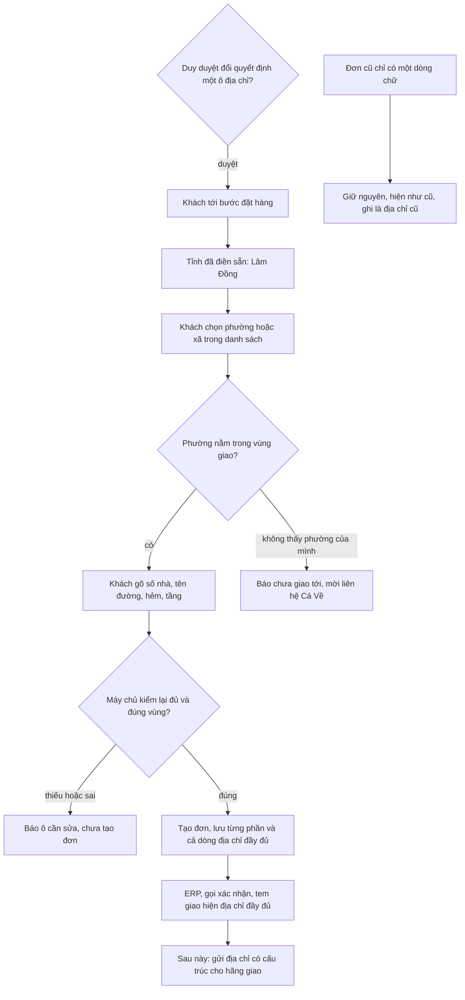

# Địa chỉ giao hàng chọn theo mục (tỉnh/thành, phường/xã, số nhà) — Phân tích nghiệp vụ

> BA · 2026-11-16 · Trạng thái: **ĐÃ DUYỆT lát 1** (16/11, xem mục "Duy trả lời")
> Nguồn: sheet FIX WEB dòng 9 (Lộc, mức Trung bình, dưới 1 tuần, ngày 16/11/2026).

## Duy trả lời (16/11/2026, trong phiên điều phối)

Nguyên văn: "cho chọn trước sáp nhập và sau sáp nhập, master data đủ tỉnh thành, huyện, xã → sau đó lên dropdown này trước".
"Còn vụ phí ship và nhà vận chuyển tính sau, cái này chưa có đối tác nên chưa làm được đâu."

| Câu | Chốt |
|---|---|
| Q-1 | **Duyệt** đổi "một ô" thành địa chỉ có cấu trúc (tỉnh, [huyện], phường/xã từ danh sách, số nhà gõ tay). Giữ các vế khác của BR-BH-29: không toạ độ, không nút vị trí hiện tại. |
| Q-3 | **Không khoá tỉnh.** Khách chọn **kiểu địa chỉ**: *Địa chỉ mới (sau sắp xếp 01/07/2025)* gồm Tỉnh/thành → Phường/xã; hoặc *Địa chỉ cũ (trước sắp xếp)* gồm Tỉnh/thành → Quận/huyện → Phường/xã. Danh mục **đủ cả nước** cho cả hai kiểu. |
| Q-2, Q-4 | **Chưa chốt, để sau.** Lát này chỉ làm dropdown; chưa chặn ngoài vùng giao (giữ như hiện nay: nhân viên gọi xác nhận lo). |
| Thứ tự | Làm **dropdown trước**: STA-01 (danh mục) + STA-02 (Shop chọn và lưu). STA-03 (chặn ngoài vùng), STA-04 (ERP sửa theo danh mục), STA-06 để lát sau. STA-05 phần "ERP và tem hiện đủ địa chỉ" tự có vì máy chủ ghép chuỗi `delivery_address`. |

Trạng thái lát 1: **ĐÃ DUYỆT** (16/11/2026).

## 1. Yêu cầu gốc

> "Mục nhập địa chỉ giao hàng, cho khách chọn theo muc, thành phố, phường, số nhà chi tiết"

Nguồn: Lộc, sheet FIX WEB dòng 9, 16/11/2026. Em hiểu "theo muc" là "theo mục" (chọn từng mục trong danh sách thả
xuống), và "thành phố" là cấp tỉnh/thành theo cách gọi quen. Cách hiểu này cần Duy xác nhận cùng câu Q-1.

## 2. Tóm tắt

**Khách mua online** cần **chọn tỉnh/thành và phường/xã từ danh sách, rồi gõ số nhà, tên đường** để **địa chỉ đúng tên
đơn vị hành chính mới, nhân viên giao tìm nhanh, và hãng giao (dòng 10) nhận được địa chỉ có cấu trúc**.

## 3. Bối cảnh trong hệ thống

### 3.1 Quy trình và rule liên quan

| Nguồn | Nội dung | Ảnh hưởng |
|---|---|---|
| URD §6 (dòng 99) | "Nhập địa chỉ giao hàng và số điện thoại khi đặt (bắt buộc)" | Giữ |
| BR-BH-09 (L) | Địa chỉ giao bắt buộc ngay bước đặt | Giữ, làm rõ "đủ" nghĩa là đủ các phần |
| **BR-BH-29 (D 10/10)** | "Địa chỉ giao là **một ô chữ**… chỉ chuỗi địa chỉ cuối cùng gửi về Cá Về. Không lưu toạ độ." | **Phải sửa.** Yêu cầu này đi ngược vế "một ô" |
| BR-BH-26 (D 10/10) | Trang đơn công khai không có địa chỉ người nhận | Giữ |
| BR-GH-01 | Người giao là nhân viên nội bộ; ghi chú 11/10 về hãng ngoài | Không đổi ở việc này |
| P-06 gọi xác nhận (CS-12) | Nhân viên gọi xác nhận được sửa địa chỉ khi phiếu ở Chờ gọi hoặc Đang soạn | Phải sửa cách sửa |
| decisions 2026-10-10 (tối) | "**Địa chỉ giao là một ô**, có nút mở Google Maps…" | **Mâu thuẫn**, cần Duy chốt (Q-1) |
| decisions 2026-10-11 S-08 | Khu vực giao: **Phan Thiết**; hãng Ahamove hoặc GHN, chưa chốt | Ràng buộc danh sách phường |
| decisions 2026-11-14 | Nhãn giờ giao ở giỏ: dưới 15 km 2 giờ, từ 15 km 4 giờ; chưa đo khoảng cách vì chưa có địa chỉ | Có liên quan (mục 9) |
| `doc/ops/bang-viec.md` | Google Maps ở trang đặt hàng **tạm dừng, chờ Duy cấp key** | Ảnh hưởng nút Bản đồ (Q-5) |
| `doc/ops/hoi-loc.md` L1 | "Giao ở đâu: chỉ trong TP Phan Thiết, hay cả các xã/phường lân cận? Ranh giới cụ thể?" — **chưa có câu trả lời** | Chặn danh sách vùng giao (Q-2) |

### 3.2 Hệ thống đang làm gì (đọc code ngày 16/11)

- **Shop** (`frontend/features/checkout/components/AddressField.tsx`): một ô chữ nhiều dòng `delivery_address`, tối đa
  500 ký tự, gợi ý "Thêm hẻm, tầng, toà nhà nếu có.", dòng "Cá Về giao trong khu vực Phan Thiết.", nút "Bản đồ" mở
  Google Maps. Comment ghi rõ "Không tách địa chỉ thành nhiều ô, không lưu toạ độ". Form không lưu `localStorage`, URL.
- **Máy chủ** (`backend/apps/sales/orders/shop_api.py`): chỉ kiểm có chữ và không quá 500 ký tự. Không kiểm vùng giao.
- **Dữ liệu**: `SalesOrder.delivery_address` (một khối chữ, bắt buộc); `Customer.default_address` (khối chữ, ghi một lần
  khi khách đặt đơn đầu, Shop không đọc lại vì khách không đăng nhập). `DeliveryNote` không có địa chỉ riêng, đọc từ đơn.
- **Tem giao** (`backend/apps/delivery/labels/services.py`): in nguyên `order.delivery_address`, SĐT đã che còn 4 số cuối.
- **Gọi xác nhận** (`delivery/confirmation/services.py`): sửa địa chỉ là ghi đè cả chuỗi, có AuditLog chỉ ghi tên trường.
- **ERP** hiển thị địa chỉ dạng một dòng ở chi tiết đơn, chi tiết phiếu giao, "Phiếu của tôi", gọi xác nhận, hồ sơ khách.
- **Danh mục đơn vị hành chính: chưa có trong repo.** Không có model, bảng tĩnh hay file dữ liệu tỉnh/phường. Chữ
  "Lâm Đồng", "Bình Thuận", "phường" chỉ có trong mock, dữ liệu demo, bản khảo sát vận chuyển và thiết kế.

### 3.3 Đơn vị hành chính sau 1/7/2025

- Từ **01/7/2025** Việt Nam bỏ cấp huyện, còn hai cấp: **tỉnh/thành phố** và **xã/phường/đặc khu**. Cả nước còn 34
  tỉnh/thành. Bình Thuận, Đắk Nông nhập vào **tỉnh Lâm Đồng** mới (`doc/ops/khao-sat-ben-van-chuyen.md` mục 1, tin cậy Cao).
- "TP. Phan Thiết" không còn là đơn vị hành chính. Khu trung tâm cũ nay là **phường Phan Thiết, tỉnh Lâm Đồng** (gộp Phú
  Trinh, Lạc Đạo, Bình Hưng); các phường, xã cũ khác của Phan Thiết đã nhập vào các phường, xã mới khác (cùng nguồn).
  Danh sách tên mới chính xác **phải lấy từ văn bản gốc** (nghị quyết của Uỷ ban Thường vụ Quốc hội về sắp xếp đơn vị
  hành chính cấp xã tỉnh Lâm Đồng năm 2025, đối chiếu danh mục của Cục Thống kê). Em chưa xác minh được bản gốc trong
  phiên này nên không liệt kê tên phường ở đây.
- Hệ quả: **"Phan Thiết" trong quyết định S-08 giờ mơ hồ** — có thể là phường Phan Thiết mới (một phường) hoặc vùng TP.
  Phan Thiết cũ (nhiều phường, xã mới). Hai cách khác nhau rất xa về danh sách cho khách chọn (Q-2).
- Khách và hãng giao còn quen tên cũ ("Phường Đức Long, TP Phan Thiết, Bình Thuận"). Bản khảo sát ghi: nhiều hãng vẫn
  dùng mã Bình Thuận cũ, phải kiểm bộ mã từng hãng (mục 7.3).

## 4. Tác nhân và quyền

| Tác nhân | Group | Làm được gì | Quyền Tầng 2 cần |
|---|---|---|---|
| Khách | (không đăng nhập) | Chọn phường/xã, gõ số nhà, đặt đơn | Không |
| Nhân viên gọi xác nhận | `customer_service` | Sửa địa chỉ khi phiếu Chờ gọi hoặc Đang soạn (CS-12) | `change_recipient` (đã có) |
| Quản lý, Chủ | `manager`, `owner` | Như trên; sửa địa chỉ mặc định ở hồ sơ khách | `change_recipient`, quyền sửa khách (đã có) |
| NV giao | `delivery_staff` | Chỉ xem địa chỉ phiếu được giao cho mình (BR-GH-06, Tầng 3) | Không đổi |
| NV kho | `warehouse_staff` | Xem theo V2 (decisions D-1), in tem | `print_label` (đã có) |
| Hệ thống | — | Kiểm phường thuộc vùng giao, ghép dòng địa chỉ đầy đủ | — |

Không có quyền mới. Việc này **không đụng tiền, giá vốn, tồn kho hay FEFO**.

## 5. Use case

### UC-1 Khách nhập địa chỉ có cấu trúc khi đặt hàng
- **Tiền điều kiện:** giỏ có hàng, Shop mở, khách ở bước đặt hàng.
- **Luồng chính:**
  1. Form hiện ba phần theo thứ tự: Tỉnh/thành (đã chọn sẵn Lâm Đồng, khoá nếu Q-3 chọn khoá), Phường/xã (danh sách),
     Số nhà và tên đường (ô gõ, có gợi ý "hẻm, tầng, toà nhà").
  2. Khách chọn phường/xã. Danh sách chỉ gồm các phường/xã trong vùng giao, tìm được bằng gõ vài chữ, có dấu hay không
     dấu đều ra.
  3. Khách gõ số nhà, tên đường.
  4. Khách bấm "Đặt hàng". Máy chủ kiểm: đủ ba phần, phường/xã có trong danh mục và đang thuộc vùng giao, độ dài hợp lệ.
  5. Hệ thống tạo đơn, lưu từng phần và một **dòng địa chỉ đầy đủ** ghép theo thứ tự "số nhà, tên đường, phường/xã,
     tỉnh" để mọi màn cũ và tem đọc như trước.
- **Luồng thay thế:**
  - 2a. Khách không thấy phường của mình → dưới danh sách có câu "Không thấy phường của bạn? Cá Về hiện chỉ giao trong
    khu vực [tên vùng]. Liên hệ chúng tôi." (nút liên hệ như món hết hàng). Không tạo đơn ngoài vùng (Q-4).
  - 2b. Khách gõ tên phường cũ (vd tên phường trước 7/2025) → nếu có bảng tên cũ → mới thì gợi ý tên mới (Q-6, mặc định
    🟡 có làm nếu nguồn danh mục có sẵn).
  - 1a. Google Maps được bật lại sau này → nút "Bản đồ" chỉ điền giúp phần số nhà, tên đường và gợi ý phường; khách vẫn
    phải xác nhận phường trong danh sách (Q-5).
- **Ngoại lệ:**
  - E1. Thiếu phường hoặc thiếu số nhà → báo đúng ô, khối "Còn N chỗ cần sửa" liệt kê theo thứ tự ô, chưa tạo đơn.
  - E2. Danh mục đổi giữa lúc khách mở form và lúc bấm đặt (phường bị bỏ khỏi vùng giao) → máy chủ từ chối, báo "Phường
    này hiện chưa giao tới", không giữ chỗ, không giữ lượt mã (giống BR-BH-24, BR-DM-19).
  - E3. Gửi lên phường không có trong danh mục (sửa tay request) → từ chối như E1, không tạo đơn.
  - E4. Mạng rớt, gửi lại → chống trùng theo BR-BH-27 như hiện nay, địa chỉ không đổi gì.
- **Hậu điều kiện:** đơn BOOKED có đủ các phần địa chỉ và dòng địa chỉ đầy đủ; tên phường, tỉnh được **chép vào đơn tại
  thời điểm đặt** (đóng băng, như giá — BR-BH-08). Không có toạ độ.

### UC-2 Nhân viên sửa địa chỉ khi gọi xác nhận (CS-12)
- **Tiền điều kiện:** phiếu giao ở Chờ gọi xác nhận hoặc Đang soạn; người sửa có `change_recipient`.
- **Luồng chính:** 1. Mở "Đổi thông tin nhận hàng". 2. Chọn lại phường/xã từ cùng danh mục, sửa số nhà. 3. Lưu → đơn có
  địa chỉ mới, dòng đầy đủ ghép lại, AuditLog ghi **tên trường đã đổi**, không chép địa chỉ.
- **Luồng thay thế:** 2a. Khách ở ngoài vùng giao nhưng Lộc vẫn muốn giao (vd người quen) → mặc định 🟡: ERP **cho chọn
  mọi phường của tỉnh** và hiện cảnh báo "Ngoài vùng giao", vì nhân viên đã nói chuyện với khách (Q-4).
  2b. Đơn cũ chỉ có một dòng chữ → form mở với phường trống, nhân viên chọn phường và gõ lại phần số nhà; không bắt buộc
  nếu chỉ đổi người nhận hộ.
- **Ngoại lệ:** phiếu đã Chờ lấy hoặc Đang giao → chặn như hiện nay (BR-GH-15); phiếu/đơn đã huỷ → chặn (BR-GH-07).
- **Hậu điều kiện:** tem in sau lúc sửa dùng địa chỉ mới; tem đã in trước đó phải in lại (luồng in lại tem như hiện có).

### UC-3 Xem và in địa chỉ trong ERP
- **Luồng chính:** chi tiết đơn, phiếu giao, "Phiếu của tôi", gọi xác nhận, tem giao hiện **dòng địa chỉ đầy đủ** như
  hiện nay. Có thể tách dòng phường cho dễ đọc (việc của UX).
- **Luồng thay thế:** đơn cũ không có phần cấu trúc → hiện nguyên dòng chữ cũ, kèm nhãn nhỏ "Địa chỉ nhập tự do" để nhân
  viên biết phải đọc kỹ.
- **Ngoại lệ:** người không có quyền xem dữ liệu khách → ẩn như hiện nay (Tầng 3, D-1, V2). Phần phường/xã cũng là địa chỉ,
  ẩn cùng.

### UC-4 Đơn cũ trước khi có tính năng
- **Luồng chính:** không chuyển đổi, không đoán phường từ chữ cũ. Dòng `delivery_address` giữ đúng nghĩa và nội dung.
- **Ngoại lệ:** nhân viên muốn chuẩn hoá đơn cũ đang mở → dùng UC-2. Đơn đã giao xong không sửa (chứng từ đã đóng).

### UC-5 (chuẩn bị cho dòng 10) Gửi địa chỉ cho hãng giao
Ngoài phạm vi việc này. Chỉ ghi yêu cầu đầu vào: khi tạo đơn trên hãng, hệ thống cần địa chỉ đã tách tỉnh, phường, số
nhà, và có thể cần **toạ độ** (Ahamove tính phí theo điểm lấy và điểm giao). Xem mục 7.3.

## 6. Business rule

| Mã | Nội dung | Nhãn | Mới / Sửa / Giữ |
|---|---|---|---|
| BR-BH-09 | Địa chỉ giao bắt buộc ngay bước đặt. Với đơn tạo từ Shop sau tính năng này, "có địa chỉ" nghĩa là **đủ tỉnh, phường/xã và số nhà, tên đường**. | L + PA | Sửa (làm rõ) |
| BR-BH-29 | Thay vế "Địa chỉ giao là một ô chữ" bằng: **địa chỉ gồm tỉnh/thành, phường/xã chọn từ danh mục, và một ô số nhà, tên đường**. Giữ nguyên: không lưu toạ độ, script bản đồ chỉ nạp khi khách bấm, thông báo gửi tới Google ngay khi mở, không nút vị trí hiện tại. | L (Lộc 16/11) — **cần D** | Sửa (lật một phần quyết định 10/10) |
| BR-BH-32 | **Danh mục đơn vị hành chính** theo hệ hai cấp sau 1/7/2025 (tỉnh/thành, phường/xã/đặc khu). Danh mục là dữ liệu công khai, **lưu trong hệ thống Cá Về**, không tra trực tiếp từ trình duyệt khách sang dịch vụ ngoài. Có ghi ngày hiệu lực và nguồn văn bản. | PA | Mới |
| BR-BH-33 | **Vùng giao** là danh sách phường/xã được bật; Shop chỉ cho chọn phường/xã trong vùng. Máy chủ kiểm lại lúc tạo đơn; ngoài vùng thì không tạo đơn, không giữ chỗ, không giữ lượt mã. Vùng giao là tham số cấu hình, không viết cứng trong giao diện. | PA (S-08 + Q-2, Q-4) | Mới |
| BR-BH-34 | Tên tỉnh, phường/xã **chép vào đơn lúc đặt** và không đổi theo danh mục về sau (đóng băng như giá, BR-BH-08). Danh mục đổi tên hay sáp nhập tiếp thì đơn cũ vẫn giữ tên lúc đặt. | PA | Mới |
| BR-BH-35 | **Đơn cũ** chỉ có dòng chữ tự do: giữ nguyên, không tự tách, không đoán phường. Phần cấu trúc để trống. Dòng địa chỉ đầy đủ luôn là nội dung hiển thị và in trên tem cho mọi đơn. | PA (bất biến 3, luật migration) | Mới |
| BR-GH-15 | Sửa địa chỉ chỉ khi phiếu Chờ gọi hoặc Đang soạn. Nay sửa theo **cùng danh mục**; ERP được chọn phường ngoài vùng giao kèm cảnh báo. | PA (Q-4) | Sửa |
| BR-GH-27 | Tem giao in dòng địa chỉ đầy đủ, **SĐT chỉ 4 số cuối** (decisions 10/10 chiều, giữ). Không in thêm dữ liệu cá nhân nào mới. | D | Giữ, ghi rõ |
| BR-BH-26 | Trang đơn công khai và API tra đơn **không trả** bất kỳ phần nào của địa chỉ, kể cả tên phường. | D | Giữ, ghi rõ |

Số BR-BH-32…35 lấy kế tiếp BR-BH-31 trong spec. BR-GH-25, BR-GH-26 đã dùng ở hồ sơ `2026-10-01-huy-don-dang-giao` nên
em lấy BR-GH-27. Khi Duy duyệt, PO đề xuất cập nhật `doc/business-process-spec.md` (em không tự sửa spec).

## 7. Tác động dữ liệu và tích hợp

### 7.1 Dữ liệu (mức nghiệp vụ, không thiết kế bảng)
- **Đơn hàng**: thêm các phần tỉnh, phường/xã (mã và tên lúc đặt), số nhà và tên đường. **Giữ `delivery_address` đúng
  nghĩa cũ**: dòng địa chỉ đầy đủ để hiển thị và in. Chỉ thêm, không đổi nghĩa trường cũ, không xoá dữ liệu.
- **Danh mục đơn vị hành chính và vùng giao**: dữ liệu mới, **không phải dữ liệu cá nhân**.
- **Khách hàng (`default_address`)**: giữ dạng chữ ở V1. Shop không đăng nhập nên không điền sẵn địa chỉ cũ cho khách;
  tách hồ sơ khách là 🟢 để sau.
- **Phiếu giao**: không thêm gì, vẫn đọc địa chỉ từ đơn.
- **Ẩn danh hoá khách** (quyền xoá dữ liệu): mọi phần địa chỉ mới phải được ẩn danh cùng dòng đầy đủ.

### 7.2 Nguồn danh mục — so sánh

| Tiêu chí | **A. Bảng tĩnh trong hệ thống Cá Về** (nạp từ văn bản nhà nước) | **B. Gọi API ngoài** (dịch vụ công khai danh sách tỉnh/phường) |
|---|---|---|
| Dữ liệu cá nhân | Không gửi gì ra ngoài | Nếu trình duyệt khách gọi thẳng: lộ IP và thói quen của khách cho bên thứ ba (bất biến 9, mục 6b go-live). Nếu máy chủ gọi: không có dữ liệu khách nhưng thêm phụ thuộc |
| Đúng sau sáp nhập | Cá Về tự kiểm, ghi nguồn | Phụ thuộc bên ngoài đã cập nhật chưa; khảo sát ghi nhiều bên còn mã cũ |
| Hỏng thì sao | Không hỏng | Dịch vụ sập là khách không đặt được hàng |
| Công sức | Một lần nạp + cập nhật khi nhà nước đổi (hiếm) | Ít lúc đầu, rủi ro về sau |
| Khớp mã hãng giao | Phải có bảng đối chiếu mã Cá Về ↔ mã từng hãng (dòng 10) | Như A, vẫn phải đối chiếu |

**Em khuyên A.** Vùng giao chỉ vài chục phường/xã; cả tỉnh Lâm Đồng mới khoảng hơn 120 đơn vị cấp xã, nhỏ. Danh mục
cả nước (34 tỉnh) có thể nạp sẵn để mở vùng sau này, nhưng Shop chỉ hiện vùng giao.

### 7.3 Liên quan dòng 10 (hãng giao Ahamove / GHTK)
- Địa chỉ có cấu trúc là **đầu vào bắt buộc** của dòng 10 (bảng việc ghi "phụ thuộc dòng 9").
- **Toạ độ:** Ahamove tính phí và điều tài xế theo điểm; có thể cần toạ độ điểm giao. BR-BH-29 hiện **cấm lưu toạ độ**,
  và mục 6 go-live coi dữ liệu vị trí xác định qua định vị là **dữ liệu nhạy cảm**. Việc này **không** thu toạ độ; nếu
  dòng 10 cần thì phải là quyết định riêng của Duy (Q-7), có thể theo hướng hãng tự đổi địa chỉ chữ ra toạ độ.
- **Mã địa chỉ của hãng:** hãng có thể vẫn dùng hệ ba cấp cũ (có quận/huyện, "Bình Thuận"). Dòng 10 phải có bảng đối
  chiếu; dòng 9 chỉ cần lưu mã chuẩn của nhà nước để đối chiếu được.
- **Lưu ý cho dòng 10:** bản khảo sát vận chuyển kết luận **GHTK "Loại, vì cấm hàng"** (đông lạnh), và quyết định 11/10
  ghi Ahamove hoặc **GHN**, không phải GHTK. Hồ sơ dòng 10 cần làm rõ, không thuộc việc này.
- Gửi tên, SĐT, địa chỉ cho hãng là **bên thứ ba mới**: cần quyết định riêng, cập nhật chính sách quyền riêng tư, có thoả
  thuận xử lý dữ liệu (decisions 11/10 S-08, khảo sát mục 6). Dòng 9 không gửi gì cho ai.

### 7.4 Màn hình bị ảnh hưởng
Shop: form đặt hàng (ô địa chỉ, khối lỗi, dòng "giao trong khu vực…"). ERP: đổi thông tin nhận hàng (gọi xác nhận), chi
tiết đơn, chi tiết phiếu giao, "Phiếu của tôi", tem giao. Hồ sơ khách: không đổi ở V1. Dữ liệu demo/QA cần địa chỉ giả
theo tên mới.

## 8. Rủi ro Cá Về

| Nhóm | Rủi ro | Mức | Cách giữ |
|---|---|---|---|
| Dữ liệu cá nhân (bất biến 9) | Trường mới là một phần của địa chỉ → dữ liệu cá nhân. Rò qua API công khai, log, AuditLog | Critical nếu xảy ra | Không thu thêm loại dữ liệu nào (chỉ tách địa chỉ đã thu); API công khai và tra đơn không trả phần nào; không log phường/số nhà; AuditLog chỉ tên trường; serializer ERP liệt kê tường minh, ẩn cùng địa chỉ theo Tầng 3 |
| Dữ liệu cá nhân — trình duyệt | Lưu nháp địa chỉ vào `localStorage` hoặc đưa phường lên URL để "nhớ" | Cao | Cấm như hiện nay: không `localStorage`, không query string, không console |
| Dữ liệu cá nhân — bên thứ ba | Tải danh mục từ API ngoài ngay trong trình duyệt khách | Trung bình | Danh mục do Cá Về phục vụ (khuyên A) |
| Lý do thu (bất biến 9) | Thêm trường cá nhân phải có lý do | — | Lý do: giao đúng chỗ, chuẩn hoá tên sau sáp nhập, chuẩn bị gửi hãng giao. Không thu toạ độ, không thu email. **Duy duyệt ở Q-1** |
| Quyết định đã chốt | Lật vế "một ô" của decisions 10/10 và BR-BH-29 khi chưa có Duy | Cao | Q-1 chặn |
| Chứng từ | Đổi nghĩa `delivery_address` hoặc tự tách đơn cũ làm sai chứng từ | Cao | BR-BH-35: chỉ thêm, đơn cũ giữ nguyên |
| Vùng giao sai | "Phan Thiết" mơ hồ sau sáp nhập → chặn nhầm khách thật hoặc nhận đơn không giao nổi | Cao (mất đơn hoặc giao trễ, đông lạnh rã) | Q-2 chặn; Lộc chốt danh sách phường |
| Danh mục sai tên | Gõ tay tên phường mới sai | Trung bình | Nạp từ văn bản gốc, ghi nguồn; legal-vn hoặc Lộc soát danh sách vùng giao |
| Tiền, giá vốn, FEFO, tồn | Không đụng | — | — |
| Trải nghiệm | Thêm ô làm form dài hơn trên điện thoại, khách quen tên cũ không tìm ra phường | Trung bình | Tìm không dấu, gợi ý tên cũ (Q-6), tỉnh điền sẵn |

## 9. Ngoài phạm vi

- Tích hợp hãng giao, bảng đối chiếu mã địa chỉ của hãng, gửi dữ liệu cho hãng (dòng 10).
- Thu hoặc lưu toạ độ; bật lại Google Maps (chờ key, xem bảng việc).
- Tính phí ship hay chọn nhãn giờ giao (2 giờ / 4 giờ) theo phường. Có thể làm sau vì phường cho biết khoảng cách thô, nhưng
  đổi lời hứa với khách là quyết định riêng (decisions 14/11).
- Tách `Customer.default_address`, sổ địa chỉ của khách, đăng nhập.
- Màn ERP để Chủ tự bật/tắt phường trong vùng giao (🟢, V1 dùng tham số cấu hình).
- Chuẩn hoá hàng loạt địa chỉ đơn cũ.

## 10. Câu hỏi mở

| # | Mức | Câu hỏi | Mặc định PA đề xuất / em khuyên |
|---|---|---|---|
| Q-1 | 🔴 | Anh duyệt **đổi quyết định 10/10 "Địa chỉ giao là một ô"** và BR-BH-29 thành địa chỉ ba phần (tỉnh, phường/xã chọn từ danh sách, số nhà gõ tay) không? Đây cũng là duyệt thu thêm trường địa chỉ tách (bất biến 9). | **Khuyên duyệt.** Giữ mọi vế khác của BR-BH-29: không toạ độ, Maps chỉ nạp khi bấm, không nút vị trí hiện tại. |
| Q-2 | 🔴 | "Khu vực Phan Thiết" (S-08) sau sáp nhập là **những phường/xã mới nào**? Chỉ phường Phan Thiết mới, hay toàn bộ vùng TP. Phan Thiết cũ, hay rộng hơn (khảo sát vận chuyển nói tới bán kính dưới 300 km, nhãn giỏ có mức "từ 15 km trở lên")? Đây là câu L1 trong `doc/ops/hoi-loc.md`, chưa có trả lời. | **Khuyên:** V1 lấy toàn bộ các phường/xã mới thuộc địa bàn TP. Phan Thiết cũ; em lập danh sách từ văn bản gốc để Lộc tick. Chưa có trả lời thì chưa giao được lô Shop. |
| Q-3 | 🔴 | Ô tỉnh/thành: **khoá cứng Lâm Đồng** hay cho chọn tỉnh? | **Khuyên khoá Lâm Đồng** (hiện chữ, không cho đổi) vì chỉ giao một vùng. Danh mục vẫn nạp đủ để mở tỉnh khác sau này chỉ bằng cấu hình. |
| Q-4 | 🔴 | Khách **ngoài vùng giao** thì sao: (a) không cho đặt, mời liên hệ; (b) cho đặt, nhân viên gọi xác nhận rồi quyết. | **Khuyên (a) trên Shop** — tránh khách trả tiền rồi phải hoàn (P-07 tốn công Chủ). **Trong ERP** nhân viên được chọn phường ngoài vùng kèm cảnh báo, cho ca Lộc tự nhận giao. |
| Q-5 | 🟡 | Nút "Bản đồ" (Google Maps, đang tạm dừng chờ key): khi có key thì làm gì với form mới? | Mặc định: **ẩn nút tới khi có key**. Bật lại thì Maps chỉ điền giúp số nhà, tên đường và gợi ý phường; khách vẫn chọn phường trong danh sách. |
| Q-6 | 🟡 | Có gợi ý tên mới khi khách gõ **tên phường cũ** (trước 7/2025) không? | Mặc định: **có**, nếu danh mục nguồn có bảng cũ → mới; không có thì chỉ ghi chú "Tên phường theo địa giới mới từ 1/7/2025". |
| Q-7 | 🟡 | Dòng 10 có thể cần **toạ độ** điểm giao. Việc này có chuẩn bị gì không? | Mặc định: **không thu toạ độ ở dòng 9**. Dòng 10 tự quyết (ưu tiên để hãng tự đổi địa chỉ chữ ra điểm), quyết định riêng của anh. |
| Q-8 | 🟡 | Nguồn danh mục: bảng tĩnh trong hệ thống hay API ngoài? | Mặc định: **bảng tĩnh** (mục 7.2), ghi nguồn văn bản và ngày hiệu lực. |
| Q-9 | 🟡 | Ô số nhà: một ô "Số nhà, tên đường" hay tách "số nhà" và "tên đường"? Có ô ghi chú (hẻm, tầng, mốc dễ tìm) riêng không? | Mặc định: **một ô** "Số nhà, tên đường, hẻm, tầng" (bắt buộc), không thêm ô ghi chú, để thu tối thiểu và form ngắn trên điện thoại. |
| Q-10 | 🟡 | Đơn cũ (chuỗi tự do) có cần chuẩn hoá không? | Mặc định: **không**; hiện nguyên, kèm nhãn "Địa chỉ nhập tự do"; nhân viên chuẩn hoá khi gọi xác nhận nếu cần. |
| Q-11 | 🟡 | Vùng giao đổi thế nào khi Lộc mở thêm phường? | Mặc định V1: **tham số cấu hình**, đổi qua đội IT; màn ERP tự bật/tắt để sau (🟢). |
| Q-12 | 🟢 | Hồ sơ khách (`default_address`) có tách theo phường không? | Để sau, khi có đăng nhập hoặc sổ địa chỉ. |
| Q-13 | 🟢 | Dùng phường để chọn đúng một mức giờ giao (2 giờ / 4 giờ) ở trang đặt hàng? | Để sau; đổi lời hứa với khách là quyết định riêng (decisions 14/11). |

**Chưa chuyển sang PO khi Q-1 … Q-4 còn mở.**
