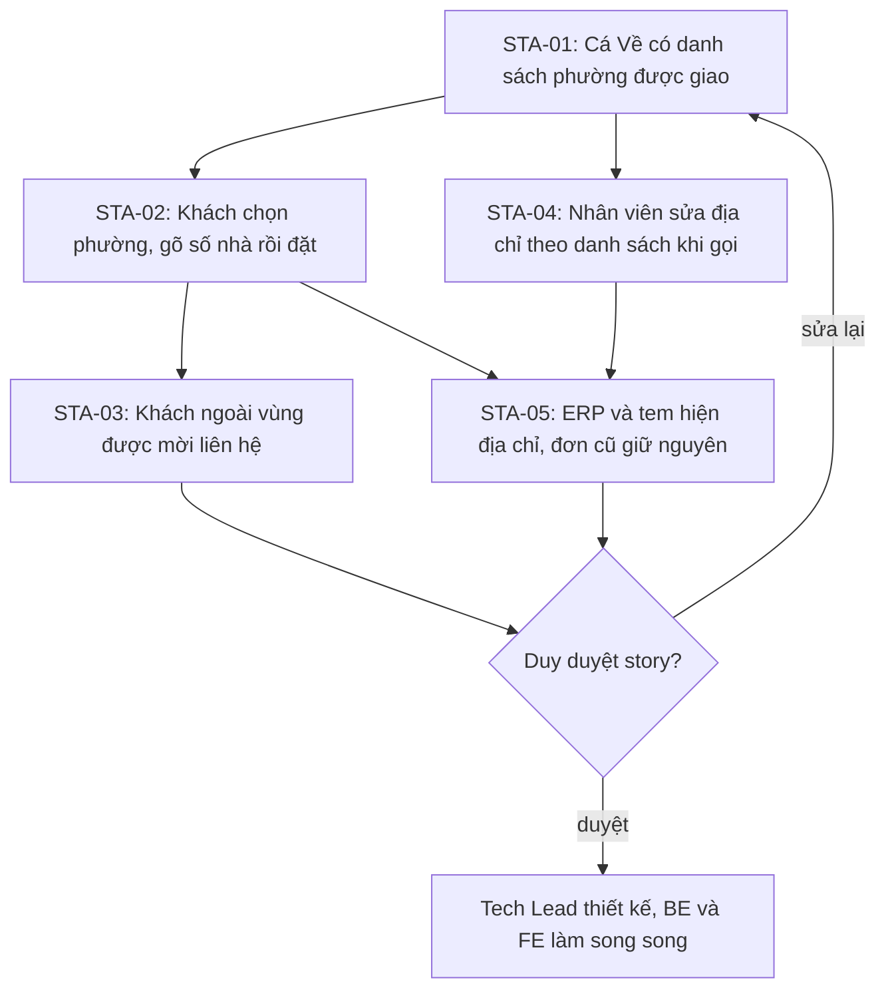

# Địa chỉ giao hàng chọn theo mục — User stories



> PO · 2026-11-16 · Nguồn: `01-analysis.md` (BA, **còn CHỜ DUYỆT**), sheet FIX WEB dòng 9 (Lộc)
> Trạng thái: **ĐÃ DUYỆT lát 1: STA-01, STA-02** (16/11, xem mục "Duy trả lời")

**Vì sao là nháp:** `01-analysis.md` chưa được Duy duyệt và Q-1…Q-4 chưa có câu trả lời. Bản này viết trước theo phương
án BA khuyên để Duy xem một lần cả phân tích lẫn story. Chưa giao Tech Lead/dev khi Duy chưa chốt Q-1…Q-4 và duyệt bản
này. Giả định đang dùng:

| Câu | Giả định trong bản nháp | Nếu Duy chọn khác thì story nào đổi |
|---|---|---|
| Q-1 | Duyệt địa chỉ 3 phần (tỉnh, phường/xã chọn từ danh sách, một ô số nhà và tên đường); giữ các vế khác của BR-BH-29 (không toạ độ) | **Không duyệt** → huỷ cả bộ STA-01…STA-06, giữ một ô như hiện nay. Chỉ có thể làm riêng dòng chữ "Cá Về giao trong khu vực…" cho rõ tên mới |
| Q-2 | Vùng giao = toàn bộ phường/xã mới thuộc địa bàn TP. Phan Thiết cũ; danh sách để Lộc tick | Chọn "chỉ phường Phan Thiết" hay vùng rộng hơn → **chỉ đổi dữ liệu cấu hình** ở STA-01, không đổi code hay AC. Chưa có danh sách Lộc tick thì STA-02 chưa lên staging được |
| Q-3 | Khoá tỉnh Lâm Đồng (hiện chữ, không cho đổi) | Cho chọn tỉnh → STA-01 trả thêm danh sách tỉnh, STA-02 thêm ô chọn tỉnh và AC "đổi tỉnh thì xoá phường đã chọn" (+0,5 ngày FE, +0,5 ngày BE) |
| Q-4 | Shop: ngoài vùng **không cho đặt**, mời liên hệ. ERP: được chọn mọi phường của tỉnh, kèm cảnh báo | Chọn (b) "cho đặt, nhân viên gọi rồi quyết" → STA-03 viết lại (Shop hiện mọi phường của tỉnh, đơn ngoài vùng được tạo và gắn cờ cho người gọi xác nhận), S2-AC5 bỏ; STA-04 không đổi |

Các câu 🟡 dùng mặc định của BA: Q-5 ẩn nút "Bản đồ" tới khi có key · Q-6 gợi ý tên cũ là Could (STA-06) · Q-7 không thu
toạ độ · Q-8 bảng tĩnh trong hệ thống · Q-9 một ô "Số nhà, tên đường, hẻm, tầng" · Q-10 không chuẩn hoá đơn cũ ·
Q-11 vùng giao là tham số cấu hình.

## Duy trả lời (16/11/2026, trong phiên điều phối)

Nguyên văn: "cho chọn trước sáp nhập và sau sáp nhập, master data đủ tỉnh thành, huyện, xã → sau đó lên dropdown này trước".
"Còn vụ phí ship và nhà vận chuyển tính sau, cái này chưa có đối tác nên chưa làm được đâu."

| Câu | Chốt |
|---|---|
| Q-1 | **Duyệt** đổi "một ô" thành địa chỉ có cấu trúc (tỉnh, [huyện], phường/xã từ danh sách, số nhà gõ tay). Giữ các vế khác của BR-BH-29: không toạ độ, không nút vị trí hiện tại. |
| Q-3 | **Không khoá tỉnh.** Khách chọn **kiểu địa chỉ**: *Địa chỉ mới (sau sắp xếp 01/07/2025)* gồm Tỉnh/thành → Phường/xã; hoặc *Địa chỉ cũ (trước sắp xếp)* gồm Tỉnh/thành → Quận/huyện → Phường/xã. Danh mục **đủ cả nước** cho cả hai kiểu. |
| Q-2, Q-4 | **Chưa chốt, để sau.** Lát này chỉ làm dropdown; chưa chặn ngoài vùng giao (giữ như hiện nay: nhân viên gọi xác nhận lo). |
| Thứ tự | Làm **dropdown trước**: STA-01 (danh mục) + STA-02 (Shop chọn và lưu). STA-03 (chặn ngoài vùng), STA-04 (ERP sửa theo danh mục), STA-06 để lát sau. STA-05 phần "ERP và tem hiện đủ địa chỉ" tự có vì máy chủ ghép chuỗi `delivery_address`. |

Trạng thái lát 1: **ĐÃ DUYỆT** (16/11/2026).

## Mục tiêu và thước đo

Địa chỉ khách gõ đúng tên phường/xã theo địa giới mới (sau 1/7/2025), nhân viên giao tìm nhà nhanh, và có sẵn địa chỉ
tách phần cho việc nối hãng giao (sheet dòng 10).

Đo bằng:
- 100% đơn Shop tạo sau ngày lên production có đủ mã tỉnh, mã phường/xã thuộc vùng giao và ô số nhà khác rỗng (đếm bằng truy vấn trên đơn mới).
- 0 đơn Shop được tạo với phường ngoài vùng giao (theo giả định Q-4).
- 0 đơn cũ bị đổi nội dung `delivery_address` (so trước và sau migration trên staging).
- Sau 2 tuần: Lộc hoặc nhân viên giao báo số lần "phải gọi lại hỏi đường vì địa chỉ thiếu phường" giảm (hỏi Lộc, không đo máy).

## Phạm vi

**Trong:** danh mục phường/xã tỉnh Lâm Đồng và vùng giao (tham số) · form đặt hàng Shop 3 phần · máy chủ kiểm vùng giao
lúc tạo đơn · sửa địa chỉ theo danh mục khi gọi xác nhận · ERP và tem hiện địa chỉ đầy đủ, đơn cũ có nhãn "Địa chỉ nhập
tự do" · giữ kín địa chỉ ở API công khai, log, trình duyệt.

**Ngoài (để sau):**
- Nối hãng giao, bảng đối chiếu mã địa chỉ của hãng, gửi dữ liệu cho hãng (dòng 10).
- Thu toạ độ; bật lại Google Maps (chờ key, Q-5).
- Phí ship, chọn nhãn 2 giờ / 4 giờ theo phường (Q-13, decisions 14/11).
- Tách `Customer.default_address`, sổ địa chỉ, đăng nhập (Q-12).
- Màn ERP cho Chủ tự bật/tắt phường trong vùng giao (Q-11).
- Chuẩn hoá hàng loạt địa chỉ đơn cũ (Q-10).
- Ẩn danh hoá khách theo yêu cầu: repo chưa có chức năng này. Khi làm thì phải xoá cả các phần địa chỉ mới (ghi vào rủi ro).

## Definition of Done (chung cho mọi story)

Test BE xanh (`Ran N tests … OK`, `makemigrations --check` sạch) · FE và ERP `npm ci` sạch, `tsc` và build sạch · QA
report APPROVED với Playwright hoặc ảnh 360 + 1280 cho AC giao diện · không rò giá vốn · không rò dữ liệu cá nhân (API
công khai, log, `localStorage`/`sessionStorage`/URL, test và ảnh chỉ dùng dữ liệu giả) · migration chỉ thêm field ·
`check_naming.py` sạch · đề xuất cập nhật `doc/business-process-spec.md` (mục cuối) đã được Duy duyệt trước khi gộp main.

Dữ liệu test: tên phường trong test dùng tên giả trong fixture (vd "Phường Thử Nghiệm", "Xã Bến Giả"), không phụ thuộc
danh sách thật; số nhà, tên khách, SĐT đều giả.

---

## STA-01 — Cá Về có danh mục phường/xã và vùng giao để Shop đọc · Must · BE

**Là** Khách, **tôi muốn** thấy đúng danh sách phường/xã Cá Về giao tới, **để** chọn chứ không phải đoán tên sau sáp nhập.

Bối cảnh: UC-1 bước 1–2, BR-BH-32, BR-BH-33, mục 7.2 (khuyên bảng tĩnh). Danh mục là dữ liệu công khai, **không phải dữ
liệu cá nhân**. Danh mục nạp đủ phường/xã tỉnh Lâm Đồng mới, có ghi nguồn văn bản và ngày hiệu lực. Vùng giao là danh
sách mã phường/xã trong cấu hình (env/settings), không viết cứng trong giao diện. Danh sách thật để Lộc tick (Q-2); test
dùng fixture giả. Story này mở contract cho FE dựng mock và làm STA-02 song song.

**Contract dự kiến (Tech Lead chốt ở 02b):**

`GET /api/shop/delivery-areas/` · `AllowAny` · cache được (không có dữ liệu khách)

```json
{
  "province": { "code": "<mã tỉnh chuẩn>", "name": "Lâm Đồng", "locked": true },
  "wards": [
    { "code": "<mã phường A>", "name": "Phường Thử Nghiệm", "kind": "ward" },
    { "code": "<mã xã B>", "name": "Xã Bến Giả", "kind": "commune" }
  ],
  "effective_date": "2025-07-01",
  "area_note": "Cá Về hiện giao trong khu vực Phan Thiết cũ."
}
```

- `wards` chỉ gồm phường/xã **đang trong vùng giao**, sắp theo tên tiếng Việt. Tìm không dấu làm ở FE (danh sách nhỏ, vài chục mục).
- `area_note` lấy từ cấu hình (đổi chữ không cần build lại Shop).
- `kind`: `ward` (phường) · `commune` (xã) · `special_zone` (đặc khu).
- Shop đang đóng (`SHOP_CLOSED`) vẫn trả danh mục, vì đây không phải đặt hàng.

| Mã | Given | When | Then | BR |
|---|---|---|---|---|
| STA-01-AC1 | Danh mục có 5 phường/xã giả của tỉnh, cấu hình vùng giao bật 3 mã | Khách chưa đăng nhập gọi `GET /api/shop/delivery-areas/` | 200; `wards` có đúng 3 mục bật, đủ `code`, `name`, `kind`; `province.locked` = true; không có 2 mục không bật | BR-BH-32, BR-BH-33 |
| STA-01-AC2 (cấu hình sai) | Cấu hình vùng giao có một mã không có trong danh mục | Gọi API trên | 200, mã lạ bị bỏ qua, không lỗi 500; lúc khởi động hoặc chạy lệnh kiểm cấu hình có cảnh báo ghi **mã** phường (không có dữ liệu khách) | BR-BH-33 |
| STA-01-AC3 (vùng trống) | Cấu hình vùng giao rỗng | Gọi API trên | 200, `wards` = `[]`; STA-02 hiểu là chưa nhận đơn theo địa chỉ (xem S2-AC6) | BR-BH-33 |
| STA-01-AC4 (dữ liệu cá nhân) | Có đơn thật giả lập với địa chỉ ở các phường trong vùng | Gọi API trên | Phản hồi không có khoá hay giá trị nào lấy từ đơn hoặc khách (không tên, SĐT, số nhà, không đếm số đơn theo phường) | bất biến 9 |
| STA-01-AC5 (nguồn) | Danh mục đã nạp | Chủ hoặc đội IT xem dữ liệu danh mục (admin hoặc lệnh) | Mỗi bản ghi có tên văn bản nguồn và ngày hiệu lực; nạp lại lần hai không tạo bản ghi trùng | BR-BH-32 |
| STA-01-AC6 (quyền) | Khách chưa đăng nhập | Gọi `POST`, `PUT`, `DELETE` vào `/api/shop/delivery-areas/` | 405, danh mục không đổi. Không có API công khai nào sửa được danh mục hay vùng giao | BR-PQ |

Ghi chú cho dev: danh mục là bảng tĩnh (model mới hoặc file dữ liệu nạp bằng migration/lệnh, Tech Lead chọn); lý do
thêm schema ghi ở 02b (bất biến 8). Không gọi dịch vụ danh mục bên ngoài lúc chạy.

---

## STA-02 — Khách chọn phường/xã, gõ số nhà và đặt hàng · Must · BE+FE

**Là** Khách, **tôi muốn** chọn phường/xã trong danh sách rồi gõ số nhà, tên đường, **để** đặt đơn với địa chỉ đúng và
đủ mà không phải nhớ tên mới.

Bối cảnh: UC-1 luồng chính, ngoại lệ E1, E3, E4; BR-BH-09 (sửa), BR-BH-29 (sửa theo Q-1), BR-BH-34, BR-BH-26. Form đổi
từ một ô thành: **Tỉnh/thành** (chữ "Lâm Đồng", khoá) · **Phường/xã** (ô chọn có tìm, không dấu vẫn ra) · **Số nhà, tên
đường, hẻm, tầng** (một ô, bắt buộc, Q-9). Nút "Bản đồ" ẩn tới khi có key (Q-5). Máy chủ ghép dòng địa chỉ đầy đủ
"`<số nhà, tên đường>`, `<phường/xã>`, `<tỉnh>`" vào `delivery_address` để mọi màn cũ và tem đọc như trước; tên phường,
tỉnh chép vào đơn lúc đặt (đóng băng).

**Contract dự kiến:**

`POST /api/shop/orders/` · `AllowAny` · giữ throttle, chống trùng `client_request_id` như hiện nay. Khoá
`delivery_address` dạng chữ ở request **thay bằng** `delivery_address_parts`:

```json
{
  "client_request_id": "1b4e28ba-2fa1-11d2-883f-0016d3cca427",
  "customer": { "name": "Khách Thử", "phone": "0900000001" },
  "delivery_address_parts": {
    "province_code": "<mã tỉnh chuẩn>",
    "ward_code": "<mã phường A>",
    "street": "12 Đường Giả, hẻm 3, tầng 2"
  },
  "items": [{ "item_code": "CA-THU", "qty": "1" }],
  "privacy_consent": { "...": "như hiện nay" },
  "voucher_code": null
}
```

- Thành công: **201/200 như hiện nay, phản hồi không thêm khoá địa chỉ nào** (không `delivery_address`, không phần nào).
- Lỗi ô (gom chung với lỗi tên, SĐT như hiện nay): `400 {"code":"VALIDATION","detail":"Thông tin đặt hàng chưa hợp lệ.","fields":{"ward_code":"Chọn phường/xã giao hàng.","street":"Nhập số nhà, tên đường (tối đa 200 ký tự)."}}`
- `province_code` khác tỉnh đang mở hoặc `ward_code` không có trong danh mục → `fields.ward_code` như trên (E3).
- Request kiểu cũ chỉ có `delivery_address` dạng chữ → `400 VALIDATION` với `fields.ward_code` (Shop không nhận ô tự do nữa).
- Ngoài vùng giao: xem STA-03 (`OUT_OF_DELIVERY_AREA`).
- Số 200 ký tự là đề xuất của PO (dòng ghép vẫn ≤ 500 như `ADDRESS_MAX` hiện nay); Tech Lead được chỉnh, ghi ở 02b.

| Mã | Given | When | Then | BR |
|---|---|---|---|---|
| STA-02-AC1 | Shop mở, giỏ có hàng, vùng giao có "Phường Thử Nghiệm" | Khách chọn "Phường Thử Nghiệm", gõ "12 Đường Giả", điền tên, SĐT giả, đồng ý, bấm "Đặt hàng" | Đơn BOOKED được tạo; đơn lưu mã và tên tỉnh, mã và tên phường, ô số nhà; `delivery_address` = "12 Đường Giả, Phường Thử Nghiệm, Lâm Đồng"; khách vào bước thanh toán như hiện nay | BR-BH-09, BR-BH-29 |
| STA-02-AC2 (tìm không dấu) | Form đặt hàng mở ở màn 360 px | Khách gõ "thu ngh" vào ô phường/xã | Danh sách lọc còn "Phường Thử Nghiệm"; gõ "THỬ" cũng ra; gõ chữ không khớp hiện "Không thấy phường của bạn?" (STA-03) | BR-BH-32 |
| STA-02-AC3 (thiếu ô) | Khách bỏ trống phường và ô số nhà | Bấm "Đặt hàng" | Không gọi tạo đơn hoặc máy chủ trả 400; khối "Còn 2 chỗ cần sửa" liệt kê theo thứ tự ô (phường trước, số nhà sau), mỗi ô có câu lỗi riêng; không tạo đơn, không giữ chỗ, không giữ lượt mã | BR-BH-09 |
| STA-02-AC4 (sửa tay request) | Request gửi `ward_code` không có trong danh mục, hoặc `province_code` khác Lâm Đồng, hoặc `street` chỉ toàn dấu cách, hoặc dài 201 ký tự | Gọi `POST /api/shop/orders/` | 400 `VALIDATION` đúng ô; không có đơn mới, không bút toán giữ chỗ, lượt mã không đổi | BR-BH-09, BR-BH-33 |
| STA-02-AC5 (đóng băng) | Đơn đã tạo ở "Phường Thử Nghiệm" | Danh mục đổi tên phường thành "Phường Thử Nghiệm Mới" | Đơn cũ vẫn giữ tên "Phường Thử Nghiệm" ở phần tên phường và trong `delivery_address` | BR-BH-34 |
| STA-02-AC6 (vùng trống) | `GET /api/shop/delivery-areas/` trả `wards` rỗng | Khách mở bước đặt hàng | Ô phường/xã báo "Cá Về đang tạm ngưng nhận đơn giao tận nơi. Liên hệ chúng tôi."; nút "Đặt hàng" không gửi được; không có lỗi console | BR-BH-33 |
| STA-02-AC7 (gửi lại) | Mạng rớt sau khi bấm "Đặt hàng", khách bấm lại với cùng `client_request_id` | Gửi lại | Trả đúng đơn cũ (200), không có đơn thứ hai, phần địa chỉ của đơn không đổi | BR-BH-27 |
| STA-02-AC8 (dữ liệu cá nhân — API công khai) | Đơn tạo ở AC1 | Gọi phản hồi tạo đơn, `POST /api/shop/orders/lookup/`, `/api/shop/orders/<mã>/checkout/` và trang đơn công khai | Không có khoá nào chứa địa chỉ (`delivery_address`, `province*`, `ward*`, `street`) và không có chuỗi "12 Đường Giả" hay "Phường Thử Nghiệm" trong body | BR-BH-26, bất biến 9 |
| STA-02-AC9 (dữ liệu cá nhân — log) | Bật bắt log ở mức DEBUG | Tạo đơn thành công và tạo đơn lỗi ô (AC3, AC4) | Log chỉ có mã đơn hoặc mã lỗi; không có tên phường, mã phường, số nhà, tên, SĐT; không log nguyên `request.data` | bất biến 9 |
| STA-02-AC10 (dữ liệu cá nhân — trình duyệt) | Khách điền đủ phường và số nhà, rồi tải lại trang | Playwright đọc `localStorage`, `sessionStorage`, URL và console | Không có phường, số nhà, tên, SĐT ở bất kỳ chỗ nào; URL không có query mới; sau tải lại form trống phần địa chỉ (như hiện nay) | bất biến 9 |
| STA-02-AC11 (giao diện) | Màn 360 px và 1280 px | Mở bước đặt hàng | Ba phần hiện theo thứ tự Tỉnh/thành → Phường/xã → Số nhà; không cuộn ngang ở 360 px; ô chọn phường cao ít nhất 44 px; tỉnh hiện chữ "Lâm Đồng", không bấm đổi được; không có nút "Bản đồ"; không có nút "Vị trí hiện tại" | BR-BH-29 |
| STA-02-AC12 (bên thứ ba) | Mở bước đặt hàng | Playwright ghi lại mọi request mạng | Danh sách phường chỉ lấy từ API Cá Về; không có request nào tới dịch vụ danh mục hay bản đồ bên ngoài | bất biến 9, BR-BH-32 |

Ghi chú cho dev: FE thay `AddressField.tsx` (comment "Không tách địa chỉ thành nhiều ô" phải sửa theo BR-BH-29 mới). Mock
FE theo contract STA-01 và STA-02 ở trên. BE thêm field vào `SalesOrder` (chỉ thêm, mặc định rỗng cho đơn cũ);
`Customer.default_address` vẫn ghi dòng đầy đủ như hiện nay.

---

## STA-03 — Khách ở ngoài vùng giao được báo rõ và mời liên hệ · Must · BE+FE

**Là** Khách ở ngoài vùng giao, **tôi muốn** biết ngay là Cá Về chưa giao tới chỗ mình, **để** không trả tiền rồi phải
chờ hoàn.

Bối cảnh: UC-1 luồng thay thế 2a, ngoại lệ E2; BR-BH-33; Q-4 phương án (a). Danh sách Shop chỉ có phường trong vùng nên
khách ngoài vùng sẽ "không thấy phường của mình". Ca máy chủ: vùng giao bị thu hẹp giữa lúc khách mở form và lúc bấm đặt.
**Story này viết lại nếu Duy chọn Q-4 (b).**

**Contract dự kiến (bổ sung cho `POST /api/shop/orders/`):**

`400 {"code":"OUT_OF_DELIVERY_AREA","detail":"Phường/xã này hiện chưa giao tới. Liên hệ Cá Về để được hỗ trợ.","fields":{"ward_code":"Phường/xã này hiện chưa giao tới."}}`

Thứ tự kiểm: sau lỗi ô (VALIDATION), **trước** giữ chỗ tồn kho và giữ lượt mã giảm giá.

| Mã | Given | When | Then | BR |
|---|---|---|---|---|
| STA-03-AC1 | Form đặt hàng mở | Khách gõ tên không có trong danh sách hoặc mở danh sách | Dưới danh sách luôn có dòng "Không thấy phường của bạn? Cá Về hiện chỉ giao trong khu vực Phan Thiết cũ." (chữ lấy từ `area_note`) và nút "Liên hệ chúng tôi" giống nút ở món hết hàng | BR-BH-33 |
| STA-03-AC2 (vùng đổi giữa chừng) | Khách đã chọn "Xã Bến Giả" (đang trong vùng); sau đó cấu hình bỏ mã này khỏi vùng | Khách bấm "Đặt hàng" | 400 `OUT_OF_DELIVERY_AREA`; không có đơn mới; không bút toán giữ chỗ; lượt mã giảm giá không bị trừ; Shop báo lỗi ở ô phường và tải lại danh sách vùng giao | BR-BH-33, BR-BH-24, BR-DM-19 |
| STA-03-AC3 (phường có trong danh mục nhưng ngoài vùng) | "Phường Ngoài Vùng" có trong danh mục, không bật vùng giao | Request gửi `ward_code` của phường này | 400 `OUT_OF_DELIVERY_AREA` (không phải `VALIDATION`), không tạo đơn | BR-BH-33 |
| STA-03-AC4 (dữ liệu cá nhân) | Ca AC2 | Đọc phản hồi lỗi và log | Phản hồi không trả lại số nhà hay tên khách; log chỉ có mã lỗi, không có mã hay tên phường đi kèm SĐT hay tên khách | bất biến 9 |
| STA-03-AC5 (giao diện) | Màn 360 px | Khách mở danh sách phường dài hơn màn hình | Dòng "Không thấy phường của bạn?" vẫn bấm được (cuối danh sách hoặc ghim dưới), nút liên hệ không bị che | |

---

## STA-04 — Nhân viên sửa địa chỉ theo danh mục khi gọi xác nhận · Must · BE+FE

**Là** Nhân viên gọi xác nhận, **tôi muốn** chọn lại phường/xã và sửa số nhà khi khách báo sai, **để** đơn có địa chỉ
đúng và các phần địa chỉ không lệch với dòng đầy đủ.

Bối cảnh: UC-2 (CS-12), BR-GH-15 (sửa), Q-4 phần ERP. Hiện nay `POST /api/confirmation/queue/<id>/recipient/` ghi đè
chuỗi `delivery_address`. Từ nay sửa địa chỉ đi qua cùng danh mục; ERP được chọn **mọi phường/xã của tỉnh**, phường
ngoài vùng có cảnh báo (ca Lộc tự nhận giao). Đơn cũ chỉ có chữ: form mở với phường trống và hiện dòng chữ cũ để tham
khảo; chỉ đổi người nhận hộ thì không bắt buộc chọn phường. Tem đã in trước khi sửa bị đánh dấu phải in lại như hiện có.

**Contract dự kiến:**

`GET /api/address/wards/?province_code=<mã>` · cần đăng nhập và quyền `delivery.change_recipient`

```json
{ "province": { "code": "<mã tỉnh chuẩn>", "name": "Lâm Đồng" },
  "wards": [
    { "code": "<mã phường A>", "name": "Phường Thử Nghiệm", "kind": "ward", "in_delivery_area": true },
    { "code": "<mã phường C>", "name": "Phường Ngoài Vùng", "kind": "ward", "in_delivery_area": false }
  ] }
```

`POST /api/confirmation/queue/<id>/recipient/` · giữ quyền và phạm vi như hiện nay. Thay khoá `delivery_address` dạng
chữ bằng `delivery_address_parts` (cùng dạng STA-02); `recipient_name`, `recipient_phone` giữ nguyên. Không gửi
`delivery_address_parts` = địa chỉ không đổi.

```json
{ "delivery_address_parts": { "province_code": "<mã tỉnh chuẩn>", "ward_code": "<mã phường C>", "street": "5 Đường Giả" } }
```

- 200: `{"changed": ["delivery_address"], "label_invalidated": true, "out_of_delivery_area": true}`
- 400 `VALIDATION` `fields.ward_code` / `fields.street`: phường không có trong danh mục hoặc khác tỉnh, số nhà rỗng hoặc quá 200 ký tự.
- 400 `VALIDATION` khi chỉ gửi `delivery_address` dạng chữ (không nhận ô tự do nữa).
- 403 không có `change_recipient`; 404 ngoài phạm vi; chặn trạng thái như hiện nay (BR-GH-15, BR-GH-07).

| Mã | Given | When | Then | BR |
|---|---|---|---|---|
| STA-04-AC1 | Phiếu ở Chờ gọi xác nhận, đơn ở "Phường Thử Nghiệm" | Nhân viên gọi xác nhận mở "Đổi thông tin nhận hàng", chọn "Xã Bến Giả", sửa số nhà "5 Đường Giả", lưu | Đơn có phần phường, số nhà mới; `delivery_address` = "5 Đường Giả, Xã Bến Giả, Lâm Đồng"; `changed` có `delivery_address`; tem in sau đó dùng địa chỉ mới | BR-GH-15, BR-BH-34 |
| STA-04-AC2 (ngoài vùng) | Như AC1 | Nhân viên chọn "Phường Ngoài Vùng" | Danh sách có phường này kèm nhãn "Ngoài vùng giao"; trước khi lưu hiện cảnh báo "Phường này ngoài vùng giao. Chỉ lưu khi Cá Về đã nhận giao."; lưu được, phản hồi `out_of_delivery_area` = true | BR-GH-15, BR-BH-33 |
| STA-04-AC3 (đơn cũ) | Đơn cũ chỉ có `delivery_address` dạng chữ, phần cấu trúc trống | Nhân viên mở form | Ô phường trống, có dòng "Địa chỉ cũ: <chữ cũ>" để tham khảo. Chỉ đổi `recipient_name` rồi lưu → thành công, địa chỉ cũ giữ nguyên từng ký tự. Chọn phường và gõ số nhà rồi lưu → đơn có phần cấu trúc, dòng đầy đủ ghép lại | BR-BH-35 |
| STA-04-AC4 (lỗi) | Phiếu ở Chờ gọi | Gửi `ward_code` không có trong danh mục, hoặc số nhà rỗng | 400 đúng ô; đơn không đổi; không ghi AuditLog | BR-GH-15 |
| STA-04-AC5 (trạng thái) | Phiếu đã Chờ lấy hoặc Đang giao, hoặc đơn đã huỷ | Gửi đổi địa chỉ hợp lệ | Bị chặn như hiện nay; đơn không đổi | BR-GH-15, BR-GH-07 |
| STA-04-AC6 (quyền) | NV kho, NV giao (không có `change_recipient`) đăng nhập | Gọi `GET /api/address/wards/` và `POST .../recipient/` | 403 cả hai; đơn không đổi. Khách chưa đăng nhập gọi `GET /api/address/wards/` → 401 | BR-PQ |
| STA-04-AC7 (dữ liệu cá nhân — AuditLog, log) | Sửa thành công ở AC1 | Đọc AuditLog và log | AuditLog ghi ai sửa, đơn nào, **tên trường** đã đổi; `detail` không có tên phường, số nhà, chữ địa chỉ cũ hay mới; log không có các giá trị đó | bất biến 9, BR-PQ-04 |
| STA-04-AC8 (giao diện ERP) | Màn 1280 px và 360 px | Mở form đổi thông tin nhận hàng | Ô phường có tìm không dấu như Shop; nhãn "Ngoài vùng giao" nhìn thấy được, không chỉ bằng màu | |

---

## STA-05 — ERP và tem hiện địa chỉ đầy đủ, đơn cũ giữ nguyên và có nhãn · Should · BE+FE

**Là** NV giao và Nhân viên gọi xác nhận, **tôi muốn** thấy địa chỉ đầy đủ như trước và biết đơn nào là địa chỉ gõ tự do,
**để** đọc kỹ những đơn cũ khi đi giao.

Bối cảnh: UC-3, UC-4, BR-BH-35, BR-GH-27, D-1/V2. Mọi màn vẫn đọc `delivery_address` (dòng đầy đủ) nên không vỡ; story
này chỉ thêm cờ để ERP gắn nhãn, và khoá lại các bất biến. Should vì không có story này Shop vẫn chạy đúng, chỉ thiếu nhãn.

**Contract dự kiến:** serializer ERP đang có `delivery_address` (chi tiết đơn, chi tiết phiếu giao, "Phiếu của tôi",
gọi xác nhận) thêm một khoá, **cùng điều kiện ẩn với `delivery_address`**:

```json
{ "delivery_address": "12 Đường Giả, Phường Thử Nghiệm, Lâm Đồng", "address_is_structured": true }
```

Màn gọi xác nhận thêm `delivery_address_parts` (để điền sẵn form STA-04), cũng cùng điều kiện ẩn.

| Mã | Given | When | Then | BR |
|---|---|---|---|---|
| STA-05-AC1 | Đơn mới tạo từ Shop (STA-02) | Quản lý mở chi tiết đơn, phiếu giao; NV giao được giao phiếu mở "Phiếu của tôi" | Hiện dòng địa chỉ đầy đủ; không có nhãn "Địa chỉ nhập tự do" | BR-BH-35 |
| STA-05-AC2 (đơn cũ giữ nguyên) | DB staging có đơn tạo trước migration | Chạy migration, rồi so `delivery_address` từng đơn trước và sau | Không đơn nào đổi nội dung; phần cấu trúc trống; không có lệnh nào tự tách hay đoán phường | BR-BH-35, bất biến 3 |
| STA-05-AC3 (nhãn đơn cũ) | Đơn cũ chỉ có chữ | Mở các màn ở AC1 | Hiện nguyên dòng chữ cũ, kèm nhãn nhỏ "Địa chỉ nhập tự do" | BR-BH-35 |
| STA-05-AC4 (tem) | Đơn mới và đơn cũ | NV kho in tem giao | Tem in dòng địa chỉ đầy đủ như hiện nay, SĐT chỉ 4 số cuối; không in thêm dữ liệu cá nhân nào mới | BR-GH-27 |
| STA-05-AC5 (quyền, Tầng 3) | NV giao A không được giao phiếu của đơn X | NV giao A gọi chi tiết phiếu, "Phiếu của tôi" | Không thấy đơn X; người dùng nào bị ẩn `delivery_address` thì cũng không có `address_is_structured` và `delivery_address_parts` | BR-GH-06, D-1, bất biến 9 |
| STA-05-AC6 (dữ liệu cá nhân — tìm kiếm, AI) | Đơn mới có phần cấu trúc | Gọi các API đã có test "không có `delivery_address`" (nội dung công khai, cấu hình AI, chính sách AI) | Các test đó mở rộng thêm khoá `ward*`, `street`, `province*`, `delivery_address_parts`; vẫn không có | bất biến 9 |

---

## STA-06 — Gợi ý tên phường mới khi khách gõ tên cũ · Could · BE+FE

**Là** Khách quen tên cũ, **tôi muốn** gõ tên phường trước 7/2025 mà vẫn ra phường mới, **để** không bỏ đặt vì không tìm thấy.

Bối cảnh: UC-1 luồng 2b, Q-6. Chỉ làm khi nguồn danh mục có bảng đối chiếu tên cũ → mới đáng tin; nếu không có thì chỉ
thêm dòng "Tên phường theo địa giới mới từ 1/7/2025" (đã gói được trong STA-02, không cần story này). **Không thuộc lát MVP.**

Contract dự kiến: mỗi mục `wards` ở STA-01 thêm `former_names: ["Phường Cũ Giả"]`.

| Mã | Given | When | Then | BR |
|---|---|---|---|---|
| STA-06-AC1 | "Phường Thử Nghiệm" có tên cũ "Phường Cũ Giả" | Khách gõ "cu gia" | Ra "Phường Thử Nghiệm", có dòng phụ "trước đây: Phường Cũ Giả" | BR-BH-32 |
| STA-06-AC2 (lỗi) | Tên cũ đã nhập vào một phường ngoài vùng | Khách gõ tên cũ đó | Không ra phường ngoài vùng; hiện dòng "Không thấy phường của bạn?" (STA-03) | BR-BH-33 |
| STA-06-AC3 (đơn) | Khách chọn phường qua tên cũ | Đặt hàng | Đơn lưu tên **mới**, không lưu tên cũ | BR-BH-34 |

---

## Bảng story

| Mã | Tiêu đề | Ưu tiên | Ai làm | Ước lượng |
|---|---|---|---|---|
| STA-01 | Danh mục phường/xã và vùng giao để Shop đọc | Must — không có danh mục thì không chọn được | BE | 1 ngày |
| STA-02 | Khách chọn phường, gõ số nhà và đặt hàng | Must — đúng yêu cầu Lộc | BE+FE | BE 1 ngày ∥ FE 1,5 ngày |
| STA-03 | Khách ngoài vùng được báo rõ, mời liên hệ | Must — tránh nhận tiền đơn không giao nổi | BE+FE | 0,5 ngày |
| STA-04 | Nhân viên sửa địa chỉ theo danh mục khi gọi xác nhận | Must — nếu không, sửa tay làm lệch phần cấu trúc | BE+FE | BE 0,5 ∥ ERP 1 ngày |
| STA-05 | ERP và tem hiện địa chỉ, đơn cũ có nhãn | Should — màn cũ vẫn chạy, chỉ thiếu nhãn | BE+FE | 0,5 ngày |
| STA-06 | Gợi ý tên mới khi gõ tên phường cũ | Could — phụ thuộc nguồn có bảng tên cũ | BE+FE | 0,5–1 ngày |

**Lát MVP (dưới 1 tuần, BE ∥ FE):** STA-01 → STA-02 + STA-03 → STA-04 → STA-05. STA-06 để sau.

## Thứ tự làm đề xuất

1. **STA-01 (BE)** ngày 1 — mở contract danh mục; FE dựng mock theo contract ngay, không chờ.
2. **STA-02 (BE ∥ FE)** ngày 1–3 — BE làm field đơn + kiểm + ghép dòng; FE làm form trên mock.
3. **STA-03** ngày 3 — cùng file với STA-02, làm liền sau.
4. **STA-04 (BE ∥ ERP)** ngày 3–4 — dùng chung danh mục và hàm kiểm của STA-02.
5. **STA-05** ngày 4–5 — chốt nhãn và mở rộng test dữ liệu cá nhân, rồi QA cả bộ.

Lý do: STA-01 là nền cho mọi story; STA-02/03 và STA-04 đụng file khác nhau (Shop/`sales` và ERP/`delivery`) nên chạy
song song được sau khi STA-02 BE có hàm kiểm chung.

## Rủi ro và phụ thuộc

- **Chặn:** Q-1…Q-4 chưa trả lời; `01-analysis.md` chưa duyệt. Danh sách phường vùng giao cần Lộc tick (Q-2, câu L1 trong
  `doc/ops/hoi-loc.md`) và tên phường lấy từ văn bản gốc — nên giao `legal-vn` soát nguồn trước khi nạp dữ liệu thật.
  Thiếu danh sách thì vẫn code và test được bằng fixture, nhưng **chưa lên staging cho Lộc thử được**.
- **Lúc deploy:** Shop bản cũ (còn trong cache trình duyệt) gửi `delivery_address` dạng chữ sẽ bị 400. Deploy BE và Shop
  cùng lượt; Tech Lead cân nhắc ở 02b có cần nhận tạm kiểu cũ một thời gian không (nếu nhận thì đơn đó coi như đơn cũ, BR-BH-35).
- **Ẩn danh hoá khách** chưa có trong repo; khi làm phải xoá cả các phần địa chỉ mới.
- **Dòng 10** (hãng giao) phụ thuộc story này; mã lưu là mã chuẩn nhà nước, đối chiếu mã hãng để dòng 10 làm.
- UX (`ux-designer`) nên chạy song song Tech Lead cho ô chọn phường trên 360 px (STA-02-AC11, STA-03-AC5).

## Đề xuất cập nhật `doc/business-process-spec.md` (chờ Duy duyệt, PO không tự sửa)

- Sửa **BR-BH-09**, **BR-BH-29**, **BR-GH-15** theo bảng mục 6 của `01-analysis.md`.
- Thêm **BR-BH-32** (danh mục), **BR-BH-33** (vùng giao), **BR-BH-34** (đóng băng tên), **BR-BH-35** (đơn cũ), **BR-GH-27** (tem).
- Ghi chú vào `doc/decisions.md` dòng mới (khi Duy duyệt Q-1) rằng vế "Địa chỉ giao là một ô" của quyết định 10/10 tối đã thay.

## Câu hỏi cho Duy

1. Q-1…Q-4 như bảng đầu file — anh chốt theo giả định hay đổi câu nào?
2. Ô số nhà tối đa **200 ký tự** (đề xuất của PO, dòng ghép vẫn ≤ 500) — anh đồng ý không?
3. Khi vùng giao trống (tạm ngưng), Shop chặn đặt hàng (STA-02-AC6) — đúng ý anh, hay để `SHOP_CLOSED` lo việc này?
