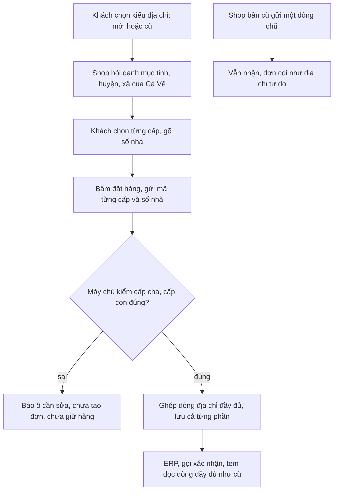

# Địa chỉ giao hàng có cấu trúc — Thiết kế kỹ thuật (lát 1: STA-01, STA-02)



> Tech Lead · 2026-11-16 · Trạng thái: **NHÁP, chờ điều phối duyệt** · Nguồn: `01-analysis.md`, `02-stories.md`
> (mục "Duy trả lời 16/11"). Giao việc: `02c-giao-viec.md`.

## 0. Phạm vi lát 1 và AC áp dụng

Duy chốt 16/11: hai kiểu địa chỉ (**mới** = tỉnh → phường/xã; **cũ** = tỉnh → quận/huyện → phường/xã), danh mục đủ cả
nước, **chưa có vùng giao**. Vì vậy phần "vùng giao" trong STA-01/STA-02 bị bỏ khỏi lát này.

| AC | Lát 1 | Ghi chú |
|---|---|---|
| STA-01-AC1, AC2, AC3 | Bỏ | Nói về vùng giao (STA-03 lát sau). Thay bằng ca §2.1 |
| STA-01-AC4 (không PII), AC6 (405) | Giữ | |
| STA-01-AC5 (nguồn) | Đổi | Nguồn ghi trong khoá `description` của file JSON + README module; không có bản ghi DB nên không có "nạp trùng" |
| STA-02-AC1, AC3, AC4, AC5, AC7–AC10, AC12 | Giữ, đổi theo hai kiểu | Tên tỉnh/xã trong test dùng mã thật từ file danh mục (dữ liệu công cộng, không phải PII); tên khách, SĐT, số nhà vẫn giả |
| STA-02-AC2 (tìm không dấu) | Giữ | Áp cho mọi ô chọn |
| STA-02-AC6 (vùng trống) | Bỏ | Không có vùng giao |
| STA-02-AC11 (giao diện) | Đổi | Tỉnh **chọn được**, có ô chọn kiểu; nút "Bản đồ" **giữ như hiện nay** (điều phối chốt, chưa mở lại Q-5) |

Không đụng: tiền, giá vốn, tồn, FEFO, voucher, ERP console, tem, serializer ERP.

## 1. Kiến trúc

- **Danh mục không vào DB.** Module mới `backend/apps/common/administrative_units/` đọc 2 file JSON đã có (`data/current.json`,
  `data/legacy.json`) **lười, một lần mỗi tiến trình** (`functools.lru_cache`), dựng chỉ mục `dict` theo mã. Lý do: dữ liệu tĩnh,
  công cộng, ~0,9 MB; không cần migration nạp, không cần bước deploy, test không phụ thuộc DB. `Dockerfile` đã `COPY . .`,
  `.dockerignore` chỉ bỏ `*.md`, nên JSON có trong image.
- **Mã luôn đi kèm kiểu.** Cùng một mã xã có nghĩa khác nhau ở hai kiểu (vd `22918` = "Phường Mũi Né" ở `current`,
  "Phường Hàm Tiến" ở `legacy`). Mọi hàm tra cứu nhận `scheme` bắt buộc; đơn lưu `address_scheme`.
- **Máy chủ ghép dòng đầy đủ** vào `SalesOrder.delivery_address` (nghĩa cũ giữ nguyên). Tên đơn vị lấy từ danh mục lúc đặt
  nên **đóng băng** trong chuỗi (BR-BH-34). ERP, gọi xác nhận, tem, AI scrub đọc `delivery_address` nên không phải sửa.
- **Tương thích lệch deploy:** request chỉ có `delivery_address` dạng chữ (Shop bản cũ trong cache) vẫn tạo đơn như hôm nay,
  phần cấu trúc để trống (= đơn "địa chỉ tự do", BR-BH-35). Lệch so với "contract dự kiến" của STA-02 (trả 400) — Tech Lead
  chốt vì deploy BE và Firebase không cùng lúc. Gỡ nhánh này ở lát STA-03.
- **Sửa địa chỉ chữ trong gọi xác nhận** (CS-12, chưa đổi ở lát này) → `update_delivery_address` **xoá trắng 5 trường cấu trúc**
  để phần tách không lệch với dòng chữ mới (đơn trở thành "tự do"). STA-04 sẽ thay bằng sửa theo danh mục.

### 1.1 Module `apps/common/administrative_units/`

| File | Nội dung |
|---|---|
| `catalog.py` | `SCHEME_CURRENT = "current"`, `SCHEME_LEGACY = "legacy"`, `SCHEMES`. `@dataclass(frozen=True) Unit(code, name, parent_code)`. `provinces(scheme)`, `districts(scheme, province_code)` (chỉ legacy), `wards(scheme, parent_code)` (current: cha = tỉnh; legacy: cha = huyện), `get_province / get_district / get_ward(scheme, code) -> Unit \| None`. Danh sách trả về: tỉnh theo thứ tự mã; huyện, xã sắp theo tên đã bỏ dấu + chữ thường (ổn định). Không log gì |
| `addresses.py` | `@dataclass(frozen=True) StructuredAddress(scheme, province_code, district_code, ward_code, street, full_text)`. `parse_address_parts(raw) -> tuple[StructuredAddress \| None, dict[str, str]]` — không ném, trả dict lỗi theo ô (§2.2). `compose_full_address(street, ward, district, province) -> str`. `STREET_MAX = 200` |
| `shop_api.py` | `AdministrativeUnitListView` (§2.1) |
| `README.md`, `tests/` | README ghi nguồn (vietnam-divisions-js 3.0.0, MIT, trích 16/11/2026), cách cập nhật file khi nhà nước đổi |

Ghép chuỗi: `", ".join([street, ward.name, district.name (chỉ legacy), province.name])`.
Ví dụ current: `12 Đường Giả, Phường Phan Thiết, Tỉnh Lâm Đồng`; legacy:
`12 Đường Giả, Phường Mũi Né, Thành phố Phan Thiết, Tỉnh Bình Thuận`. Tên dài nhất 30 ký tự → chuỗi ≤ 300 < 500 (`ADDRESS_MAX`).

## 2. Contract API

### 2.1 `GET /api/shop/administrative-units/` — công khai, chỉ đọc

- `AllowAny`, `http_method_names = ["get", "head", "options"]` (POST/PUT/DELETE → 405).
- Throttle: dùng lại `PublicContentThrottle` (scope `public_content`, 600/phút/IP), không thêm scope mới.
- 200 gắn `Cache-Control: public, max-age=<ADMINISTRATIVE_UNITS_CACHE_SECONDS>` (settings, env, mặc định `86400`).
- Shop đóng (`SHOP_CLOSED`) vẫn trả (không phải đặt hàng). Không đọc DB, không có dữ liệu khách.

Query: `scheme` = `current` | `legacy` (bắt buộc) · `level` = `province` | `district` | `ward` (bắt buộc) ·
`parent` = mã cấp trên (bắt buộc với `district`, `ward`; bỏ qua với `province`).

| Gọi | Cha của `parent` |
|---|---|
| `scheme=current&level=province` · `scheme=legacy&level=province` | — |
| `scheme=legacy&level=district&parent=60` | tỉnh legacy |
| `scheme=current&level=ward&parent=68` | tỉnh current |
| `scheme=legacy&level=ward&parent=593` | huyện legacy |

```json
// GET /api/shop/administrative-units/?scheme=current&level=ward&parent=68  -> 200
{
  "scheme": "current",
  "level": "ward",
  "parent_code": "68",
  "items": [
    { "code": "22918", "name": "Phường Mũi Né" },
    { "code": "22945", "name": "Phường Phan Thiết" }
  ]
}
```
`parent_code` là `null` khi `level=province`. Mỗi mục **chỉ** có `code`, `name`.

Lỗi — 400, phong bì chung `BusinessError(code="VALIDATION", extra={"fields": …})`, không gắn cache:
```json
{ "code": "VALIDATION", "detail": "Tham số tra cứu địa giới hành chính chưa hợp lệ.",
  "fields": { "parent": "Không tìm thấy đơn vị cấp trên." } }
```
| Ca | `fields` |
|---|---|
| `scheme` thiếu/lạ | `scheme`: "Kiểu địa chỉ chưa hợp lệ." |
| `level` thiếu/lạ | `level`: "Cấp đơn vị chưa hợp lệ." |
| `level=district` với `scheme=current` | `level`: "Địa chỉ mới không có cấp quận/huyện." |
| `district`/`ward` thiếu `parent` | `parent`: "Thiếu mã đơn vị cấp trên." |
| `parent` không có trong kiểu đó, hoặc sai cấp (vd `scheme=legacy&level=ward&parent=60`) | `parent`: "Không tìm thấy đơn vị cấp trên." |

### 2.2 `POST /api/shop/orders/` — thêm `delivery_address_parts`

Giữ mọi thứ khác (thứ tự kiểm 02b Shop §3.3, throttle, `client_request_id`, phản hồi). Request mới:

```json
{
  "client_request_id": "1b4e28ba-2fa1-11d2-883f-0016d3cca427",
  "customer": { "name": "Khách Thử", "phone": "0900000001" },
  "delivery_address_parts": {
    "scheme": "legacy",
    "province_code": "60",
    "district_code": "593",
    "ward_code": "22915",
    "street": "12 Đường Giả, hẻm 3"
  },
  "items": [{ "item_code": "CA-THU", "qty": "1" }],
  "privacy_consent": { "accepted": true, "policy_version_id": 1 },
  "voucher_code": null
}
```
Với `scheme = "current"`: `district_code` là `null`, `""` hoặc không gửi.

Quy tắc chọn nhánh (trong `_parse_create_body`, bước 2 VALIDATION, **trước** giữ chỗ và giữ lượt mã):
1. Có khoá `delivery_address_parts` khác `null` → nhánh cấu trúc. `delivery_address` chữ nếu gửi kèm thì **bỏ qua** (máy chủ ghép).
   Không phải object → `fields.delivery_address` = "Chọn địa chỉ giao hàng."
2. Không có `delivery_address_parts` → nhánh cũ y như hôm nay (`fields.delivery_address` khi rỗng/quá 500); đơn tạo với phần
   cấu trúc trống; log một dòng `shop order <mã> address=free_text` (chỉ mã đơn).

Kiểm nhánh cấu trúc (`parse_address_parts`, gom vào cùng `fields` với lỗi tên, SĐT, đồng ý; khoá lỗi = khoá request):

| Ca | `fields` |
|---|---|
| `scheme` không phải `current`/`legacy` | `scheme`: "Chọn kiểu địa chỉ." (không kiểm các mã) |
| `province_code` thiếu, không phải chuỗi, không có trong kiểu | `province_code`: "Chọn tỉnh/thành phố." |
| legacy: `district_code` thiếu/lạ/không thuộc tỉnh | `district_code`: "Chọn quận/huyện." |
| current: `district_code` khác rỗng | `district_code`: "Địa chỉ mới không có quận/huyện." |
| `ward_code` thiếu/lạ/không thuộc cấp cha (tỉnh ở current, huyện ở legacy) | `ward_code`: "Chọn phường/xã." |
| `street` rỗng sau khi gộp khoảng trắng (`" ".join(s.split())`), không phải chuỗi, hoặc > 200 ký tự | `street`: "Nhập số nhà, tên đường (tối đa 200 ký tự)." |

Kiểm từ tỉnh xuống: cấp đầu tiên sai báo lỗi của nó, **mọi cấp dưới** cũng báo "Chọn …" (FE xoá cấp con khi đổi cấp cha).
`scheme` sai thì chỉ báo `scheme`. `street` kiểm độc lập. Ví dụ phản hồi:
```json
{ "code": "VALIDATION", "detail": "Thông tin đặt hàng chưa hợp lệ.",
  "fields": { "ward_code": "Chọn phường/xã.", "street": "Nhập số nhà, tên đường (tối đa 200 ký tự)." } }
```

Thành công: **201/200 không đổi**, phản hồi **không** có khoá địa chỉ nào (như hôm nay). Gửi lại cùng `client_request_id`
với phần địa chỉ khác → 200 trả đơn cũ, địa chỉ đơn không đổi (BR-BH-27).

### 2.3 Hàm service

```python
# apps/sales/orders/services.py
def create_order(*, ..., delivery_address, address_parts: StructuredAddress | None = None, ...):
    # address_parts có -> delivery_address phải == address_parts.full_text (shop_api truyền vậy);
    # ghi address_scheme, province_code, district_code, ward_code, street_address. Customer.default_address = dòng đầy đủ.
def place_order(*, client_request_id=None, **kwargs)  # không đổi, chuyển tiếp address_parts
def update_delivery_address(order, address):  # thêm: đặt 5 trường cấu trúc = "" trong cùng save(update_fields=[...])
```
Người gọi khác (`seed_demo`, `qa_fixture`) không đổi.

## 3. Model và migration

`SalesOrder` thêm (tất cả `blank=True, default="", editable=False` — admin không sửa được, tránh lệch với dòng đầy đủ):

| Field | Kiểu | Ghi chú |
|---|---|---|
| `address_scheme` | `CharField(16, choices=[("current","Địa chỉ mới (từ 01/07/2025)"), ("legacy","Địa chỉ cũ (trước 01/07/2025)")])` | `""` = địa chỉ tự do (đơn cũ, Shop bản cũ, đã sửa chữ ở CS-12) |
| `province_code` | `CharField(8)` | mã GSO 2 số |
| `district_code` | `CharField(8)` | 3 số, chỉ legacy |
| `ward_code` | `CharField(8)` | 5 số |
| `street_address` | `CharField(200)` | số nhà, tên đường — **dữ liệu cá nhân** |

Migration `apps/sales/migrations/0024_salesorder_structured_address.py`: 5 × `AddField`, không data migration, đơn cũ giữ
nguyên từng ký tự (STA-05-AC2). Không index (lát này không lọc theo mã). Lý do thêm schema (bất biến 8): chuẩn hoá tên sau sắp
xếp 2025 và chuẩn bị gửi hãng giao (sheet dòng 10) — Duy duyệt Q-1 ngày 16/11. Không lưu tên đơn vị riêng: tên đóng băng
trong `delivery_address`, mã + kiểu đủ để đối chiếu mã hãng sau này.

## 4. Rủi ro bắt buộc

| Rủi ro | Cơ chế chặn | Test bắt |
|---|---|---|
| Rò địa chỉ qua API công khai (bất biến 9, BR-BH-26) | Phản hồi tạo đơn, tra đơn, checkout dựng tay (`shop_payload`), không thêm khoá. Danh mục chỉ trả `code`, `name` từ file, không đọc DB | T-B11: body tạo đơn, `lookup`, `checkout` không có khoá `delivery_address*`, `province*`, `district*`, `ward*`, `street*` và không có chuỗi số nhà giả / tên xã đã chọn. T-A8: mục danh mục chỉ có đúng 2 khoá |
| Rò qua serializer ERP | Serializer ERP liệt kê field tường minh; lát này **không thêm** field mới vào serializer nào; `editable=False` | T-B12: chi tiết đơn ERP bằng `owner` và `delivery_staff` (phiếu của mình) không có khoá cấu trúc mới |
| Rò qua log (STA-02-AC9) | Module danh mục không log; `shop_api` chỉ log mã đơn; không log `request.data` hay `fields` | T-B13: `assertLogs` mức DEBUG trên logger gốc khi tạo đơn đúng và sai: không có số nhà, tên xã, mã xã, tên, SĐT |
| Rò qua AI | Thêm `street_address`, `street`, `ward_code`, `district_code`, `province_code`, `address_scheme`, `delivery_address_parts` vào `SCRUB_PII_KEYS` (`apps/ai/policy/rules.py`) và `PII_LEAVES` (`apps/accounts/data_scopes/tests/snapshot.py`) để cổng release bắt nếu sau này lộ | Test hiện có của scrub và release gate xanh |
| Rò qua trình duyệt (STA-02-AC10) | FE giữ state trong component, không `localStorage`/`sessionStorage`/URL/console; cache danh mục chỉ trong bộ nhớ và không có PII | QA Playwright đọc storage, URL, console sau khi điền và F5 |
| Bên thứ ba (STA-02-AC12) | Danh mục phục vụ từ API Cá Về; FE không gọi dịch vụ danh mục ngoài | QA ghi request mạng |
| Phần tách lệch dòng đầy đủ | Chỉ máy chủ ghép; admin không sửa (`editable=False`); CS-12 sửa chữ thì xoá trắng phần tách | T-B10 |
| Sửa tay request vượt kiểm | Mọi mã kiểm lại ở máy chủ theo cặp cha-con và theo kiểu | T-B3…T-B8 |
| Giữ chỗ / lượt mã khi lỗi | Lỗi địa chỉ nằm ở bước 2 VALIDATION, trước giữ chỗ | T-B9 |
| Vượt quyền | Endpoint danh mục chỉ đọc, không có API sửa danh mục; tạo đơn vẫn `AllowAny` + throttle như cũ | T-A7 (405) |
| Chứng từ | Không xoá, không đổi nghĩa `delivery_address`, migration chỉ thêm | `makemigrations --check`; T-B1 kiểm đơn cũ |
| Giá vốn | Không đụng | — |

## 5. Test bắt buộc (BE)

`apps/common/administrative_units/tests/`:
- **T-A1** toàn vẹn file: current 34 tỉnh / 3321 xã, legacy 63 / 696 / 10051; mọi khoá cha tồn tại; không trùng mã trong cùng cấp.
- **T-A2** `22918` tra theo hai kiểu ra hai tên khác nhau.
- **T-A3** khách chưa đăng nhập: `current/province` 34 mục, `legacy/province` 63, `legacy/district?parent=60` có `593`,
  `current/ward?parent=68` có `22945`, `legacy/ward?parent=593` có `22915`; header `Cache-Control` chứa `public, max-age=`.
- **T-A4** lỗi: `scheme` lạ, `level` lạ, `current/district`, thiếu `parent`, `parent` không tồn tại, `parent` sai cấp
  (`legacy/ward?parent=60`, `current/ward?parent=593`) → 400 `VALIDATION` đúng khoá `fields`.
- **T-A5** chạy được khi Shop đóng (`PRIVACY_CONSENT_REQUIRED=True`, không có chính sách).
- **T-A7** `POST`, `PUT`, `DELETE` → 405. **T-A8** mỗi mục đúng tập khoá `{"code","name"}`.
- Hàm `parse_address_parts` thuần: các ca của §2.2 (không cần HTTP).

`apps/sales/orders/tests/test_shop_structured_address.py` (theo `test_shop_create.py`):
- **T-B1** current đúng → 201; đơn lưu `address_scheme="current"`, `province_code="68"`, `district_code=""`, `ward_code="22945"`,
  `street_address`; `delivery_address == "12 Đường Giả, Phường Phan Thiết, Tỉnh Lâm Đồng"`; `Customer.default_address` cùng chuỗi.
- **T-B2** legacy đúng (`60/593/22915`) → chuỗi có huyện.
- **T-B3** current: mã xã của tỉnh khác (vd `00004` thuộc `01`) với `province_code=68` → `fields.ward_code`.
- **T-B4** legacy thiếu `district_code` → `fields.district_code` + `fields.ward_code`; legacy huyện không thuộc tỉnh (`001` với `60`);
  legacy xã không thuộc huyện (`22915` với huyện khác).
- **T-B5** current có `district_code="593"` → `fields.district_code`.
- **T-B6** mã không tồn tại (`province_code="99"`, `ward_code="00000"`), mã kiểu số nguyên, `scheme="new"`, `parts` là chuỗi.
- **T-B7** `street` rỗng, toàn dấu cách, 201 ký tự → lỗi; đúng 200 ký tự → 201; xuống dòng bị gộp thành một dấu cách.
- **T-B8** gửi cả `delivery_address` chữ và `parts` → dòng lưu là chuỗi máy chủ ghép, không phải chuỗi gửi lên.
- **T-B9** mỗi ca lỗi T-B3…T-B7: số `SalesOrder` không đổi, tồn giữ chỗ của lô không đổi, số `VoucherRedemption` không đổi (gửi kèm mã hợp lệ).
- **T-B10** chỉ có `delivery_address` chữ (Shop cũ) → 201, 5 trường cấu trúc rỗng. Sửa địa chỉ chữ qua
  `POST /api/confirmation/queue/<id>/recipient/` với user `customer_service` → 5 trường về rỗng; chỉ đổi `recipient_name` thì giữ nguyên.
- **T-B11** không rò ở phản hồi tạo đơn, `lookup` (bằng SĐT và bằng token), `checkout` (§4).
- **T-B12** chi tiết đơn ERP bằng `owner`, `manager`, `delivery_staff` (phiếu của mình), `warehouse_staff`: không có khoá cấu trúc mới; `delivery_address` vẫn theo luật ẩn hiện hành.
- **T-B13** log (§4). **T-B14** gửi lại cùng `client_request_id` với phần địa chỉ khác → 200, đơn cũ, địa chỉ không đổi.

Mọi test cũ của tạo đơn (gửi `delivery_address` chữ) phải xanh **không sửa** — đó là bằng chứng tương thích.

## 6. FE Shop (`frontend/`)

- `lib/types.ts`: `AddressScheme = "current" | "legacy"`, `AdministrativeLevel = "province" | "district" | "ward"`,
  `AdministrativeUnit {code, name}`, `AdministrativeUnitList {scheme, level, parent_code: string | null, items}`,
  `DeliveryAddressParts {scheme, province_code, district_code: string | null, ward_code, street}`. `CreateOrderPayload`:
  `delivery_address` thành tuỳ chọn, thêm `delivery_address_parts?`. Shop mới **chỉ gửi** `delivery_address_parts`.
- `lib/api.ts`: `getAdministrativeUnits(scheme, level, parent?)` gọi §2.1, cache `Map` trong bộ nhớ theo khoá truy vấn
  (xoá mục khi lỗi, như `getCatalog`). Nhánh mock `mockGetAdministrativeUnits`.
- `lib/mock.ts`: dữ liệu mẫu nhỏ — current: `68 Tỉnh Lâm Đồng` (xã `22918`, `22945` + 1 xã), `79 Thành phố Hồ Chí Minh` (2 xã);
  legacy: `60 Tỉnh Bình Thuận` → `593 Thành phố Phan Thiết` (xã `22915`, `22918`) + 1 huyện khác. `mockCreateOrder` kiểm như §2.2
  (trả `fields` cùng khoá); đầu dò giới hạn (`[GIOI-HAN-DONG]`…) đọc từ `parts.street` (còn `delivery_address` nếu có).
- Form (`AddressField.tsx` viết lại + component mới `AdministrativeUnitPicker.tsx`):
  thứ tự **Kiểu địa chỉ** (hai thẻ radio gốc ≥ 44 px trong `fieldset` — chấp nhận thay `SegmentedControl` khi review lô 1: "Địa chỉ mới" mặc định / "Địa chỉ cũ", dòng phụ "Từ 01/07/2025 không còn quận/huyện")
  → **Tỉnh/thành** → [**Quận/huyện** chỉ khi cũ] → **Phường/xã** → **Số nhà, tên đường, hẻm, tầng** (ô chữ, tối đa 200, giữ id
  `f-addr` và nút "Bản đồ"; bản đồ trả chuỗi thì điền vào ô này, cắt 200, khách vẫn phải chọn các cấp).
  Id: `f-addr-scheme`, `f-addr-province`, `f-addr-district`, `f-addr-ward`, `f-addr`.
- Ô chọn: nút mở danh sách có ô tìm (`foldVietnamese` ở `lib/text.ts`, khớp không dấu, không phân biệt hoa thường); 360 px dùng
  `BottomSheet` (`components/ui/Sheet`, 360 px trượt từ đáy, từ 768 px hộp thoại giữa màn — Tech Lead chấp nhận thay `Popover` khi review lô 1); vùng bấm ≥ 44 px; có `role="listbox"`/`option`, bàn phím được; ô cấp dưới
  bị tắt khi chưa chọn cấp trên. Tải danh sách có 3 trạng thái (đang tải · lỗi + "Thử lại" · rỗng).
- **Đổi kiểu → xoá tỉnh, huyện, xã; đổi tỉnh → xoá huyện, xã; đổi huyện → xoá xã.** Ô số nhà giữ.
- `formRules.ts`: `FormField` thêm `province`, `district`, `ward`, `street` (bỏ `address`), `FIELD_ORDER` theo thứ tự trên;
  `validateForm` nhận thêm `scheme` (district chỉ bắt buộc khi `legacy`); `STREET_MAX = 200`. Lỗi máy chủ map `fields.scheme |
  province_code | district_code | ward_code | street | delivery_address` về ô tương ứng (`delivery_address` → ô tỉnh).
- Không lưu gì vào `localStorage`/`sessionStorage`/URL; không `console.*` payload.
- Comment "Không tách địa chỉ thành nhiều ô" ở `AddressField.tsx` sửa theo BR-BH-29 mới.

## 7. Thứ tự và lô

Một lô **L1: BE ∥ FE** (STA-01 + STA-02). FE làm trên mock theo §2 ngay, không chờ BE. Chi tiết file: `02c-giao-viec.md`.

## 8. Lệnh kiểm chứng

```bash
cd backend && DJANGO_SECRET_KEY=test .venv/bin/python manage.py test --parallel 1 && .venv/bin/python manage.py makemigrations --check --dry-run
cd frontend && npm ci && npx tsc --noEmit && node scripts/test-order-state.mjs && NEXT_PUBLIC_USE_MOCK=0 NEXT_PUBLIC_API_BASE=http://localhost:8000 npm run build
python3 frontend/e2e/run_shop_e2e.py --suite general_rules --suite full_flow
python3 scripts/check_naming.py && python3 scripts/sync_ai_workspace.py --check
```

## 9. Câu hỏi kỹ thuật

Không có 🔴 chặn. Tech Lead tự chốt, điều phối báo Duy một dòng:
- Nhận tạm `delivery_address` chữ (Shop bản cũ) — lệch "contract dự kiến" STA-02, gỡ ở lát STA-03.
- Ô số nhà tối đa **200** ký tự (đề xuất PO, câu hỏi 2 của PO chưa có trả lời; dòng ghép ≤ 300).
- Sửa địa chỉ chữ ở gọi xác nhận xoá trắng phần tách (đơn thành "tự do") cho tới STA-04.
- Trước khi gộp `main`: đề xuất cập nhật BR-BH-09, BR-BH-29, thêm BR-BH-32, BR-BH-34, BR-BH-35 vào spec cần Duy duyệt (DoD của 02).

## 10. Review

Lô 1 (STA-01 + STA-02), 16/11/2026: **REVIEW PASS**. Chi tiết, lệch đã chấp nhận và ghi chú Low ở `03-dev-notes.md`
mục "Tech Lead review".
