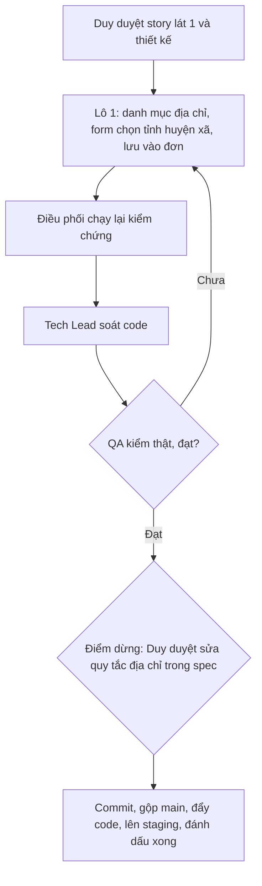

# Giao việc — Địa chỉ giao hàng có cấu trúc (lát 1)

> Claude (Tech Lead) · 2026-11-16 · Trạng thái: **NHÁP** (chờ điều phối duyệt 02b)
> Người hiện thực: đội Claude (`be-dev` ∥ `fe-dev`) → `techlead` review → `qa-tester`, theo quy trình lô trong `AGENTS.md`.
> Nhánh làm việc: worktree `/home/user/wt-address`, nhánh do điều phối tạo; QA APPROVED thì commit theo pathspec, gộp `main`, push.

## Điều kiện đầu vào
- `02-stories.md`: ĐÃ DUYỆT lát 1 (STA-01, STA-02, 16/11/2026) · `02b-tech-design.md`: chờ duyệt
- Dữ liệu danh mục đã có: `backend/apps/common/administrative_units/data/{current,legacy}.json` (điều phối đã kiểm khoá cha-con).
- Migration mới nhất của `sales` là `0023_salesorder_client_ip_hash` → migration lô này là `0024`.

## Lô
| ☐/☑ | Lô | Story | BE / FE | Được sửa (thư mục/file) | Không được đụng | Commit |
|---|---|---|---|---|---|---|
| ☑ | 1-BE | STA-01, STA-02 | BE | Mới: `backend/apps/common/administrative_units/{__init__,catalog,addresses,shop_api}.py`, `README.md`, `tests/` · Sửa: `backend/apps/sales/models/orders.py`, `backend/apps/sales/migrations/0024_salesorder_structured_address.py` (sinh bằng `makemigrations`), `backend/apps/sales/orders/shop_api.py`, `backend/apps/sales/orders/services.py` (chỉ `create_order`, `update_delivery_address`), `backend/apps/sales/orders/tests/test_shop_structured_address.py` (mới), `backend/config/api_urls.py` (1 route), `backend/config/settings.py` (`ADMINISTRATIVE_UNITS_CACHE_SECONDS`), `backend/apps/ai/policy/rules.py` (`SCRUB_PII_KEYS`), `backend/apps/accounts/data_scopes/tests/snapshot.py` (`PII_LEAVES`), `backend/apps/common/README.md`, `backend/README.md` (bản đồ module) | File JSON trong `data/` (chỉ đọc), migration cũ, test tạo đơn cũ (phải xanh không sửa), `apps/delivery/**` (confirmation, labels, serializers), serializer ERP trong `apps/sales/orders/serializers.py`, `Customer`, `frontend/`, `erp-console/`, `doc/decisions.md`, `doc/business-process-spec.md` | `c213e9d`, gộp main `8aff58f` |
| ☑ | 1-FE | STA-02 (+ đọc STA-01) | FE | `frontend/features/checkout/components/AddressField.tsx` + `.module.css` (viết lại), `frontend/features/checkout/components/AdministrativeUnitPicker.tsx` + `.module.css` (mới), `frontend/features/checkout/components/CheckoutScreen.tsx`, `frontend/features/checkout/formRules.ts`, `frontend/features/checkout/README.md`, `frontend/lib/api.ts`, `frontend/lib/types.ts`, `frontend/lib/mock.ts`, `frontend/scripts/test-order-state.mjs`, `frontend/e2e/shop_e2e_lib.py` (hàm `fill_address`, sửa `fill_checkout`), `frontend/e2e/{shop_design_screens,shop_footer_consent,shop_full_flow,shop_payment_choice}.py` (chỉ chỗ điền địa chỉ) | `backend/`, `erp-console/`, `AddressMapPicker.tsx`, `googleMaps.ts`, `components/ui/*` (dùng, không sửa), `components/CartContext.tsx`, các feature khác | `c213e9d`, gộp main `8aff58f` |

BE và FE chạy **song song**; FE bám contract 02b §2 trên mock, không chờ BE. Lệch contract → báo điều phối, Tech Lead chốt.

## Mỗi lô: điều kiện xong
- Lệnh kiểm chứng (dán output vào `03-dev-notes.md`), theo 02b §8:
  - BE: `cd backend && DJANGO_SECRET_KEY=test .venv/bin/python manage.py test --parallel 1` (thấy `Ran N tests … OK`) và
    `makemigrations --check --dry-run` sạch.
  - FE: `cd frontend && npm ci && npx tsc --noEmit && node scripts/test-order-state.mjs && NEXT_PUBLIC_USE_MOCK=0 NEXT_PUBLIC_API_BASE=http://localhost:8000 npm run build`.
  - Chung: `python3 scripts/check_naming.py`; e2e `python3 frontend/e2e/run_shop_e2e.py --suite general_rules --suite full_flow` (sau khi gộp BE + FE).
- Test bắt buộc BE: T-A1…T-A8, T-B1…T-B14 ở 02b §5 — gồm các ca ngoài đường thuận: mã xã không thuộc tỉnh, legacy thiếu
  huyện, current có huyện, mã không tồn tại, street rỗng/quá dài, đơn cũ chuỗi tự do vẫn tạo được, không giữ chỗ/lượt mã khi lỗi,
  không rò ở API công khai, log, serializer ERP theo từng Group.
- Test FE: `test-order-state.mjs` thêm ca `validateForm` theo kiểu (legacy bắt huyện, current không), thứ tự `FIELD_ORDER`,
  lọc không dấu, xoá cấp con khi đổi cấp cha.
- QA (`04-qa-report.md`, Playwright 360 + 1280): STA-02-AC1 (cả hai kiểu), AC2, AC3, AC4, AC7, AC8, AC9, AC10, AC11 (đổi như 02b §0),
  AC12; STA-01-AC4, AC6. Không PASS bằng đọc code.
- `techlead` review diff (PII, migration, lệch 02b), rồi QA APPROVED.

## Điểm dừng hỏi Duy
- **Trước khi gộp `main`:** đề xuất sửa `doc/business-process-spec.md` (BR-BH-09, BR-BH-29, thêm BR-BH-32, BR-BH-34, BR-BH-35)
  và dòng `doc/decisions.md` thay vế "Địa chỉ giao là một ô" phải được Duy duyệt (DoD của `02-stories.md`). Điều phối soạn, Duy chốt.
- Contract/thiết kế không khớp code → ghi "Lệch thiết kế" trong `03-dev-notes.md`, dừng lô.
- Bất kỳ việc nào đụng tiền, giá vốn, phân quyền ngoài phạm vi story.
