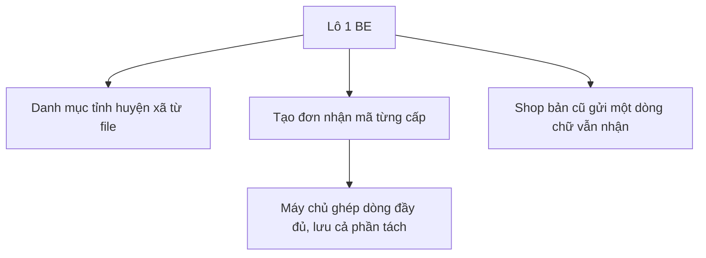
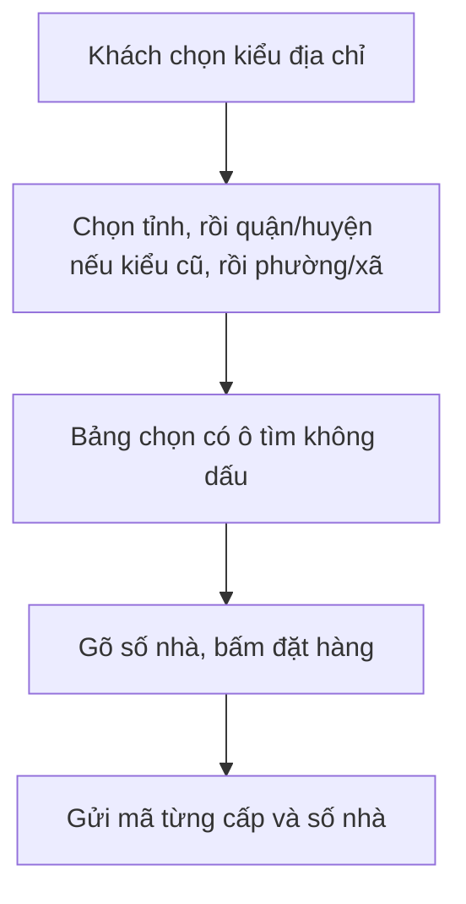

# Dev notes — Địa chỉ giao hàng có cấu trúc (lát 1)



## BE (lô 1-BE, STA-01 + STA-02)

**Lệch thiết kế:** không có.

### File
- Mới: `backend/apps/common/administrative_units/{__init__,catalog,addresses,shop_api}.py`, `README.md`, `tests/test_catalog_api.py`;
  `backend/apps/sales/orders/tests/test_shop_structured_address.py`; `backend/apps/sales/migrations/0024_salesorder_structured_address.py`.
- Sửa: `apps/sales/models/orders.py` (5 field), `apps/sales/orders/shop_api.py` (nhánh `delivery_address_parts`),
  `apps/sales/orders/services.py` (`create_order` thêm `address_parts`; `update_delivery_address` xoá trắng 5 trường),
  `config/api_urls.py`, `config/settings.py` (`ADMINISTRATIVE_UNITS_CACHE_SECONDS`), `apps/ai/policy/rules.py` (`SCRUB_PII_KEYS`),
  `apps/accounts/data_scopes/tests/snapshot.py` (`PII_LEAVES`), `apps/common/README.md`, `backend/README.md`.

### Endpoint (đúng 02b §2)
- `GET /api/shop/administrative-units/?scheme=current|legacy&level=province|district|ward[&parent=<mã>]` -> `{scheme, level, parent_code, items:[{code,name}]}`;
  lỗi 400 `VALIDATION` kèm `fields`. Cache-Control `public, max-age=86400` (chỉ khi 200).
- `POST /api/shop/orders/` nhận `delivery_address_parts {scheme, province_code, district_code, ward_code, street}`; bỏ qua
  `delivery_address` chữ nếu gửi kèm; không có `parts` thì nhánh chữ cũ (đơn "tự do", log `address=free_text`). Phản hồi không đổi.

### Migration
`sales/0024_salesorder_structured_address`: 5 `AddField` (`address_scheme`, `province_code`, `district_code`, `ward_code`, `street_address`), không data migration.

### Rule
BR-BH-29 (ghép dòng đầy đủ, kiểm cha-con ở máy chủ), BR-BH-34 (tên đóng băng trong `delivery_address`), BR-BH-35 (địa chỉ tự do). Spec chưa sửa (chờ Duy duyệt).

### Giả định / còn nợ
- Khi lỗi có `delivery_address_parts` không phải object, khoá lỗi là `delivery_address` (đúng 02b).
- Test T-B12 duyệt qua `GET /api/sales/orders/<id>/` cho 5 Group; chỉ kiểm khoá cấu trúc mới không xuất hiện (địa chỉ trong `customer.address` theo luật ẩn hiện hiện hành).
- Test T-B11 checkout chấp nhận mọi mã trạng thái hợp lệ vì cấu hình SePay không có trong test; chỉ kiểm không rò.
- Chưa chạy test Postgres (chạy trên GitHub Actions).

## FE (lô 1-FE, STA-02)



**Lệch thiết kế:** hai chỗ nhỏ, không đổi contract.
1. 02b §6 nói 1280 px dùng `Popover`. Em dùng `BottomSheet` cho cả hai cỡ (điện thoại: tấm trượt từ đáy; từ 768 px: hộp thoại giữa màn).
   Lý do: danh sách xã dài + ô tìm cần bẫy tiêu điểm và Esc đúng nghĩa, `BottomSheet` đã có sẵn; `Popover` không bẫy tiêu điểm.
2. Ô "Kiểu địa chỉ" là hai thẻ radio gốc (cao >= 44 px) trong `fieldset#f-addr-scheme`, không dùng `SegmentedControl` (nút cao 36 px, nhãn dài bị xuống dòng xấu ở 360 px).

### File đã sửa / mới (chỉ `frontend/`)
- Mới: `features/checkout/components/AdministrativeUnitPicker.tsx` + `.module.css` (nút mở + bảng chọn: ô tìm không dấu `foldVietnamese`,
  `role=combobox/listbox/option`, mũi tên lên xuống + Enter + Esc, đang tải / lỗi có "Thử lại" / rỗng, tải lại khi đổi cấp cha).
- Viết lại: `AddressField.tsx` + `.module.css` (kiểu → tỉnh → [huyện chỉ kiểu cũ] → xã → số nhà + nút "Bản đồ" giữ nguyên).
  Id: `f-addr-scheme` (fieldset), `f-addr-province`, `f-addr-district`, `f-addr-ward`, `f-addr` (số nhà, tối đa 200).
- Sửa: `CheckoutScreen.tsx` (state `selection` + `street`, gửi `delivery_address_parts`, map lỗi máy chủ; bản đồ chỉ điền ô số nhà),
  `formRules.ts` (`validStreet`, `selectScheme/Province/District/Ward` xoá cấp con, `filterUnits`, `validateForm` theo kiểu,
  `FIELD_ORDER` mới, `mapServerFields`; bỏ `validAddress`/`ADDRESS_MAX`), `lib/types.ts` (kiểu mới, `delivery_address` thành tuỳ chọn),
  `lib/api.ts` (`getAdministrativeUnits`, cache `Map` trong bộ nhớ, bỏ mục khi lỗi), `lib/mock.ts` (`mockGetAdministrativeUnits`
  kiểm tham số như §2.1; `mockCreateOrder` kiểm `parts` như §2.2; đầu dò giới hạn đọc từ `street`),
  `scripts/test-order-state.mjs` (+ca theo kiểu, xoá cấp con, lọc không dấu), `e2e/shop_e2e_lib.py` (`pick_unit`, `fill_address`,
  `fill_checkout`, `create_order_api` gửi `parts`), `e2e/shop_{design_screens,footer_consent,full_flow}.py` (chỗ điền địa chỉ).
  `shop_payment_choice.py` không cần sửa (chỉ dùng `#f-addr` làm mốc vị trí, vẫn đúng).
- Dữ liệu mock: current `68 Lâm Đồng` (xã 22918, 22945, 22950), `79 TP.HCM`; legacy `60 Bình Thuận` → `593 Phan Thiết` (22915, 22918, 22921),
  `594 Tuy Phong`; `79` → `760 Quận 1`. Số nhà, tên khách đều giả.

### Hành vi
- Đổi kiểu → xoá tỉnh, huyện, xã. Đổi tỉnh → xoá huyện, xã. Đổi huyện → xoá xã. Số nhà giữ. Lỗi của ô vừa bị xoá tự tắt.
- Ô cấp dưới tắt (có chữ "Chọn … trước") khi chưa có cấp trên. Enter trong ô tìm không gửi form.
- Không lưu địa chỉ vào storage/URL/console (đã kiểm bằng Playwright, mục dưới). Danh mục chỉ cache trong bộ nhớ.
- Shop mới chỉ gửi `delivery_address_parts` (`district_code: null` ở kiểu mới).

### Kiểm chứng (chạy trong lượt này)
```
cd frontend && npx tsc --noEmit                          -> sạch
node scripts/test-order-state.mjs                        -> test-order-state: 101/101 đạt
NEXT_PUBLIC_USE_MOCK=0 NEXT_PUBLIC_API_BASE=http://localhost:8000 npm run build -> Compiled successfully, /shop/checkout 17.6 kB
python3 scripts/check_naming.py                          -> OK - 6437 vi phạm cũ trong 173 file, không phát sinh mới
```
Playwright mock mode (360 và 1280): chọn Lâm Đồng + gõ "mui ne" ra "Phường Mũi Né" (không dấu); đổi tỉnh xoá xã; đổi kiểu xoá tỉnh;
kiểu cũ đủ 3 cấp; không cuộn ngang; localStorage/sessionStorage/URL/console không có tên, SĐT, số nhà, tỉnh; đặt hàng ở mock sang trang thanh toán giả lập.
Ảnh: `doc/features/2026-11-16-structured-address/anh/` (`01-form-trong`, `02-chon-tinh`, `03-tim-khong-dau`, `04-kieu-cu-da-dien`, `05-loi`, mỗi cái -360 và -1280).
Lưu ý ảnh fullPage 360 (`01`, `04`, `05`) có thanh "Đặt hàng" dính đáy chồng lên giữa ảnh (do chụp toàn trang), không phải lỗi bố cục.

### Việc còn nợ
- e2e `run_shop_e2e.py` chưa chạy (cần BE + FE gộp, theo 02c); hàm e2e dùng dữ liệu thật của danh mục (Lâm Đồng/Phan Thiết/Bình Thuận/Hàm Tiến), cần BE trả đúng các mã đó.
- Khi lỗi máy chủ trả `district_code` mà ô huyện đang tắt (tỉnh trống), bấm tên ô trong "Còn N chỗ cần sửa" không đưa được tiêu điểm vào nút bị tắt.
- Chưa kiểm bằng trình đọc màn hình thật; đã dùng role/aria chuẩn.

## Tech Lead review (lô 1, STA-01 + STA-02) — 16/11/2026

**Kết luận: REVIEW PASS (APPROVED)** — không có lỗi Critical/High. Hai lệch FE được chấp nhận, đã ghi lại vào 02b §6.

### Đã soát
- **Dữ liệu cá nhân (bất biến 9):** API danh mục chỉ trả `code`, `name` từ file tĩnh, không đọc DB, không log; `parent_code`
  chỉ dội lại sau khi đã tra thấy (không phản chiếu input lạ). Tạo đơn, tra đơn (SĐT và token), checkout không thêm khoá
  địa chỉ nào (T-B11). Serializer ERP không thêm field (T-B12). `editable=False` nên admin không hiện/sửa phần tách.
  Log chỉ có mã đơn (`address=free_text`); lỗi `VALIDATION` chỉ chứa câu thông báo, không chứa giá trị khách gửi (T-B13).
  Khoá mới vào `SCRUB_PII_KEYS` và `PII_LEAVES`. FE: state chỉ trong component, `client_request_id` vẫn chỉ vân tay giỏ,
  cache danh mục là `Map` trong bộ nhớ, không `console`/storage/URL.
- **Giá vốn, tiền, tồn, FEFO, voucher:** không đụng. Lỗi địa chỉ nằm ở bước 2 VALIDATION, trước giữ chỗ và giữ lượt mã.
- **Phân quyền:** endpoint danh mục `AllowAny` chỉ đọc (`get/head/options`, 405 cho ghi), throttle `public_content` dùng lại.
- **Migration:** `sales/0024` chỉ 5 `AddField` có default `""`, không data migration, không đổi nghĩa `delivery_address`.
  `makemigrations --check` sạch.
- **Tương thích Shop bản cũ:** không có `delivery_address_parts` → nhánh chữ cũ y nguyên, đơn "tự do"; test cũ xanh không sửa.
  Sửa chữ ở gọi xác nhận xoá trắng 5 trường trong cùng `save(update_fields)`; địa chỉ không đổi thì giữ (T-B10).
- **Cha-con theo `scheme`:** mọi tra cứu nhận `scheme`; xã kiểm theo tỉnh (current) hoặc huyện (legacy), huyện kiểm theo tỉnh;
  cấp trên sai thì cấp dưới cũng báo. `create_order` chặn thêm nếu `delivery_address != full_text`.
- **Input bẩn:** `parts` không phải object (chuỗi, list, số, `false`) → `delivery_address`; mã kiểu số/list → không tra (chỉ nhận
  `str`); `scheme` không băm được vẫn an toàn (so bằng tuple); `street` gộp mọi khoảng trắng Unicode, giới hạn 200 sau khi gộp;
  `district_code` khác rỗng ở current bị chặn. Mã có khoảng trắng thừa bị từ chối (đúng contract, FE gửi mã nguyên).
- **Hiệu năng:** `_index(scheme)` `lru_cache` một lần mỗi tiến trình (~0,9 MB, chỉ 2 khoá); tra cứu O(1); danh sách con đã nhóm
  và sắp sẵn; HTTP có `Cache-Control: public, max-age=86400`; FE cache theo khoá truy vấn, bỏ khi lỗi.
- **Đặt tên:** tiếng Anh; `check_naming.py` OK, không phát sinh mới.

### Lệch 02b — chốt
1. `BottomSheet` thay `Popover` ở 1280: **chấp nhận** (cần bẫy tiêu điểm + Esc cho danh sách dài có ô tìm; dùng component có sẵn).
2. Hai thẻ radio gốc thay `SegmentedControl`: **chấp nhận** (vùng bấm ≥ 44 px, nhãn dài không vỡ ở 360, phím mũi tên gốc).

### Tech Lead đã tự sửa (chỉ test, không đổi code sản phẩm)
- `backend/apps/sales/orders/tests/test_shop_structured_address.py` T-B9: trước dùng mã giảm giá **không tồn tại** (`KHONG-CO`)
  nên không chứng minh được "không giữ lượt mã". Đổi sang mã hợp lệ thật `CAVE10`, 3 ca lỗi (xã sai tỉnh, huyện sai tỉnh,
  số nhà rỗng) + ca đối chứng hợp lệ giữ đúng 1 lượt.
- Cùng file, T-B12: thêm điều kiện `owner` phải nhận 200 để test không qua rỗng khi mọi nhóm đều 403/404.

### Ghi chú, không chặn (Low, giao sau hoặc lát STA-03/04)
- L-1 `frontend/features/checkout/formRules.ts:44` khai lại `AddressScheme` trùng `frontend/lib/types.ts:77`; nên dùng một nguồn.
- L-2 `frontend/e2e/shop_e2e_lib.py:216` `import unicodedata` trong thân hàm; đưa lên đầu file.
- L-3 Django Admin (superuser) vẫn sửa được `delivery_address` mà không xoá phần tách (`backend/apps/sales/admin.py:45`); xử lý cùng STA-04.
- L-4 Bản đồ điền nguyên chuỗi Google (thường có sẵn phường, tỉnh) vào ô số nhà, máy chủ ghép thêm phường, tỉnh → dòng đầy đủ có thể
  lặp tên. Đúng 02b (khách vẫn sửa được); QA/UAT để ý, lát sau cân nhắc cắt phần hành chính.
- L-5 Dev đã nêu: lỗi máy chủ `district_code` khi ô huyện đang tắt thì bấm trong "Còn N chỗ cần sửa" không vào được ô.

### Kiểm chứng trong lượt review
```
cd backend && DJANGO_SECRET_KEY=test .venv/bin/python manage.py test apps.common.administrative_units apps.sales apps.delivery.confirmation apps.ai apps.accounts.data_scopes --parallel 1
  -> Ran 1542 tests in 200.483s  OK (skipped=11)        (trước khi sửa test)
cd backend && DJANGO_SECRET_KEY=test .venv/bin/python manage.py test apps.common.administrative_units apps.sales --parallel 1
  -> Ran 972 tests in 102.027s  OK (skipped=10)         (sau khi sửa T-B9, T-B12)
cd backend && DJANGO_SECRET_KEY=test DJANGO_DEBUG=1 .venv/bin/python manage.py makemigrations --check --dry-run -> No changes detected
cd frontend && npx tsc --noEmit -> sạch · node scripts/test-order-state.mjs -> 101/101 đạt
python3 scripts/check_naming.py -> OK, không phát sinh mới
```
Chưa chạy: build FE, e2e `run_shop_e2e.py` (cần BE + FE chạy cùng), test Postgres (GitHub Actions).
