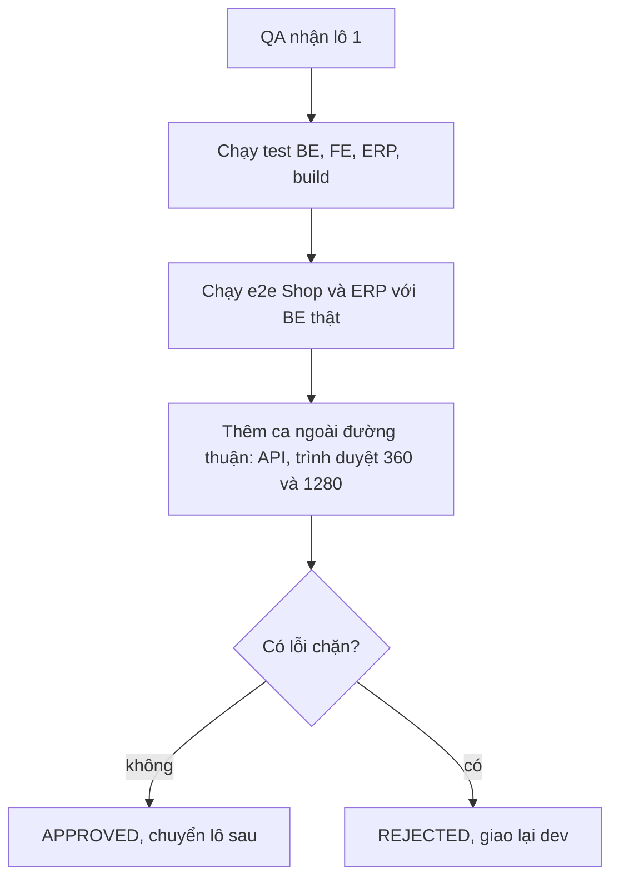

# QA — Địa chỉ giao hàng có cấu trúc (lô 1: STA-01 + STA-02)



> QA · 2026-11-16 · lần 1 · Worktree `/home/user/wt-address` · Dữ liệu 100% giả (Lê Thị Mẫu, 0900000555, "37 Hẻm Giả, tầng 2").
> Ảnh: `doc/features/2026-11-16-structured-address/anh/qa-*.png` (22 ảnh, 360 và 1280). Thư mục này bị `.gitignore` (`*.png`) nên ảnh chỉ nằm trên máy, không vào commit.

## Kết luận: APPROVED — không có lỗi Critical/High/Medium; 3 ghi nhận Low và 3 mục ⏸ (chưa kiểm được trong môi trường này, lý do ở dưới)

## Tổng: 6.000+ ca (BE 4164, ERP 1391, FE 101, e2e 303, QA thêm 100) · ✅ tất cả ca đã chạy đạt · ❌ 0 (6 ca đỏ ở lần chạy API đầu là lỗi script QA/SQLite, đã chạy lại đúng, xem "Ca QA tự sửa") · ⏸ 3

| Nguồn | Kết quả |
|---|---|
| BE `manage.py test --parallel 1` (toàn bộ) | `Ran 4164 tests in 537.824s` · `OK (skipped=19)` |
| `makemigrations --check --dry-run` | `No changes detected` |
| FE `npm ci` · `tsc --noEmit` · `npm run build` (USE_MOCK=0) | sạch · exit 0 · exit 0 (`/shop/checkout 17.6 kB`) |
| FE `node scripts/test-order-state.mjs` | `101/101 đạt` |
| ERP `npm ci` · `tsc --noEmit` · `npm test` | sạch · exit 0 · `Test Files 118 passed · Tests 1391 passed` |
| e2e `run_shop_e2e.py --suite general_rules --suite full_flow` | `general_rules: 168 đạt, 0 lỗi, 1 bỏ qua (axe-core không có sẵn)` · `full_flow: 135 đạt, 0 lỗi, 0 bỏ qua` |
| QA API trên BE thật (`qa_api.py` + `qa_api2.py`) | 73 + 16 ca; 6 ca đỏ đều do script QA hoặc môi trường SQLite (xem dưới); các ca đó đã chạy lại đúng bằng `qa_api2.py`, 16/16 đạt |
| QA Playwright thật 360 + 1280, BE thật (`qa_ui.py`) | **84/84 đạt** |
| `check_naming.py` · `sync_ai_workspace.py --check` | `OK, không phát sinh mới` · `OK - 20 file, 22 liên kết` |

Ghi chú môi trường: `python3` mặc định không có Playwright và máy chặn tải Chromium (cdn.playwright.dev 403). QA dựng venv riêng
`scratchpad/pwvenv` với `playwright==1.63.0` dùng đúng Chromium có sẵn ở `/opt/pw-browsers`. Không sửa code sản phẩm, không làm git.
Cổng 8000/3000/3100 đều rảnh trước và sau khi chạy.

## Theo AC

| Mã AC | Kết quả | Bằng chứng |
|---|---|---|
| STA-01-AC1, AC2, AC3 (vùng giao) | Bỏ theo 02b §0 | Thay bằng ca danh mục ở dưới (đều ✅) |
| Danh mục đủ cả nước, hai kiểu | ✅ | `qa_api.py`: current/province 34, legacy/province 63; `legacy/district?parent=60` có `593`; `current/ward?parent=68` có `22945`; `legacy/ward?parent=593` có `22915`; `22918` ra hai tên khác nhau theo kiểu. UI: "danh sách tỉnh kiểu mới đủ 34", "kiểu cũ đủ 63" (360 và 1280) |
| STA-01-AC4 (không PII) | ✅ | Mỗi mục đúng `{code,name}`; không đọc DB; `parent` chỉ dội lại khi tra thấy. Phản hồi 400 với `parent=<script>…` và `parent=99…9` (3000 ký tự) không chứa lại chuỗi vào |
| STA-01-AC5 (nguồn, đổi) | ✅ | Nguồn ghi ở README module + `description` file JSON (đọc, không phải PASS bằng đọc mã: dữ liệu sinh ra đúng 34/63 như test T-A1 trong 4164 ca) |
| STA-01-AC6 (405) | ✅ | `POST`, `PUT`, `PATCH`, `DELETE` → 405; `HEAD`/`OPTIONS` 200 |
| Tham số sai → 400 | ✅ | 14 ca (scheme thiếu/lạ/`€`, level thiếu/lạ, `current/district`, thiếu parent, parent lạ, parent sai cấp cả hai chiều, parent XSS, parent dài): 400 `VALIDATION` đúng khoá `fields` (`scheme`/`level`/`parent`), không có `Cache-Control: public` ở 400. 200 có `Cache-Control: public, max-age=86400` |
| STA-02-AC1 | ✅ | UI 360 + 1280: Lâm Đồng → Phường Phan Thiết, số nhà giả → đơn `address_scheme=current, province=68, district="", ward=22945`, `delivery_address = "37 Hẻm Giả, tầng 2, Phường Phan Thiết, Tỉnh Lâm Đồng"`. Ảnh `qa-06-kieu-moi-da-dien-{360,1280}.png` |
| Kiểu cũ (Bình Thuận → TP Phan Thiết → phường) | ✅ | UI: đơn `legacy`, `60/593/22918`, dòng ghép có "Thành phố Phan Thiết, Tỉnh Bình Thuận". API: `60/593/22915` → "…Phường Mũi Né, Thành phố Phan Thiết, Tỉnh Bình Thuận". Ảnh `qa-05-kieu-cu-3-cap-*` |
| STA-02-AC2 (tìm không dấu) | ✅ | "lam dong", "LÂM ĐỒNG", "phan thiet" ra đúng; chữ không khớp → danh sách rỗng, có thông báo (360 + 1280). Ảnh `qa-03`, `qa-04` |
| STA-02-AC3 (thiếu ô) | ✅ | Bấm "Đặt hàng" khi trống → "Còn 3 chỗ cần sửa: Tỉnh/thành phố, Phường/xã, Số nhà, tên đường" theo thứ tự ô; đếm DB: không có đơn mới. Ảnh `qa-02-loi-thieu-o-*` |
| STA-02-AC4 (sửa tay request) | ✅ | 16 ca API: xã khác tỉnh, legacy thiếu huyện, huyện không thuộc tỉnh, xã không thuộc huyện, current có huyện, mã không tồn tại, mã kiểu số, scheme lạ, street rỗng/toàn dấu cách/201 ký tự/thiếu/không phải chuỗi, `parts` là chuỗi/list/`{}` → 400 `VALIDATION` đúng field; sau cả 16 ca: số đơn, tổng `qty_reserved`, số `VoucherRedemption` **không đổi** (gửi kèm mã giảm giá hợp lệ). Đối chứng: parts hợp lệ + mã giữ đúng 1 lượt |
| Biên street | ✅ | Đúng 200 ký tự → tạo; xuống dòng/tab/nhiều dấu cách gộp thành một dấu cách |
| Shop cũ gửi chuỗi `delivery_address` | ✅ | Tạo đơn thành công, 5 trường cấu trúc rỗng; chuỗi rỗng và 501 ký tự → 400 `delivery_address`; không có cả hai → 400. Gửi cả chuỗi lẫn parts → dùng chuỗi máy chủ ghép |
| STA-02-AC5 (đóng băng) | ⏸ | Danh mục là file tĩnh nên không đổi tên được lúc chạy để thử; chỉ xác nhận chuỗi lưu độc lập trong `SalesOrder.delivery_address` (đọc từ DB). Chưa có ca đổi tên danh mục. Rủi ro thấp, không chặn |
| STA-02-AC6 (vùng trống) | Bỏ theo 02b §0 | |
| STA-02-AC7 (gửi lại) | ✅ (tuần tự) / ⏸ (đồng thời) | Gửi lại cùng `client_request_id` với địa chỉ khác → cùng đơn, địa chỉ giữ `current`. UI bấm đúp "Đặt hàng" → đúng 1 đơn mới (360 và 1280) và e2e `full_flow` đúng 1 lần mở cổng. 6 luồng đồng thời cùng id trên SQLite: DB chỉ có 1 đơn nhưng 5 request 500 "database is locked" là giới hạn SQLite (không liên quan địa chỉ); cần Postgres, chạy ở CI |
| STA-02-AC8 (API công khai) | ✅ | Phản hồi tạo đơn, `lookup` bằng SĐT, `lookup` bằng token, `checkout`: không có khoá `delivery_address*`/`province*`/`district*`/`ward*`/`street*`/`address_scheme`, không có chuỗi số nhà/tên tỉnh/tên phường/mã xã. Trang đơn công khai (HTML, 360 + 1280): không có địa chỉ, tên, SĐT, khoá tách. GET tra đơn → 404/405 |
| STA-02-AC9 (log) | ✅ | `runserver` DEBUG qua toàn bộ ca đạt/lỗi: log BE không chứa số nhà, tên, SĐT, mã xã (hai lần kiểm). Test T-B13 trong 4164 ca |
| STA-02-AC10 (trình duyệt) | ✅ | 360 + 1280: sau khi điền và đặt, `localStorage`/`sessionStorage`/cookie, URL, console không chứa tên, SĐT, số nhà, tên tỉnh/phường. Điền đủ rồi F5 → tên, SĐT, tỉnh, phường, số nhà đều trống; URL không query. Console không lỗi |
| STA-02-AC11 (giao diện) | ✅ | Thứ tự Kiểu → Tỉnh → Phường/xã → Số nhà (kiểu cũ thêm Quận/huyện), ô chọn cao ≥ 44 px, không cuộn ngang ở 360. Ảnh `qa-01`, `qa-05`, `qa-06`. Khác AC gốc theo 02b: tỉnh chọn được, có ô chọn kiểu, nút "Bản đồ" giữ nguyên |
| STA-02-AC12 (bên thứ ba) | ✅ | Playwright ghi mọi request: chỉ `localhost`; danh mục lấy từ `/api/shop/administrative-units/` (8 request/lượt); URL danh mục không có tên/SĐT/số nhà |

## Ngoại lệ và biên

| Ca | Kết quả | Bằng chứng |
|---|---|---|
| Đổi kiểu → xoá tỉnh, huyện, xã; giữ số nhà | ✅ | UI 360 + 1280 |
| Đổi tỉnh → xoá xã (kiểu mới) | ✅ | UI |
| Đổi huyện → xoá xã; đổi tỉnh (kiểu cũ) → xoá huyện và xã | ✅ | UI |
| Ô cấp dưới tắt khi chưa chọn cấp trên | ✅ | UI ("Chọn tỉnh/thành phố trước") |
| Máy chủ báo `ward_code` sai (sửa request giữa đường) | ✅ | UI hiện lỗi ở ô phường/xã, không tạo đơn, ở lại checkout. Ảnh `qa-08-loi-may-chu-*` |
| Danh mục lỗi mạng | ✅ | Hiện lỗi + "Thử lại"; bấm Thử lại khi có mạng → đủ 34 mục. Ảnh `qa-09-loi-mang-danh-muc-360.png` |
| Tem in (ERP) đơn kiểu mới, kiểu cũ, Shop cũ (chữ tự do) | ✅ | API `/delivery/notes/<id>/label/` và trang `/print/label/` 1280 + chi tiết đơn ERP 1280 + 360: địa chỉ đúng từng đơn (đơn cũ giữ nguyên từng ký tự), SĐT che còn 4 số cuối, không khoá cấu trúc mới, không giá vốn. Ảnh `qa-10`, `qa-11`, `qa-12` |
| `Customer.default_address` | ✅ | Khách mới: bằng dòng đầy đủ. Khách đã có sẵn thì giữ giá trị cũ (hành vi có từ trước, `get_or_create`) |
| Gọi xác nhận sửa địa chỉ chữ (CS-12) | ✅ | Chỉ đổi tên người nhận: phần cấu trúc giữ. Sửa chữ địa chỉ: 5 trường cấu trúc về rỗng, tem dùng chuỗi mới. AuditLog chỉ ghi `{'fields': ['delivery_address']}`, không có chuỗi địa chỉ |
| Migration chỉ thêm | ✅ | `makemigrations --check` sạch; đơn Shop cũ giữ nguyên |

## Phân quyền (chi tiết đơn `GET /api/sales/orders/<id>/` và phiếu giao `GET /api/delivery/notes/<id>/`)

| Group | Chi tiết đơn / phiếu | Khoá cấu trúc mới | Sửa địa chỉ `POST …/recipient/` |
|---|---|---|---|
| owner | 200 / 200 | không | (chưa thử riêng) |
| manager | 200 / 200 | không | — |
| warehouse_staff | 200 / 200 | không | 403/404 |
| delivery_staff (không được giao phiếu) | 404 / 404, không chứa địa chỉ | không | 403/404 |
| customer_service | 200 / 403 | không | 200 (đúng quyền `change_recipient`) |
| Không thuộc nhóm nào | 403 / 403, không chứa địa chỉ | không | 403/404 |
| Chưa đăng nhập | 401 | — | — |

"Phiếu của tôi" của `delivery_staff` không có khoá cấu trúc mới. Ma trận trên là hành vi hiện hành, lô này không đổi quyền.

## Rò giá vốn
Lô không đụng. Tem và chi tiết phiếu không chứa `cost`; chuỗi "cost" không có trong JSON tem. ✅

## Rò dữ liệu cá nhân
- API công khai (tạo đơn, lookup SĐT/token, checkout, danh mục), HTML trang đơn: sạch ✅.
- Log BE, console trình duyệt, `localStorage`/`sessionStorage`/cookie, URL, request danh mục, form gửi cổng thanh toán: sạch ✅.
- Tra đơn dùng POST (UI chỉ gọi POST, URL không có SĐT); GET không còn dùng được ✅. Giới hạn tần suất: e2e `full_flow` "tra đơn lặp nhiều lần → 429" ✅.
- AuditLog: chỉ tên trường ✅. Khoá mới không cho tính ngược giá vốn.
- Ảnh và report chỉ dùng dữ liệu giả ✅ (tên/SĐT/số nhà giả; tên tỉnh, phường là danh mục công cộng).

## Hồi quy
BE toàn bộ 4164 ca OK; ERP 1391 ca OK; e2e `general_rules` 168 và `full_flow` 135 đều đạt (gồm đặt đơn, mã giảm giá, thanh toán IPN 2 lần idempotent, giới hạn tần suất, lỗi mạng).

## Ca QA tự sửa (không phải lỗi sản phẩm)
Lần chạy `qa_api.py` đầu có 6 ca đỏ: (1) và (2) assertion của QA sai (khách có sẵn nên `default_address` giữ giá trị cũ; mã `22915` ở kiểu cũ là "Phường Mũi Né" chứ không phải "Hàm Tiến"); (3) 5 request 500 do khoá ghi SQLite khi 6 luồng đồng thời; (4)-(6) tem trả 400 BR-GH-09 "chưa xác nhận, chưa in tem" đúng luật vì phiếu còn CONFIRMING. Cả sáu đã chạy lại đúng trong `qa_api2.py` (đặt phiếu sang PREPARING rồi lấy tem) và Playwright: đạt.

## Lỗi
Không có lỗi chặn.

## Ghi nhận (Low, không chặn)
- **N1 · Low · UX ô chọn:** khi ô tìm còn chữ, nhấn Esc lần 1 chỉ xoá chữ, lần 2 mới đóng bảng (kiểm: "2 lần bấm"). Hành vi combobox thông dụng nhưng người dùng bàn phím có thể tưởng Esc không đóng. Cân nhắc đóng ngay ở lần 1.
- **N2 · Low · môi trường:** đồng thời cùng `client_request_id` trên SQLite trả 500 "database is locked"; không thuộc lô này, cần ca Postgres ở CI để chốt.
- **N3 · Low · chữ:** dòng gợi ý "Cá Về giao trong khu vực Phan Thiết." vẫn hiện dưới ô số nhà trong khi khách chọn được mọi tỉnh. Là chữ cũ chưa chặn vùng giao (Q-2, Q-4 để sau, STA-03); nên chốt lại chữ khi làm STA-03.
- Các ghi chú L-1..L-5 của Tech Lead: L-3 (Django Admin sửa chữ không xoá phần tách) và L-4 (nút "Bản đồ" điền chuỗi đã có phường/tỉnh) **không kiểm bằng chạy thật** ⏸: không có Google key trong môi trường nên không bấm được bản đồ; admin không thuộc phạm vi lô. L-5 (bấm tên ô trong "Còn N chỗ" khi ô huyện đang tắt): không tái hiện vì lỗi tách ô huyện chỉ xảy ra khi client sửa request; để lát sau như ghi.

## ⏸ Chưa kiểm
1. STA-02-AC5 đóng băng tên khi danh mục đổi (không đổi được danh mục lúc chạy).
2. STA-02-AC7 phần đồng thời trên Postgres (chạy ở GitHub Actions).
3. Nút "Bản đồ" điền chuỗi vào ô số nhà (L-4), axe-core (e2e ghi "bỏ qua").

## Lệnh đã chạy (tóm tắt)
```
cd backend && DJANGO_SECRET_KEY=test .venv/bin/python manage.py test --parallel 1   -> Ran 4164 tests in 537.824s · OK (skipped=19)
cd backend && .venv/bin/python manage.py makemigrations --check --dry-run            -> No changes detected
cd frontend && npm ci && npx tsc --noEmit                                           -> sạch (0 vulnerabilities)
cd frontend && NEXT_PUBLIC_USE_MOCK=0 NEXT_PUBLIC_API_BASE=http://localhost:8000 npm run build -> exit 0, /shop/checkout 17.6 kB
cd frontend && node scripts/test-order-state.mjs                                    -> 101/101 đạt
cd erp-console && npm ci && npx tsc --noEmit && npm test                            -> Test Files 118 passed · Tests 1391 passed
python3 frontend/e2e/run_shop_e2e.py --suite general_rules --suite full_flow (venv playwright 1.63.0)
   -> PASS general_rules: 168 đạt, 0 lỗi, 1 bỏ qua · PASS full_flow: 135 đạt, 0 lỗi, 0 bỏ qua
qa_api.py + qa_api2.py (BE thật, SQLite tạm) -> xem "Ca QA tự sửa"; qa_api2: 16 PASS, 0 FAIL
qa_ui.py (Playwright 360 + 1280, BE thật, ERP + Shop build USE_MOCK=0) -> 84 PASS, 0 FAIL
python3 scripts/check_naming.py -> OK, không phát sinh mới · sync_ai_workspace.py --check -> OK
```
Script QA nằm ở scratchpad (`qa_api.py`, `qa_api2.py`, `qa_ui.py`), không đưa vào repo.
