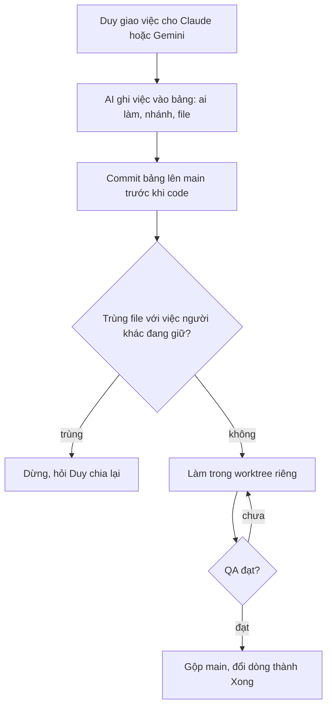

# Bảng việc chung Claude và Gemini

Luật (chi tiết ở `AGENTS.md` mục "Làm chung Claude và Gemini"):
- Mỗi việc một dòng. **Nhận việc trước khi code**: ghi cột Ai, Nhánh, Phạm vi file, đổi Trạng thái thành "Đang làm",
  commit riêng file này lên `main` và push.
- Hai việc "Đang làm" **không được trùng phạm vi file**. Cần đụng file của việc người khác thì dừng và hỏi Duy.
- Ai: `claude` hoặc `gemini`. Nhánh: `<ai>/<slug>`. Worktree đặt ngoài checkout chính.
- Trạng thái: Chờ làm → Đang làm → Chờ QA → Xong (kèm hash commit gộp main) · Tạm dừng (ghi lý do).
- Xong thì giữ dòng thêm một tuần rồi chuyển xuống mục "Đã xong".

## Đang làm và chờ làm

| Việc | Hồ sơ | Ai | Nhánh | Phạm vi file | Trạng thái | Ghi chú |
|---|---|---|---|---|---|---|
| Rà soát bảo mật toàn diện, chống tấn công | `doc/features/2026-11-15-ra-soat-bao-mat/` | claude | `sec/tong` | backend, adapter, firebase*.json, e2e | Xong `93b24ad` (staging api:v30) | Production chờ Duy duyệt; checklist ở nhật ký `moi-truong.md` 15/11 |
| An toàn khi AI làm nhầm (sao lưu DB, chặn lệnh nguy hiểm, bảo vệ nhánh) | — | claude | `sec/ai-guard` | hạ tầng GCP, `.claude/settings.json`, `.agents/hooks.json` | Xong `93b24ad` | Sao lưu đêm 02:00 (giữ 30 ngày, đã khoá), `main` cấm force-push, hook `scripts/ai_guard.py` cho Claude + Antigravity |
| Ô địa chỉ giao chọn theo danh mục (kiểu mới/cũ, cả nước) — lát 1 STA-01, STA-02 | `doc/features/2026-11-16-structured-address/` | claude-cloud | `claude/sheet-structured-address` | `frontend/` trang đặt hàng, `backend/apps/sales/`, `backend/apps/common/administrative_units/` | Ready UAT `8aff58f` (chờ Duy test rồi cho lên thật) | sheet FIX WEB dòng 9; còn lại STA-03 vùng giao, STA-04 ERP sửa theo danh mục, STA-06 (chờ Duy chốt vùng giao) |
| Liên kết hãng giao Ahamove / Giao Hàng Tiết Kiệm (in tem → giao xong) | `doc/features/2026-11-16-shipping-partner/` | claude-cloud | `claude/sheet-shipping-partner` | `backend/apps/delivery/`, `adapter/` (webhook hãng giao), `erp-console/` màn phiếu giao | Tạm dừng | Duy 16/11: chưa có đối tác giao hàng, làm sau. Hồ sơ BA + story nháp đã có. sheet FIX WEB dòng 10; phụ thuộc dòng 9 (địa chỉ có cấu trúc) |
| Google Maps ở trang đặt hàng | `doc/features/2026-10-06-shop-giao-dien-moi/` (SHOP-3-04) | claude | `claude/shop-maps` | `frontend/firebase.json`, `frontend/firebase.staging.json`, `doc/ops/moi-truong.md` | Đang làm | Key staging đã tạo 24/11 (secret `cangca-staging-google-maps-key`); sửa CSP cho Places |

## Đã xong

| Việc | Ai | Commit gộp main | Ngày |
|---|---|---|---|
| Shop UI GUI-01..15 | gemini + claude | xem `doc/features/2026-11-11-shop-ui-gemini/02c-giao-viec.md` | 11–15/11 |
| FISH-66 bán 0,5 kg, nhập/xuất Excel · FISH-67 nhãn giao · FB-01 · NX-01 Next 15 | claude | `4ec6b2f` | 15/11 |
| Trả nợ kỹ thuật TD-01..10 (staging api:v29) | claude | `e27788a` | 15/11 |
| Dùng chung workspace Claude và Gemini | claude | `a46c1b2` | 15/11 |
