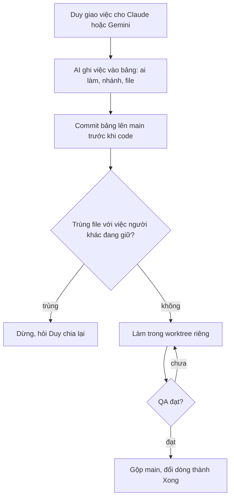

# Bảng việc chung Claude và Gemini

Luật (chi tiết ở `AGENTS.md` mục "Làm chung Claude và Gemini"):
- Mỗi việc một dòng. **Nhận việc trước khi code**: ghi cột Ai, Nhánh, Phạm vi file, đổi Trạng thái thành "Đang làm",
  commit riêng file này lên `main` và push.
- Hai việc "Đang làm" **không được trùng phạm vi file**. Cần đụng file của việc người khác thì dừng và hỏi Duy.
- Ai: `claude` hoặc `gemini`. Nhánh: `<ai>/<slug>`. Worktree đặt ngoài checkout chính.
- Trạng thái: Chờ làm → Đang làm → Chờ QA → Xong (kèm hash commit gộp main) · Tạm dừng (ghi lý do).
- Xong thì giữ dòng thêm một tuần rồi chuyển xuống mục "Đã xong".

## Đang làm và chờ làm

| Việc | Hồ sơ | Ai | Nhánh | Phạm vi file | Trạng thái | Ghi chú |
|---|---|---|---|---|---|---|
| Trả nợ kỹ thuật TD-01..10 | `doc/features/2026-11-15-tra-no-ky-thuat/` | claude | `td/be`, `td/fe-shop`, `td/fe-tiptap`, `td/e2e`, `td/spec` | `backend/apps/{catalog/item_files,sales,content}`, `frontend/{features,lib,components,e2e/run_shop_e2e.py}`, `erp-console/` (Tiptap, nhập Excel), `doc/business-process-spec.md` | Đang làm | Duy giao 15/11 |
| Dùng chung workspace Claude và Gemini | — | claude | `ai/workspace-chung` | `AGENTS.md`, `CLAUDE.md`, `GEMINI.md`, `.claude/`, `.agents/`, `.gemini/`, `scripts/sync_ai_workspace.py`, `.github/workflows/` | Đang làm | Duy giao 15/11 |
| An toàn khi AI làm nhầm (sao lưu DB, chặn lệnh nguy hiểm, bảo vệ nhánh) | — | — | — | hạ tầng GCP, `.claude/settings.json`, `.agents/hooks.json` | Chờ làm | Chờ Duy đồng ý bước 1 (15/11) |
| Google Maps ở trang đặt hàng | — | — | — | — | Tạm dừng | Chờ Duy cấp key |

## Đã xong

| Việc | Ai | Commit gộp main | Ngày |
|---|---|---|---|
| Shop UI GUI-01..15 | gemini + claude | xem `doc/features/2026-11-11-shop-ui-gemini/02c-giao-viec.md` | 11–15/11 |
| FISH-66 bán 0,5 kg, nhập/xuất Excel · FISH-67 nhãn giao · FB-01 · NX-01 Next 15 | claude | `4ec6b2f` | 15/11 |
