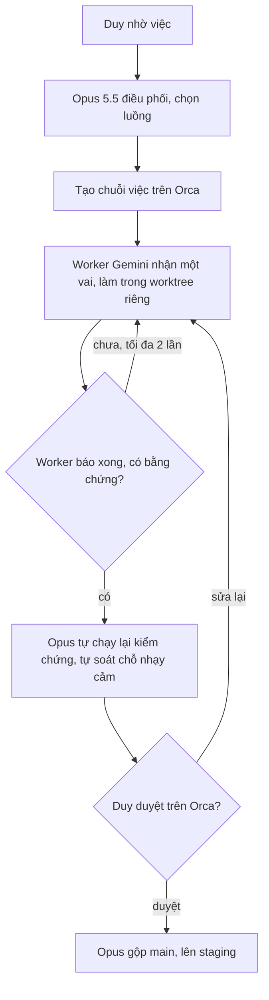

# Điều phối bằng Orca: Opus 5.5 giao việc cho worker Opus và Gemini



Duy chốt ngày 24/11/2026, làm giống dự án LiveTranscribe:

- **Điều phối duy nhất** là Claude Code chạy model `claude-opus-5-5` trong Orca.
- **Mọi vai** trong bảng ở `AGENTS.md` chạy dưới dạng **worker Orca**, chia hai nhóm (Duy chốt 24/11):
  - **Vai quan trọng → worker Claude Opus** (`--agent claude --model claude-opus-5-5`): `techlead`, `ba-analyst`, `po-owner`, `legal-vn`.
    Sai ở đây là sai nghiệp vụ, giá vốn hoặc pháp lý, sửa về sau rất tốn.
  - **Các vai còn lại → worker Gemini** (`--agent antigravity --model gemini-4-carbon-high`): `product-manager`,
    `ux-designer`, `mkt-brand`, `be-dev`, `fe-dev`, `qa-tester`, `shop-ui-dev`, `shop-ui-qa`, `image-scout`.
- Gemini **không làm điều phối** nữa. Bỏ `.agents/agents/`, `.gemini/commands/` và chế độ "ngang quyền".
- Opus **tự review diff** ở các chỗ nhạy cảm: giá vốn, dữ liệu cá nhân, phân quyền, migration, thanh toán, webhook.
  Việc này không giao cho worker.
- Các **điểm Duy duyệt** (phân tích, story, lên staging, lên thật) là **gate của Orca**. Duy bấm duyệt trên máy tính hoặc
  điện thoại.

## 1. Lệnh của điều phối viên

`ORCA` là `/Applications/Orca.app/Contents/Resources/bin/orca`. Mỗi phiên, trước lần giao việc đầu tiên, chạy
`ORCA status --json` và `ORCA skills get orchestration --full`. Nếu cờ trong hướng dẫn đó khác file này thì **làm theo
hướng dẫn đó** và sửa lại file này.

```bash
# một Run cho mỗi tính năng hoặc mỗi đợt
ORCA orchestration run-create --environment local --objective "<slug>: <mục tiêu> (hồ sơ doc/features/<ngày>-<slug>/)"

# một Task cho mỗi lượt giao vai; spec viết ra file theo mẫu mục 3
ORCA orchestration task-create --environment local --task-title "BA <slug>" --spec-file <spec.md>
ORCA orchestration task-create --environment local --task-title "PO <slug>" --spec-file <spec.md> --deps '["<task BA>"]'

# điểm Duy duyệt chặn Task phía sau
ORCA orchestration gate-create --task <task PO> --question "Duyệt phân tích BA <slug>? (tóm tắt + câu hỏi 🔴)" \
  --options '["duyet","sua-lai","dung"]'

# giao worker; mỗi việc một worktree mới tách từ origin/main
#   vai techlead, ba-analyst, po-owner, legal-vn: --agent claude --model claude-opus-5-5
#   các vai còn lại:                             --agent antigravity --model gemini-4-carbon-high
ORCA orchestration worker-start --environment local --task <task_id> --agent <agent> --model <model> \
  --worktree new-top-level --repo id:19653c71-270c-4299-8146-e6ff05e5e8c9 --base-branch origin/main --name claude-<slug>-<vai>
```

- Orca đặt tên nhánh worker là `DuyduyFedev46/<--name>` (đã chạy thử 24/11), worktree ở `~/orca/workspaces/loc/<--name>`.
  Gộp nhánh đó vào nhánh lô, xong thì dọn: `ORCA orchestration worker-release --dispatch <id>` rồi
  `ORCA worktree rm --worktree path:<worktree> --delete-branch`.
- `--model gemini-4-carbon-high` được Orca hiểu là model `gemini-4-carbon`, mức `high`.
- Việc chỉ viết tài liệu (PM, BA, PO, UX, Tech Lead viết 02b, Pháp lý, Marketing chỉ soạn chữ): có thể cho chung một
  worktree tài liệu `claude-<slug>-doc`. Dùng `--worktree <selector của worktree đó>`, không tạo mới mỗi lượt.
- Việc code: BE và FE song song thì **mỗi bên một worktree**. Không bao giờ cho hai worker sửa cùng một file.
- **e2e dùng cổng cố định 8000/3000/3100**: mỗi lúc chỉ một worker được chạy e2e. Opus xếp lượt QA.
- Không poll, không viết script canh worker: Orca tự đánh thức điều phối viên khi có thư.
- Sửa worker bằng `ORCA orchestration send --to dispatch:<id>`. Đọc kết quả bằng `worker-read`. Không gõ vào terminal của worker.
- Worker hỏi (`question`): câu trả lời có sẵn trong hồ sơ hoặc luật thì Opus `reply`; không có thì hỏi Duy.
- Worker trượt cổng kiểm chứng: gửi log lỗi cho **chính worker đó**, tối đa **2 lần**. Quá 2 lần thì dừng và báo Duy.
  Không tự code thay.
- Worker báo xong: Opus đọc bằng chứng, rồi **tự chạy lại** lệnh kiểm chứng trong worktree của worker (luật "không tin báo
  cáo"). Sau đó gộp nhánh worker vào nhánh lô `claude/<slug>`, rồi gộp `main` theo `AGENTS.md`.

### Đường dự phòng

Khi Orca hoặc `agy` hỏng, hoặc khi phiên chạy ở chỗ không có Orca (routine quét sheet trên cloud), thì giao bằng công cụ
Agent của Claude Code với `subagent_type` là tên vai. Model lấy theo frontmatter `model:` của file vai. Báo Duy một dòng
rằng đang chạy dự phòng.

## 2. Luật worker (dán nguyên khối vào đầu mọi spec)

```text
LUẬT WORKER CÁ VỀ (bắt buộc)
0. Bạn là worker, không phải điều phối viên. Đọc AGENTS.md (luật chung, nhất là "Luật bắt buộc" và "Đặt tên"),
   rồi đọc file vai .claude/agents/<vai>.md và mọi skill vai đó liệt kê ở frontmatter (.agents/skills/<skill>/SKILL.md).
   Không chạy skill feature, không giao việc cho ai khác.
1. Chỉ sửa file trong mục "File được sửa". Cần sửa file khác thì `orca orchestration ask` trước, không tự sửa.
2. Không thêm thư viện, package, migration ngoài mục "Được thêm".
3. KHÔNG BỊA API. Trước khi gọi hàm của Django, DRF, Next.js, thư viện ngoài hay code trong repo, mở file nguồn ra đọc.
   Trong báo cáo, mỗi API ngoài dùng tới ghi "file:line". Không tìm thấy thì dừng, báo failed, body bắt đầu "BLOCKED:".
4. Không để stub giả vờ xong (TODO, return rỗng, pass, NotImplementedError) trừ khi spec cho phép.
5. Chạy đủ "Cổng kiểm chứng" trong spec trước khi báo xong. Dán 20 dòng cuối output của từng lệnh. Test Django phải có dòng
   "Ran N tests ... OK". npm phải là `npm ci` sạch, không --legacy-peer-deps.
6. Giá vốn và dữ liệu cá nhân khách (tên, SĐT, địa chỉ) không được lộ ra API công khai, log, prompt AI, test, tài liệu.
   Chỉ dùng dữ liệu giả.
7. Git: chỉ commit trên nhánh của worktree mình, theo pathspec (`git add <file>`, `git commit -m "<mã story>: …" -- <file>`),
   message tiếng Việt, dòng cuối `Co-Authored-By: Gemini 4 Carbon <noreply@google.com>` (worker Opus ghi
   `Co-Authored-By: Claude Opus 5.5 <noreply@anthropic.com>`).
   Không push, không merge, không rebase, không `git add -A`. Không deploy, không gcloud, không đụng DB staging/production.
8. Không kill tiến trình nào bạn không tự bật. Cổng 8000/3000/3100 bận thì báo, không tự giải phóng.
9. Báo xong đúng một lần theo cách Orca ghi ở đầu prompt (worker_done), kèm danh sách file đã sửa. Body gồm:
   (a) đã làm gì, (b) giả định, (c) API ngoài đã dùng + file:line, (d) output cổng kiểm chứng, (e) còn lại gì, câu hỏi 🔴.
```

## 3. Mẫu spec cho một Task

```markdown
# <Vai> — <mã story hoặc bước> — <slug>

<LUẬT WORKER CÁ VỀ ở mục 2, dán nguyên>

## Vai
`<vai>`: đọc `.claude/agents/<vai>.md`.

## Hồ sơ
`doc/features/<ngày>-<slug>/` (đọc: 01-analysis, 02-stories, 02b… tuỳ bước). Mã story: <…>.

## Việc cần làm
<mục tiêu, đầu ra cụ thể (file nào, mục nào)>

## Hiện trạng (điều phối viên đã kiểm)
<file:line liên quan, contract 02b, quyết định đã chốt không được lật>

## File được sửa
- <đường dẫn hoặc glob>

## Không được đụng
- <đường dẫn>

## Được thêm
Không gì / <package, migration cụ thể>

## Cổng kiểm chứng
<lệnh trong mục "Lệnh kiểm chứng" của AGENTS.md, chỉ phần liên quan; với việc tài liệu: kiểm có sơ đồ Mermaid đầu file,
`python3 scripts/check_naming.py`>
Exit khác 0 nghĩa là Task thất bại.

Placement: this machine (local), the user named it.
```

## 4. Vai nào ai làm

| Bước trong skill `feature` | Ai làm |
|---|---|
| Chọn luồng, nhận việc ở bảng việc, tạo Run/Task/gate | Opus |
| BA, PO (viết story và nghiệm thu), Tech Lead viết 02b, Pháp lý | worker Claude Opus theo vai |
| PM, UX, Marketing | worker Gemini theo vai |
| BE, FE, UI review (đánh bóng), QA, Shop UI, image-scout | worker Gemini theo vai |
| Tự chạy lại kiểm chứng, review diff chỗ nhạy cảm (bước 3c) | Opus |
| Commit gộp, gộp `main`, push, deploy staging, cập nhật bảng việc và sheet | Opus |
| Duyệt phân tích, story, lên staging (khi cần), lên thật | Duy, qua gate Orca |
